# Decode 5 Toni

!!! info "Source"
    Originally published by Norman Williams on hamradiosouthernrepeaters.co.uk. [Original PDF](../originals/images/Anytone/5Toni_Encode_Decode_V31_Eng.pdf) · [Source](https://hamradiosouthernrepeaters.co.uk/images/Anytone/5Toni_Encode_Decode_V31_Eng.pdf) Hub item 166.

Valid for 878 from FW versions V3.02 and for 578 from FW versions V2.04.

## Decode

To be able to receive a selective 5 Tone, enable it in the channel:


*Channel: Optional Signal = 5Tone.*

In section **5 Tone Setting**, follow the next settings:

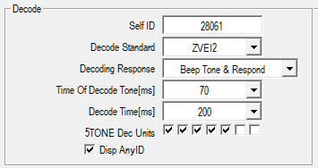

*5 Tone Setting → Decode: Self ID = 28061, Decode Standard = ZVEI2, Decoding Response = Beep Tone & Respond, Time Of Decode Tone[ms] = 70, Decode Time[ms] = 200, first five 5TONE Dec Units boxes ticked, Disp AnyID ticked.*

- **Self ID**: here we set our SelfID.
- **Decode Standard**: it is not important, because the standard Encoder ID in use in the channel will be used.
- **Decoding Response**: here we decide if, upon receiving the sequence, the radio will have to sound a beep, and if it will have to respond by sending its own selective Self ID (2861).
- **5TONE Dec Units**: the seven 5TONE Dec Units boxes indicate which digits of the selective Self ID must be recognized. For example, by ticking only the first two boxes on the left, any selection starting with 28 will be recognized; therefore sending a sequence like 28123D12345 or 28678D12345 we will always read: PRIVATE CALL 12345.

### Private Call

By sending a selective to the SelfID 28061D12345, the radio displays PRIVATE CALL 12345 (D is a separation tone, but it also accepts any tone from 0123456789ABCD).

### Group Call

It is possible to send a Group Call by replacing some numbers of the Self ID with A. For example, sending the sequence 28AAAD12345 or AA061D12345, the radio displays Group Call 12345.

!!! note
    If BeepTone is set in the SelfID, it will also sound in this condition.

### User Id

(If the Disp AnyID flag is enabled.)


By sending any sequence of tones, for example 12345, the radio will display User Id:12345.

If the flag is disabled instead:


it will only recognize special sequences starting with E6; then, sending a sequence E612345, a radio will display User Id:12345.

!!! note
    It is possible to send up to 16 tones, but the display can show a maximum of 14.

    - E repeat tone
    - F stop tone #

### Names from the Analog Address Book

If in **Analog Address Book** we have associated a name to the sequence 12345, for example the name TEST, it will be displayed:

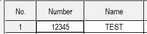

- PRIVATE CALL TEST
- GROUP CALL TEST
- User Id TEST

## Information ID NO.

In this section we can set up to a maximum of 16 different sequences which, once recognized, will have one of the following results (the selected numbers are only examples).

### Call All

By sending the sequence 11111, the radio displays Call All, and it is also possible to sound a beep.

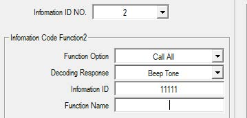

*Information ID NO. 2: Function Option = Call All, Decoding Response = Beep Tone, Information ID = 11111.*

### Emergency Alarm

By sending the sequence 99999, the radio emits an alarm sound and displays Alarm.

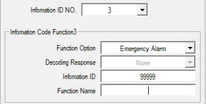

*Information ID NO. 3: Function Option = Emergency Alarm, Decoding Response = None, Information ID = 99999.*

### Squelch Off

By sending the sequence 66666, the radio squelch will open if the **Squelch Mode** has been set as **Optional Signal** in the channel.

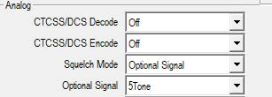

*Channel → Analog: CTCSS/DCS Decode = Off, CTCSS/DCS Encode = Off, Squelch Mode = Optional Signal, Optional Signal = 5Tone.*

Moreover, you can make a beep and answer with your Self ID.

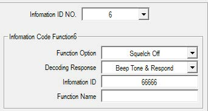

*Information ID NO. 6: Function Option = Squelch Off, Decoding Response = Beep Tone & Respond, Information ID = 66666.*

### Msg Group

By sending the sequence 88888, the radio displays:

```
Msg Group
88888
```

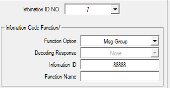

*Information ID NO. 7: Function Option = Msg Group, Decoding Response = None, Information ID = 88888.*

!!! note
    If BeepTone is set in the SelfID, it will also sound in this condition.

### Remote kill, stun and wake up

In addition to these functions, it is possible to associate a sequence to remotely turn off the radio (Remotely Kill), to turn it back on (Remotely Wake Up) or block it (Remotely Stun).

!!! warning
    Be careful when using these commands.

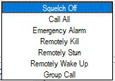

## Encode sequence 5 Toni

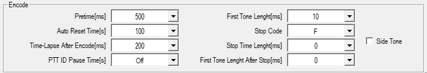

*5 Tone Setting → Encode: Pretime[ms] = 500, Auto Reset Time[s] = 100, Time-Lapse After Encode[ms] = 200, PTT ID Pause Time[s] = Off, First Tone Lenght[ms] = 10, Stop Code = F, Stop Time Lenght[ms] = 0, First Tone Lenght After Stop[ms] = 0.*

| Setting | Meaning |
|---|---|
| Pretime | Pause before the sequence is sent |
| First Tone Lenght | This time is added to the length of the first tone |
| Stop Code | This letter will be used to generate a pause between tones |
| Stop Time Lenght | Pause duration |
| Side Tone | Allows you to listen to the transmitted sequences in the loudspeaker |
| Time-Lapse After Encode | Time before audio opens after receiving the correct 5 Tones |
| PTT ID Pause Time | The radio will send other PTT IDs only after this time |
| First Tone Lenght After Stop | This time is added to the length of the first tone after the pause |

### Stored sequences

It is possible to define up to 100 selective 5-tone sequences by specifying the type of Standard and giving a name to each sequence.

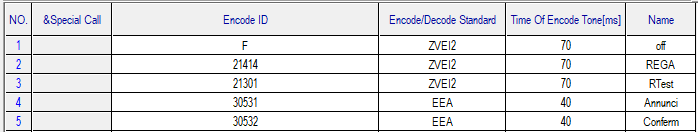

*Encode/Decode Standard column: No. 1 F (ZVEI2, 70, off), 2 21414 (ZVEI2, 70, REGA), 3 21301 (ZVEI2, 70, RTest), 4 30531 (EEA, 40, Annunci), 5 30532 (EEA, 40, Conferm).*

!!! tip
    I recommend adding an F in Encode ID with Name off; this just indicates a pause. This will come in handy, because by selecting the sequence off we will deactivate the BOT or the EOT, which at the moment can only be enabled/disabled via the CP editor.

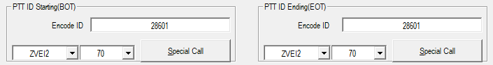

*PTT ID Starting(BOT) and PTT ID Ending(EOT): Encode ID = 28601, ZVEI2, 70.*

### BOT and EOT sequences in the channel

It is also possible to specify two sequences to be sent as soon as the **PTT** is pressed (BOT) or when the **PTT** is released (EOT).

In the channel, set **Optional Signal** to 5Tone, and in **5Tone ID** choose a number between 1 and 100 of the memorized sequences. This sequence can be sent by assigning the Call function to a key, or by pressing **PTT**+**PF2** on the 878, or **PTT**+**UP** on the microphone of the 578. The selected ID standard will also be used for the decoder, so we can use different encoders/decoders for each channel.

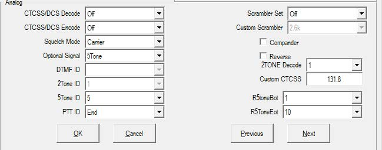

*Channel → Analog: Squelch Mode = Carrier, Optional Signal = 5Tone, 5Tone ID = 5, PTT ID = End, R5toneBot = 1, R5toneEot = 10.*

In **PTT ID** it is possible to decide whether to send a sequence when pressing the **PTT**, when releasing, or both.

In **R5Tone Bot** and **Eot** you can choose which PTT ID BOT or EOT sequence will be sent among the 100 available, or by selecting customize you will use those set in the two specific windows in the 5ToneEncode section.

## Special Call

The **Special Call** key allows us to generate two types of sequences.


### Send Message

Enter the ID of the recipient plus the message to be sent; pressing **OK**, a selective will be generated: E1+ID+E+text message in hex.

Example: `E167890E54455354`. The receiving radio will display Message TEST.

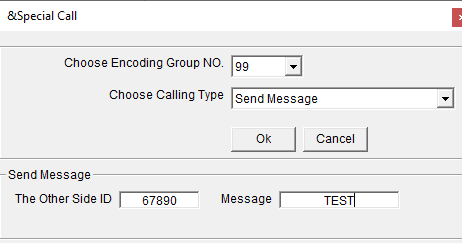

*Choose Encoding Group NO. = 99, Choose Calling Type = Send Message, The Other Side ID = 67890, Message = TEST.*

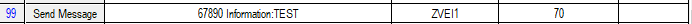

### ANI

Enter the recipient's ID plus the separator character D to generate a private call.

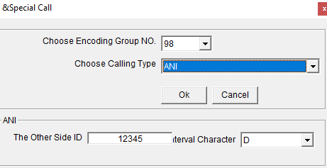

*Choose Encoding Group NO. = 98, Choose Calling Type = ANI, The Other Side ID (Id to call) = 12345, Interval Character (separator character) = D.*


### PTT ID

Generate a sequence made up of E6+Self Id: `E628061`. Then, when transmitted, the receiving radio will display:

```
User Id
28061
```

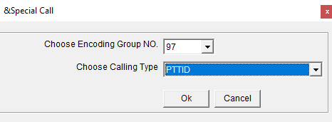

*Choose Encoding Group NO. = 97, Choose Calling Type = PTTID.*

## Private calls from the Analog Address Book

The Analog Address Book list can also be used to send private calls.

On the radio, select **Book → Book List**, select a contact and press **PTT**.

Example: recalling the TEST memory in Book and pressing the **PTT**, we will send the sequence 28061D12345 (SelfID + TEST) which, following the example above in the Decode settings, will cause the receiving radio to play and display Private Call 12345 (or TEST).

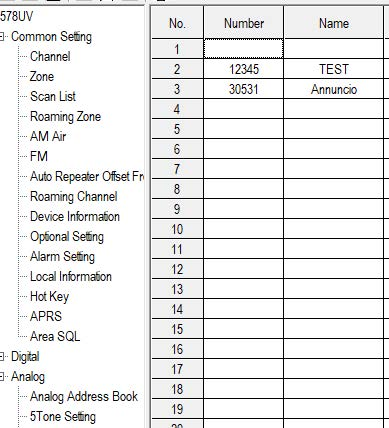

!!! note
    Unfortunately, at the moment it is not possible to enter letters to be able to call a Group.
