# Decode 5 Tone by Francesco IK8JHL (Italian)

!!! info "Source"
    Originally published by Norman Williams on hamradiosouthernrepeaters.co.uk. [Original PDF](../originals/images/Anytone/5Toni_Encode_Decode_V31_IT.pdf) · [Source](https://hamradiosouthernrepeaters.co.uk/images/Anytone/5Toni_Encode_Decode_V31_IT.pdf) Hub item 166.

Valido per 878 a partire dalle versioni FW V3.02 e per 578 a partire dalle versioni FW V2.04

## Decode selettive 5 Toni

Per poter ricevere una selettiva 5 Toni abilitare nel canale :


*Optional Signal = 5Tone.*

Nella sezione **5 Toni setting** seguire le prossime inpostazioni

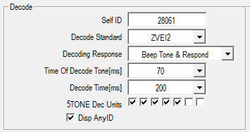

*Decode: Self ID = 28061, Decode Standard = ZVEI2, Decoding Response = Beep Tone & Respond, Time Of Decode Tone[ms] = 70, Decode Time[ms] = 200, 5TONE Dec Units = prime cinque caselle spuntate, Disp AnyID = spuntato.*

- Qui impostiamo il nostro SelfID
- non è importante perchè verrà usato lo standard dell'Enoder ID in uso nel canale
- Qui decidiamo se alla ricezione della selettiva la radio dovrà far suonare un beep, e se dovrà rispondere inviando la propria selettiva Self ID (28061)
- Le sette caselle 5TONE Dec Units indicano quali cifre della selettiva Self ID dovranno essere riconosciute, ad esempio spuntando solo le prime due caselle di sinistra, qualunque selettiva che inizia con 28 sarà riconosciuta, quindi inviando una sequenza tipo 28123D12345 oppure 28678D12345 leggeremo sempre: PRIVATE CALL 12345

### Chiamate private

Inviando una selettiva al SelfID 28061D12345 la radio visualizza PRIVATE CALL 12345 (D è un tono di separazione, ma accetta anche una qualunque tono da 0123456789ABCD)

### Chiamata di Gruppo

E' possibile inviare una chiamata di Gruppo sostituendo alcuni numeri del Self ID con delle A quindi esempio: inviando la sequenza 28AAAD12345, oppure AA061D12345 la radio visualizza Group Call 12345

!!! note "NB"
    Se nel SelfID è impostato BeepTone suonerà anche in questa condizione

### User Id

(se il flag Disp AnyID e abilitato  )

Inviando una qualsiasi sequenza di toni, ad esempio 12345 la radio visualizzerà User Id:12345

Se il flag invece è disabilitato 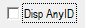, riconoscerà solo sequenze speciali che iniziano con E6, quindi inviando una sequenza E612345 la radio visualizzerà User Id:12345

!!! note "NB"
    È possibile inviare fino a 16 toni, ma il display ne può visualizzare al massimo 14:

    - **E** tono ripetizione
    - **F** tono di stop #

Se in Analog Addresse Book abbiamo associato un nome alla selettiva 12345, ad esempio il nome TEST, verranno visualizzato:

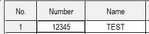

*Analog Address Book: No. 1, Number = 12345, Name = TEST.*

- PRIVATE CALL TEST
- GROUP CALL TEST
- User Id TEST

### Information ID NO.

In questa sezione possiamo impostare fino ad un massimo di 16 selettive diverse che una volta riconosciute avranno uno dei seguenti risultati: ( i numeri scelti sono solo di esempio )

#### Call All

Inviando la sequenza 11111 la radio visualizza Call All ed è possibile anche far suonare un Beep

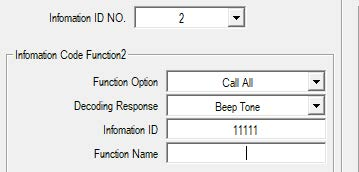

*Information ID NO. = 2, Function Option = Call All, Decoding Response = Beep Tone, Information ID = 11111.*

#### Emergency Alarm

Inviando la sequenza 99999 la radio emette un suono di Allarme e visualizza Alarm

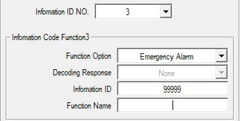

*Information ID NO. = 3, Function Option = Emergency Alarm, Decoding Response = None (disattivato), Information ID = 99999.*

#### Squelch Off

Inviando la sequenza 66666 aprirà lo squelch della radio se nel canale è stato impostato lo **Squelch Mode** come **Optional Signal**

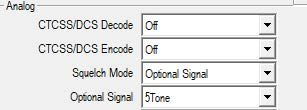

*Analog: CTCSS/DCS Decode = Off, CTCSS/DCS Encode = Off, Squelch Mode = Optional Signal, Optional Signal = 5Tone.*

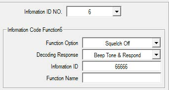

*Information ID NO. = 6, Function Option = Squelch Off, Decoding Response = Beep Tone & Respond, Information ID = 66666.*

Inoltre si puo far emettere un beep e far rispondere con il proprio Self ID

#### Msg Group

Inviando la sequenza 88888 la radio visualizza:

```text
Msg Group
88888
```

!!! note "NB"
    Se nel SelfID è impostato BeepTone suonerà anche in questa condizione

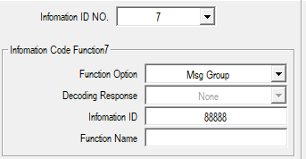

*Information ID NO. = 7, Function Option = Msg Group, Decoding Response = None (disattivato), Information ID = 88888.*

#### Remotely Kill / Wake Up / Stun

Oltre a queste funzioni è possibile associare una selettiva per spegnere a distanza la radio (Remotely Kill), per riaccenderla (Remotely Wake Up) o bloccarla (Remotely Stun) ma fate attenzione quando usate questi comandi

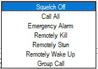

*IK8JHL*

## Encode selettive 5 Toni

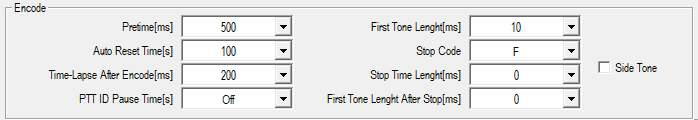

*Encode: Pretime[ms] = 500, Auto Reset Time[s] = 100, Time-Lapse After Encode[ms] = 200, PTT ID Pause Time[s] = Off, First Tone Lenght[ms] = 10, Stop Code = F, Stop Time Lenght[ms] = 0, First Tone Lenght After Stop[ms] = 0, Side Tone = non spuntato.*

- Pausa prima che venga inviata la selettiva
- alla lunghezza del primo tono viene aggiunto questo tempo
- questa lettera verrà usata per generare una pausa tra i toni
- Durata pausa
- Permette di ascoltare in altoparlante le selettive trasmesse
- la radio invierà altri PTT ID solo trascorso questo tempo
- Tempo che intercorre prima dell'apertura audio dopo aver ricevuto i 5 Toni corretti
- alla lunghezza del primo tono dopo la pausa viene aggiunto questo tempo

E' possibile definire fino a 100 sequenze di selettive 5 Toni specificando il tipo di Standard e dando un nome ad ogni sequenza

### Encode/Decode Standard

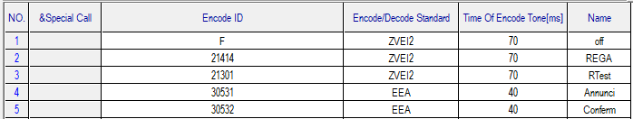

*1: F, ZVEI2, 70, off; 2: 21414, ZVEI2, 70, REGA; 3: 21301, ZVEI2, 70, RTest; 4: 30531, EEA, 40, Annunci; 5: 30532, EEA, 40, Conferm.*

Consiglio di aggiungere una F in Encode ID con Nome off, questa indica solo una pausa. Questo ci ritornerà utile, perchè selezionando la selettiva off disattiveremo il BOT o l' EOT che al momento possono essere abilitati/disabilitati solo via CP editor

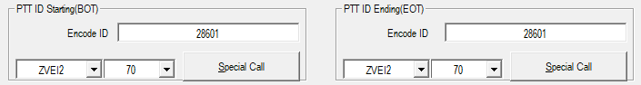

*PTT ID Starting(BOT): Encode ID = 28601, ZVEI2, 70; PTT ID Ending(EOT): Encode ID = 28601, ZVEI2, 70; pulsanti Special Call.*

Inoltre è possibile specificare due sequenze da inviare appena si preme il PTT (BOT) oppure al rilascio del PTT (EOT)

Nel canale impostare Optional Signal 5Tone, e in 5Tone ID scegliere un numero tra 1 e 100 delle sequenze memorizzate questa sequenza potrà essere inviata assegnando ad un tasto la funzione Call, oppure premendo PTT+PF2 sull'878, o PTT+UP sul microfono del 578. Lo standard dell'ID selezionato sarà anche usato per il Decoder quindi potremo utilizzare Encoder/Decoder diversi per ogni canale

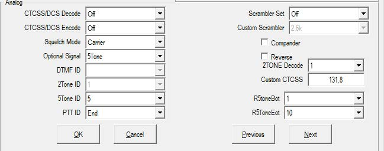

*Squelch Mode = Carrier, Optional Signal = 5Tone, 5Tone ID = 5, PTT ID = End, Custom CTCSS = 131.8, R5toneBot = 1, R5ToneEot = 10.*

In PTT ID è possibile decidere se inviare una selettiva alla pressione del PTT, al rilascio o ad entrambi

In R5Tone Bot e Eot si puo' scegliere quale sequenza PTT ID BOT o EOT andrà inviata tra le 100 disponibile oppure selezionando customize si useranno quelle impostate nelle due finestre specifiche nella sezione 5ToneEncode

*IK8JHL*

### Special Call

Il tasto special Call ci permette di generare due tipi di sequenze


#### Send Message

Inerire l'ID del destinatario piu' il messaggio da inviare, premendo OK verrà generata una selettiva, E1+ID+E+messaggio di testo in hex

Esempio: E167890E54455354

La radio ricevente visualizzerà Message TEST

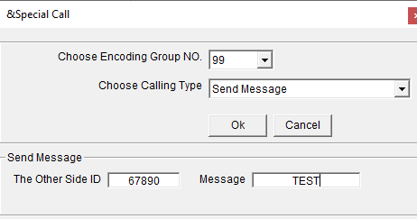

*Choose Encoding Group NO. = 99, Choose Calling Type = Send Message, The Other Side ID = 67890, Message = TEST.*

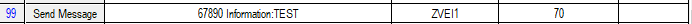

#### ANI

Inserire l'ID del destinatario più il carattere di separazione D per generare una chiamata privata

- Id da chiamare
- carattere separatore

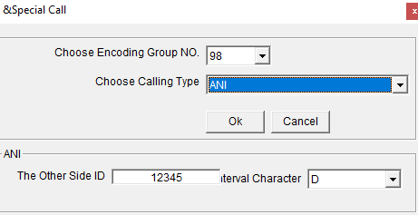

*Choose Encoding Group NO. = 98, Choose Calling Type = ANI, The Other Side ID = 12345, Interval Character = D.*


*IK8JHL*

#### PTT ID

Genera una selettiva composta dal E6+Self Id E628061 quindi quando trasmessa, la radio ricevente visualizzerà: User Id 28061

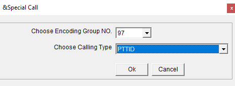

*Choose Encoding Group NO. = 97, Choose Calling Type = PTTID.*

### Analog Address Book

La lista Analog Address Book puo' essere usata anche per inviare delle chiamate private

Sulla radio selezionare il menu' **Book → Book List →** selezionare un contatto e premere il PTT

esempio: richiamando in Book la memoria TEST e premendo il PTT invieremo la sequenza 28061D12345 (SelfID + TEST) che seguendo l'esempio riportato sopra nelle impostazioni di Decode, farà suonare la radio ricevente e visualizzerà Private Call 12345 (oppure TEST)

!!! note
    Purtroppo al momento non è possibile inserire lettere per poter chiamare un Gruppo.

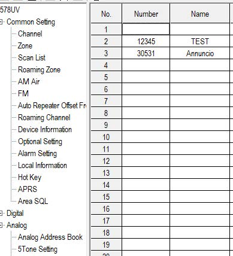

*Analog Address Book: 2 = 12345 TEST, 3 = 30531 Annuncio.*

*IK8JHL*
