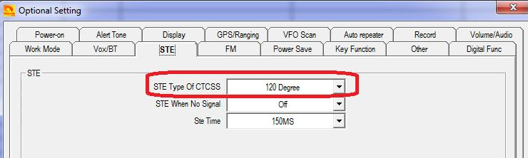
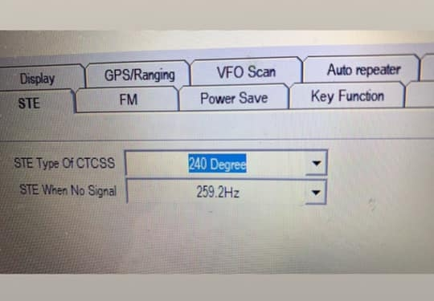

# STE - Squelch Tail Eliminate

!!! info "Source"
    Originally published by Norman Williams on hamradiosouthernrepeaters.co.uk. [Source](https://hamradiosouthernrepeaters.co.uk/anytone-dmr/2-uncategorised/17-ste.html) Hub item 57.

Posted by [Jason Reilly](../mods/868-878/index.md)  
Hearing an FM signal followed by a squelch tail 'chhhhk' sound, when you know that there is some sort of sub-tone / CTCSS phase reversal present that should eliminate that sound? Here's your answer.  
The below setting isn't just for TX. Unless you specify a phase reversal angle the RX will ignore any STE / quiet muting / phase reversal received, even though it may be there.  
Normally on most other radios this setting applies to TX only and is always enabled for RX in the background; but with the AnyTone radios, it must be selected to be active on RX as well.

**Q.** By Alessandro M. Di Santo - Explain me better what you mean for CTCSS phase reversal please...  
**A.** By Jason Reilly - At the end of a transmission, one with a PL / sub-tone / CTCSS tone (whatever you like to call it in your part of the world) the phase angle of the sub-audible tone is rapidly changed to indicate the end of the transmission. Receiving radios detect this and rapidly close the mute, so there's no FM "chhhhk' sound

Post by Markus Große-Schware - This works better with Motorola Repeaters for some reason.

[Link by Markus Große-Schware](https://communications.support/threads/16883-Anytone-AT-D878UV-excellent-tech-radio?p=114847&fbclid=IwAR2wSHJyzgbkLwb3pF6c4ytjjtBiszYWD1t7843GiunH1jANvHhoXFr_PGc)

**Q.** By Alan Matthews - At the end of a QSO in FM mode there is a low level type hum, I guess roger beep and its annoying folk I have looked in the manual and cannot find any reference to it, can anyone advise please?  
**A.** By Thomas Guenzel - " Optional Setting" =\> " STE" is set to "on"...turn to "off" and the hum disappears..  
**A.** By Jason Reilly - Look for a setting in CPS called STE under Optional setting. Turn it off. STE sends a certain CTCSS / PL tone at the end of an FM transmission to quietly mute on a repeater so equipped to detect it's presence.

**Q.** What is this setting for?  
**A.** Back in the days when two way radio receivers used mechanical resonators (reeds) to detect the subaudible tones, they would "ring" for a bit when the signal stopped, so you would hear a squelch tail before the resonator settled down. The manufacturers added a reverse burst at the end of each transmission, which would stop the resonator immediately and eliminate the squelch tail.

**UK Ham Radio Repeaters.**
I have been told we do not use STE. So should be set to OFF

All info taken from the Facebook Group [ANYTONE AT-D868/878UV & D578UV UK USER GROUP](https://www.facebook.com/groups/1798919343492370/)
