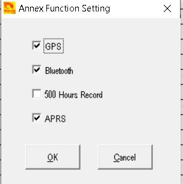
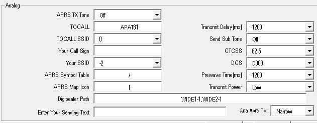
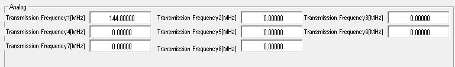
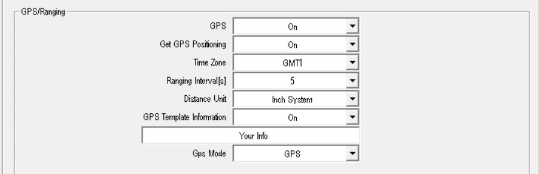
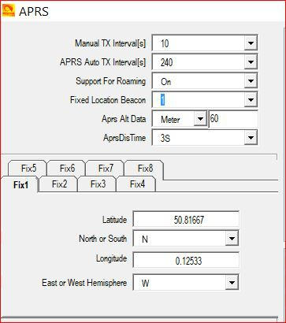
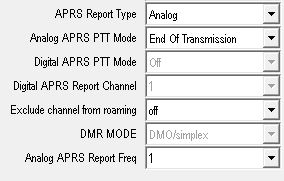

# Analog APRS Anytone 168/878/878plus/578 v7

!!! info "Source"
    Originally published by Norman Williams on hamradiosouthernrepeaters.co.uk. [Original PDF](../originals/images/PDF/Analog_APRS_Anytone_878-878plus.pdf) · [Source](https://hamradiosouthernrepeaters.co.uk/images/PDF/Analog_APRS_Anytone_878-878plus.pdf) Hub item 4.

## Turn on APRS in the CPS

**CPS → Tool → Options**

*Annex Function Setting: GPS ticked, Bluetooth ticked, 500 Hours Record unticked, APRS ticked.*

Newer firmware will have more options.

## Step One

*Analog: APRS TX Tone = Off, TOCALL = APAT81, TOCALL SSID = 0, Your SSID = -2, APRS Symbol Table = /, APRS Map Icon = [, Digipeater Path = WIDE1-1,WIDE2-1, Transmit Delay [ms] = 1200, Send Sub Tone = Off, CTCSS = 62.5, DCS = D000, Prewave Time [ms] = 1200, Transmit Power = Low, Ana Aprs Tx = Narrow.*

*Transmission Frequency1 [MHz] = 144.80000; Frequencies 2 to 8 = 0.00000.*

Newer firmware will have this for frequencies.

| Setting | Value |
|---|---|
| APRS TX Tone | On or Off |
| Destination Call Sign | Leave as |
| Your Call Sign | Enter your call sign |
| Your SSID | See list below |
| APRS Signal Path\* | WIDE1-1,WIDE2-1 |
| Enter Your Sending Text | Call sign and name |
| Transmit Power | Whatever you want |
| Transmit Frequency | UK – 144.80000 |
| Transmit Delay [ms] | 1200 |
| Prewave Time [ms] | 1200 |
| Ana Aprs TX | Wide or Narrow (both/all radios must be set the same). UK is Narrow |

All others leave as default.

### SSID list

| SSID | Use |
|---|---|
| -0 | Your primary station usually fixed and message capable |
| -1 | Generic additional station, digi, mobile, wx, etc |
| -2 | Generic additional station, digi, mobile, wx, etc |
| -3 | Generic additional station, digi, mobile, wx, etc |
| -4 | Generic additional station, digi, mobile, wx, etc |
| -5 | Other networks (Dstar, Iphones, Androids, Blackberry's etc) |
| -6 | Special activity, Satellite ops, camping or 6 meters, etc |
| -7 | Walkie talkies, HT's or other human portable |
| -8 | Boats, sailboats, RV's or second main mobile |
| -9 | Primary Mobile (usually message capable) |
| -10 | Internet, Igates, echolink, winlink, AVRS, APRN, etc |
| -11 | Balloons, aircraft, spacecraft, etc |
| -12 | APRStt, DTMF, RFID, devices, one-way trackers\*, etc |
| -13 | Weather stations |
| -14 | Truckers or generally full time drivers |
| -15 | Generic additional station, digi, mobile, wx, etc |

## Step Two

1. Go to **Optional Settings**.
2. Select the **GPS/Ranging** tab.
3. Select **GPS** On. (Some 168 do not have GPS.)
4. Select **GPS Mode** = GPS or Fix 1 to Fix 8.
5. Select all settings as shown below.

    

    *GPS/Ranging: GPS = On, Get GPS Positioning = On, Time Zone = GMT1, Ranging Interval [s] = 5, Distance Unit = Inch System, GPS Template Information = On, Gps Mode = GPS.*

### Non GPS radios (168)

You will need to use Fixed Location.

*APRS: Manual TX Interval [s] = 10, APRS Auto TX Interval [s] = 240, Support For Roaming = On, Fixed Location Beacon = 1, Aprs Alt Data = Meter 60, AprsDisTime = 3S; Fix1 Latitude 50.81667 N, Longitude 0.12533 W.*

- **Fixed Location Beacon** = 1 to 8
- Fill in Fix 1 to Fix 8

## Step Three

Turn on in each channel you wish to send Analog APRS:

*Channel: APRS Report Type = Analog, Analog APRS PTT Mode = End Of Transmission, Exclude channel from roaming = off, DMR MODE = DMO/simplex, Analog APRS Report Freq = 1.*

… and set the analogue APRS frequency number in the channel setting (**Analog APRS Report Freq** 1 to 8).

## If APRS does not work

!!! note
    \*APRS is not always working on Analog. This seems to be down to the APRS gateways.

APRS Signal Path = WIDE1-1,WIDE2-1. If it does not work, try changing to one of the below:

- WIDE1-1
- WIDE2-1
- WIDE2-2
- WIDE1-1,WIDE2-2

From Lynn (D) - KJ4ERJ - Author of APRSISCE for Windows Mobile and Win32:

> Recommended paths in the NEWn-N paradigm are:
>
> - WIDE2-1 - Use for fixed stations that don't need a lower-level digipeater boost
> - WIDE1-1,WIDE2-1 - Normal path for mobiles, 2 total hops requested
> - WIDE1-1,WIDE2-2 - A good path for mobiles going further afield, 3 total hops requested
>
> The WIDE1-1 will trigger both lower level fill-in digipeaters as well as the higher coverage digipeaters. The WIDE2-1 and/or WIDE2-2 will trigger only the higher coverage digipeaters.
>
> Of course, these recommendations are based on having properly configured digipeaters that respond based on their anticipated coverage areas and a well-designed digipeater network to start with.

For a good animation of the effects of the path, see <http://wa8lmf.net/DigiPaths/NNNN-Digi-Demo.htm>

## See also

- [Analogue APRS RX v8](analogue-aprs-rx.md)
- [Analog APRS will not work](analog-aprs-will-not-work.md)
- [SMS/Messages via Analogue APRS v2](sms-messages-via-analogue-aprs.md)
