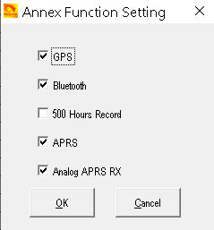
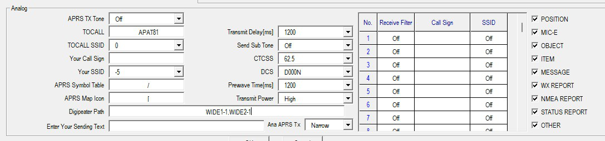
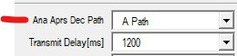
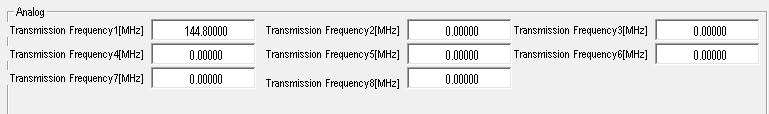
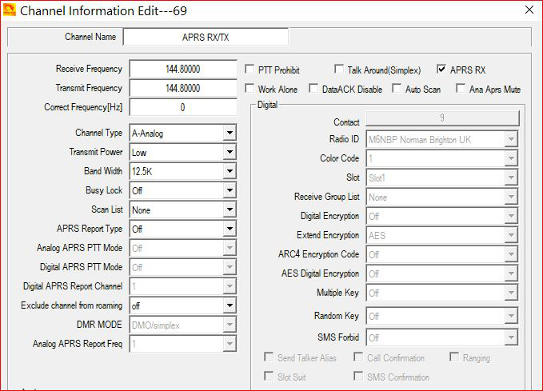
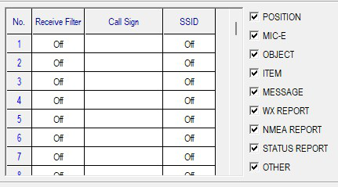
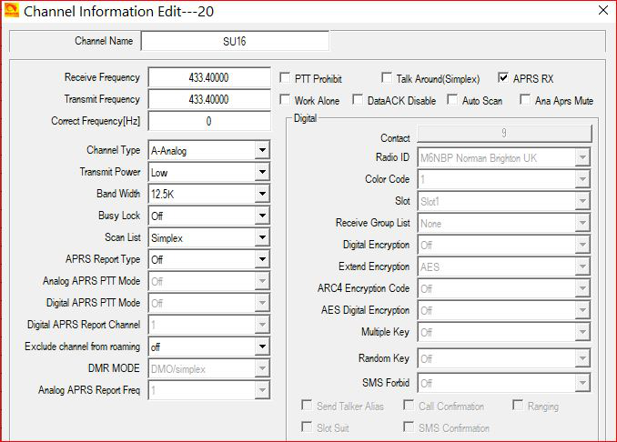
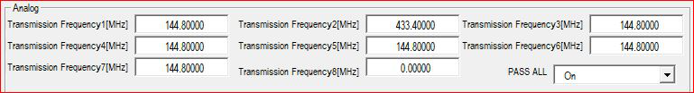
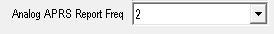

# Analogue APRS RX v8

!!! info "Source"
    Originally published by Norman Williams on hamradiosouthernrepeaters.co.uk. [Original PDF](../originals/images/Anytone/Analogue_APRS_RX.pdf) · [Source](https://hamradiosouthernrepeaters.co.uk/images/Anytone/Analogue_APRS_RX.pdf) Hub item 145.

## 1. Turn on the options

In **CPS → Tools → Options**, turn on:

*GPS, Bluetooth, APRS and Analog APRS RX ticked; 500 Hours Record unticked.*

Newer firmware will have more options.

## 2. APRS Setting – to RX all on APRS frequency 144.8000

In **CPS → APRS Setting**:

*Analog APRS settings: Transmit Delay = 1200, Prewave Time = 1200, Digipeater Path WIDE1-1,WIDE2-1, Ana APRS TX = Narrow.*

| Setting | Value |
|---|---|
| Transmit Delay [ms] | 1200 |
| Prewave Time [ms] | 1200 |
| Ana Aprs TX | Wide or Narrow (both/all radios must be set the same). UK is Narrow. |

On the AT890 you need to set this path. APRS RX will work on SUB channel A. If set to B, APRS RX will need to be on SUB channel B.

*Ana Aprs Dec Path = A Path; Transmit Delay [ms] = 1200.*

Newer firmware will have this for frequencies:

*Transmission Frequency1 = 144.80000 MHz; Frequencies 2 to 8 = 0.00000.*

## 3. Make a channel for 144.8000

Keep in mind 144.8000 is for data only and not for voice traffic in the UK, so I have **PTT Prohibit** ticked. Tick **APRS RX**.

*Channel Name = APRS RX/TX; Receive and Transmit Frequency = 144.80000; Channel Type = A-Analog; Band Width = 12.5K; PTT Prohibit and APRS RX ticked.*

!!! note
    Even though the UK should be narrow on the APRS RX/TX frequency:

    > 144.8000 MHz – Unconnected nets – APRS, UiView etc (Note 14)
    >
    > Note 14: 144.800 use should be NBFM to avoid interference to 144.8125 DV Gateways

    you might wish to set Band Width to 25K wide. Sorry to say, too many are still using WIDE.

Add to a zone and send to the radio. Go to the channel and you will RX all analogue APRS.

## 4. RX only preferred stations

This section covers RX of preferred stations only.

*Receive Filter list (rows 1 to 7 set to Off) and ticked report types: Position, MIC-E, Object, Item, Message, WX Report, NMEA Report, Status Report, Other.*

Fill in as required to only RX that station.

## 5. TX & RX analogue APRS on a different frequency / channel

This is for radio to radio (not over the APRS network). The newer firmware and CPS lets you have up to 8 different frequencies/channels. Ideal for large events (RAYNET) where you want the location of each user on each different channel, but do not wish to go out on the APRS network for privacy.

Same as the above, and we will use a simplex frequency, 433.40000.

*Channel Name = SU16; Receive and Transmit Frequency = 433.40000; Channel Type = A-Analog; Scan List = Simplex; APRS RX ticked; PTT Prohibit not ticked.*

As this is a simplex frequency and permits voice traffic, you will see **PTT Prohibit** is not ticked.

## 6. Change the Transmission Frequency in APRS Settings

In APRS Settings we need to change the **Transmission Frequency [MHz]** to 433.40000.

*Transmission Frequency1 = 144.80000; Transmission Frequency2 = 433.40000; Pass All = On.*

You will see I am using 2 for the 433.40000 frequency. In that channel I set it to 2:

*Analog APRS Report Freq = 2.*

Follow step 4 if required.

The maximum received number is 256; the older ones are removed to make room for the new ones.
