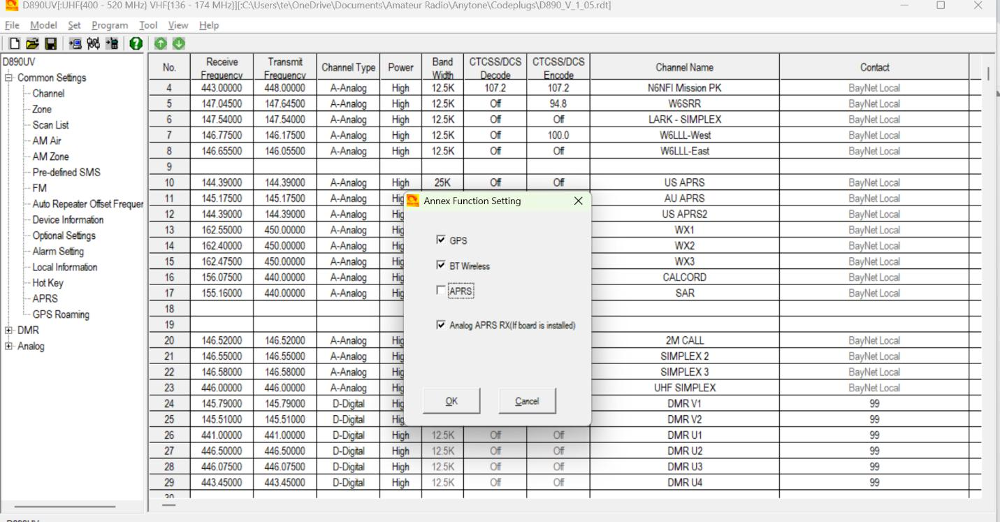
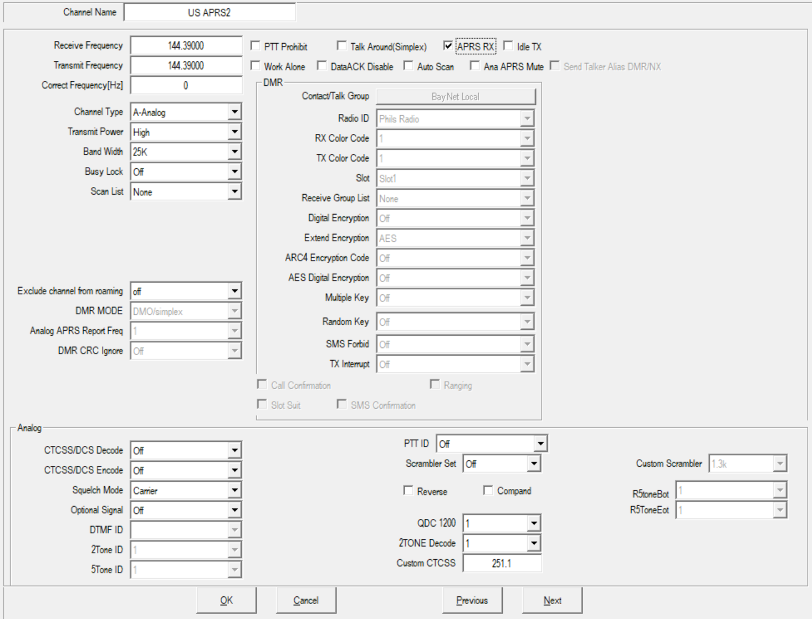
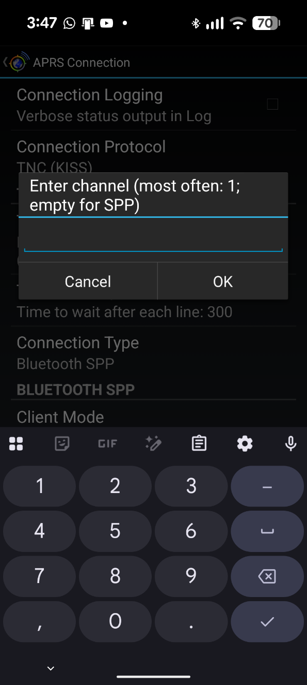
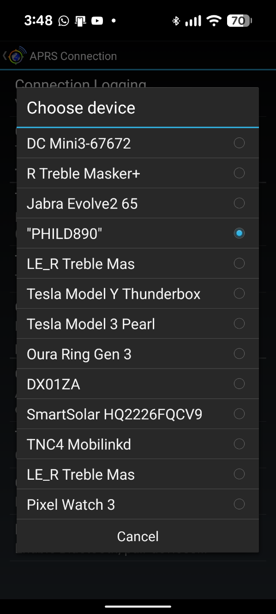
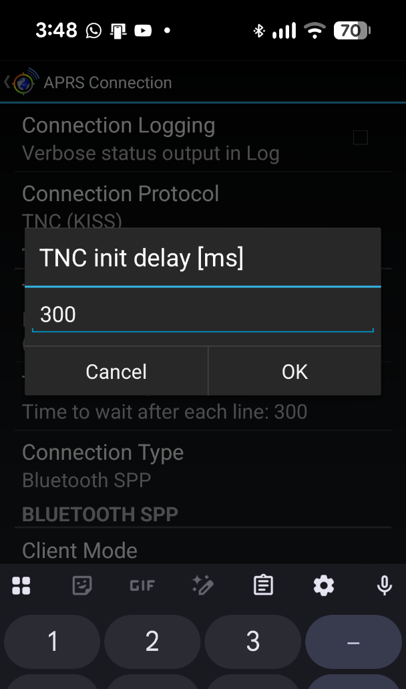
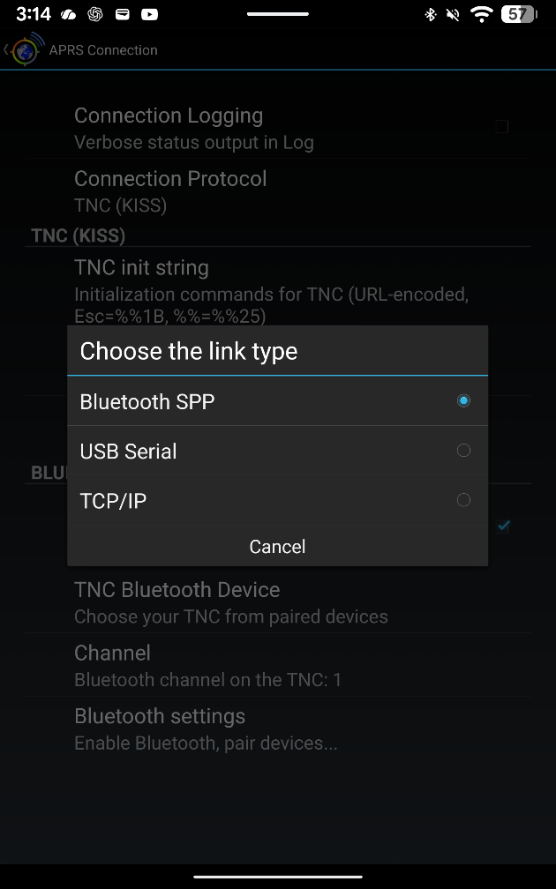
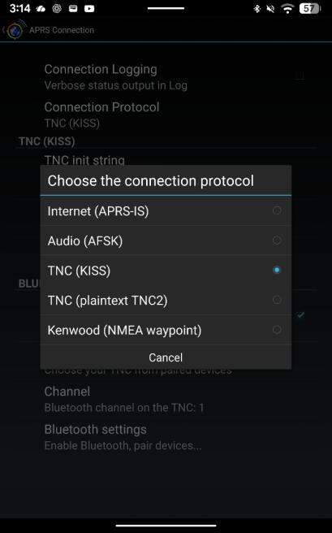
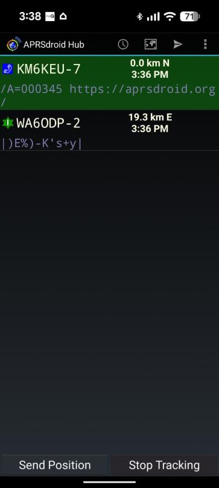

# How to Use the AnyTone AT-D890UV as a Bluetooth KISS TNC with APRSdroid

!!! info "Source"
    Originally published by Norman Williams on hamradiosouthernrepeaters.co.uk. [Original PDF](../originals/images/Anytone/AnyTone_AT-D890UV_as_a_Bluetooth_KISS_TNC_with_APRSdroid.pdf) · [Source](https://hamradiosouthernrepeaters.co.uk/images/Anytone/AnyTone_AT-D890UV_as_a_Bluetooth_KISS_TNC_with_APRSdroid.pdf) Hub item 183.

By Phil Montgomery KM6KEU

Document version: 19 August 2026 | Tested with firmware v1.05

This document explains how I was able to pair my Android Pixel 9 XL with the D890 and use the radio as a Bluetooth KISS TNC with APRSdroid. I am still experimenting and may not fully understand every setting, but the configuration below is working for me on firmware v1.05:

## STEP 1 Pair Bluetooth

The D890 may advertise two Bluetooth devices with the same or a similar name. In my setup, I initially paired the device that Android presented as a headset/audio device. Do not be surprised if a second device with the same name remains visible.

1. Set the D890 to BT KISS TNC mode.
2. On the Android device, pair the D890 entry presented as a headset/audio device.
3. Accept the pairing code shown.
4. After APRSdroid is configured, try to start the TNC. If it will not start, delete the pairing and use the workaround below.

### Bluetooth workaround

With the D890 in BT KISS TNC mode I could pair the phone, but APRSdroid refused to start the TNC. Thanks to Randy on Facebook, this sequence worked for me:

1. Set the D890 to BT On mode.
2. Pair the Bluetooth device that Android presents as a headset/audio device.
3. Change the D890 to BT KISS TNC mode.
4. Return to APRSdroid and try the connection again.

**Bluetooth notes:** A second Bluetooth device remains visible with the same radio name - I ignore it. Also, if I change the Bluetooth name, the radio advertises it with double quotation marks around the name, but this has not affected operation.

## STEP 2 Configure the D890UV in CPS

### 2.1 CPS Annex Function Settings

In CPS, open Annex Function Settings and use these values:

- APRS: disabled (unchecked)
- Analog APRS RX (If board is installed): enabled (checked)

Important tested finding: Analog APRS RX must remain enabled for KISS reception - when I disabled it, the D890 stopped receiving analog APRS packets and APRSdroid no longer received them through the KISS TNC. Also, with it enabled, the radio can continue decoding packets on its own screen while also passing them to APRSdroid.

*Annex Function Settings: APRS off, Analog APRS RX on*

### 2.2 APRS channel settings

Create or edit the analog APRS channel and set:

- APRS RX: checked
- Analog APRS Decode Path: A
- Place the APRS channel on the A/main side of the radio.

*APRS channel: APRS RX checked*

## STEP 3 Configure APRSdroid

These are the APRSdroid connection settings that work with my D890:

| Setting | Known-working value |
|---|---|
| Bluetooth device | The paired D890 Bluetooth device |
| Channel | Leave blank – DO NOT SET TO 1 |
| TNC Init Delay | 300 ms |
| Link Type | Bluetooth SPP |
| Connection Protocol | KISS TNC (shown as TNC (KISS) in APRSdroid) |

*Enter channel: left empty.*

*Choose device: "PHILD890" selected.*

### APRSdroid settings, continued

*TNC init delay [ms] = 300.*

*Link type = Bluetooth SPP.*

Connection Protocol: TNC (KISS)

## STEP 4 Test RX and TX

### Test RX

1. Select Start Tracking in APRSdroid.
2. Wait for local APRS traffic. Received stations should appear in APRSdroid.

### Test TX

3. Select Send Position in APRSdroid.
4. The D890 should key and transmit an APRS beacon.
5. Check APRS.fi a short time later to confirm that the beacon reached the APRS network.

## Troubleshooting

### TNC connects and TX works, but RX does not

- Confirm Annex Analog APRS RX is enabled.
- Confirm Channel APRS RX is checked.
- Check that the APRS channel is on the selected Analog APRS Decode Path. My known-working setup uses path A and the APRS channel on A.

### APRSdroid will not start the TNC

- Confirm that APRSdroid is using the paired D890 Bluetooth device.
- Delete the Bluetooth pairing and repeat the Bluetooth workaround in Step 1.
