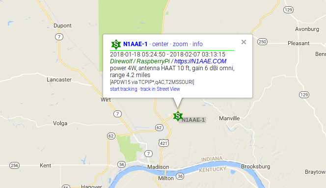
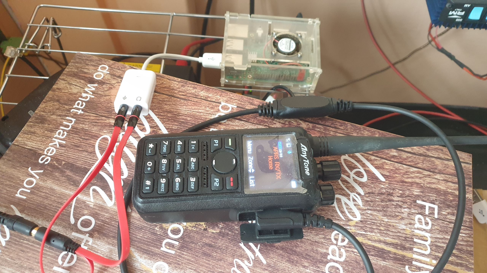
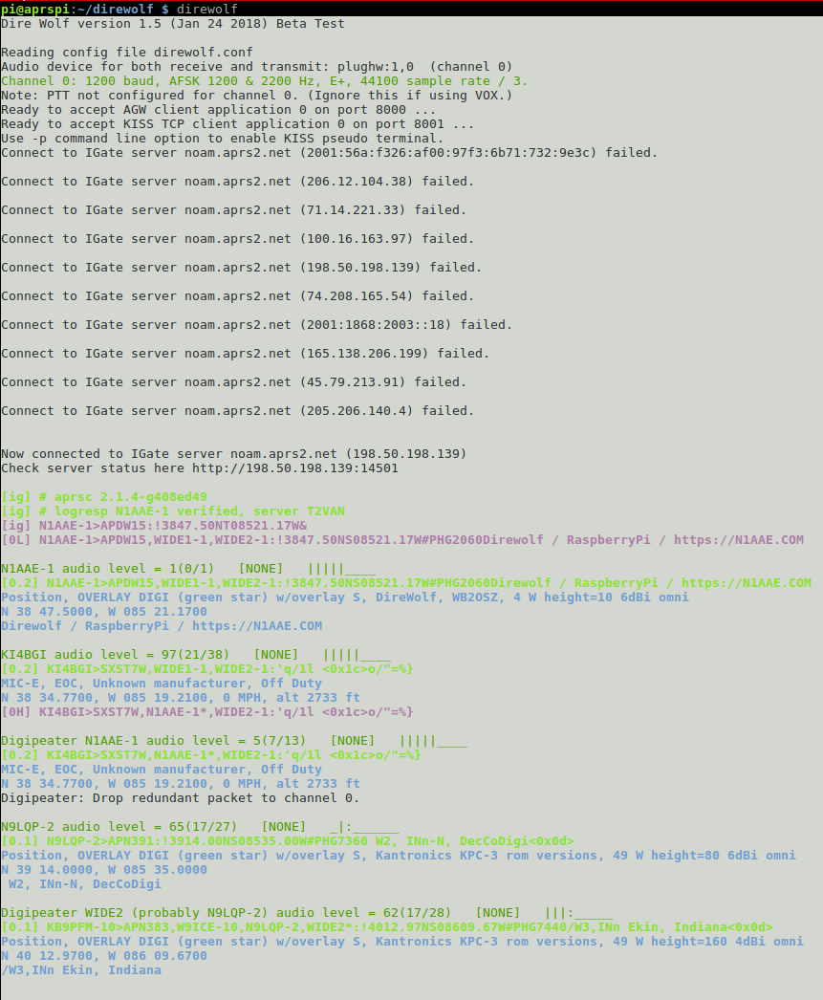
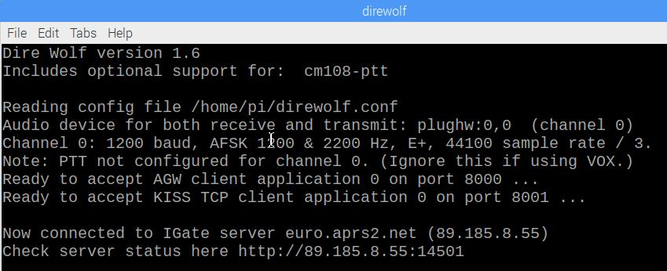
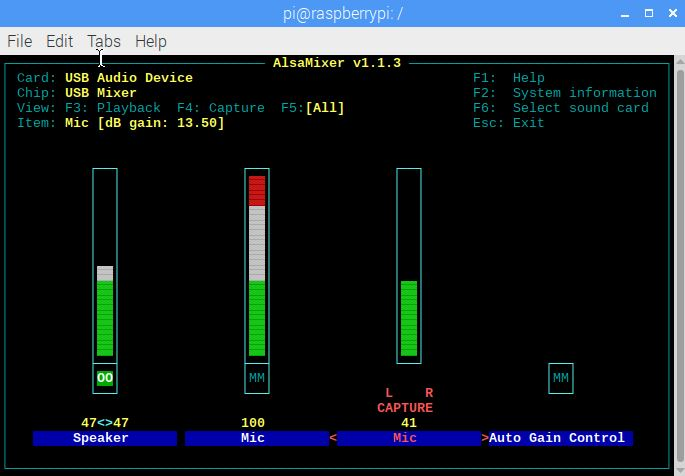
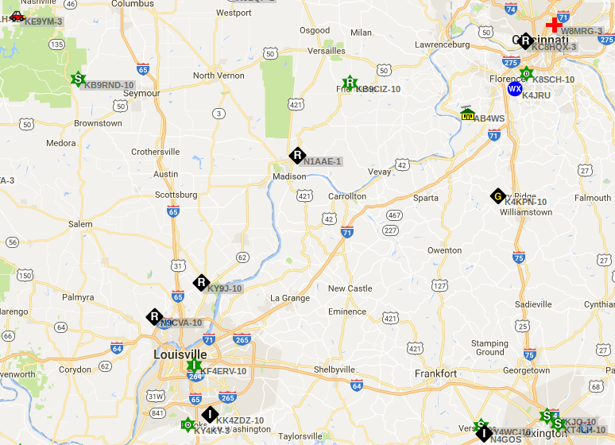

# Anytone IGate

!!! info "Source"
    Originally published by Norman Williams on hamradiosouthernrepeaters.co.uk. [Source](https://hamradiosouthernrepeaters.co.uk/64-anytone-igate.html) Hub item 158.

Direwolf or [APRSIS32](anytone-igate.md)

This page is copied and adapted from the links below for the Direwolf set up. Credit to them and a great job.

- [http://hb1bbs.com/Packetradio-on-a-Raspberry/](http://hb1bbs.com/Packetradio-on-a-Raspberry/)
- [https://packet-radio.net/direwolf-1-6-official-release/](https://packet-radio.net/direwolf-1-6-official-release/)
- [https://godseyonline.net/raspberry-pi-direwolf-digipeater-igate-soundcard-version/](https://godseyonline.net/raspberry-pi-direwolf-digipeater-igate-soundcard-version/)
- [https://ww8tf.club/building-an-aprs-igate/](https://ww8tf.club/building-an-aprs-igate/)
- [https://www.rozenek.com/how-to-set-up-an-i-gate-aprs-receiver-on-raspberry-pi-zero-and-usb-sound-card-using-old-fm-handheld-radio/](https://godseyonline.net/raspberry-pi-direwolf-digipeater-igate-soundcard-version/)
- [https://k5eok.org/2021/01/19/aprs-digipeater-igate-with-direwolf-entry-level/](https://k5eok.org/2021/01/19/aprs-digipeater-igate-with-direwolf-entry-level/)[](https://godseyonline.net/raspberry-pi-direwolf-digipeater-igate-soundcard-version/)

!!! note
    For all things regarding Ham Radio, homework is required. The information below should help in getting you up and running as a RX only or RX/TX IGate.

## Direwolf set up on Raspberry Pi

### What hardware you will need

- [Raspberry Pi computer](https://thepihut.com/pages/search-results?q=raspberry%20pi%203&page_num=3) (Older models also work well)
- [This Raspberry Pi kit](https://www.amazon.co.uk/Smraza-Raspberry-Heatsinks-Supply-Switch/dp/B07C69LRJX/) (Includes power supply, case, heatsinks, fan)
- [A MicroSD card](https://www.amazon.co.uk/s?k=B073JWXGNT) (Any Class10 card should work)
- [Cheap USB soundcard](https://thepihut.com/products/usb-audio-adapter-works-with-raspberry-pi)
- Anytone 868 or 878 radio can RX/TX, APRS data via a IGate.
- [APRS Interface Cable for Baofengs](https://amzn.to/2BmrAye). Also works with Anytone radios. I could only find in USA.
- [3.5mm Female to 2 Male Headphone / Mic audio Y Splitter](https://www.amazon.co.uk/Maeline-Female-Plated-Headphone-Splitter/dp/B00PYZ2BT4/)

### Raspberry Pi OS

[I used 32-bit, Raspberry Pi OS with desktop](https://www.raspberrypi.com/software/operating-systems/)

### You might wish to use TightVNC

- [Install TightVNC on your Pi](https://raspi.tv/2012/install-and-use-tightvnc-remote-desktop-on-raspberry-pi-through-windows-android-or-ios) or [this website](http://www.penguintutor.com/raspberrypi/tightvnc)
- [Download TightVNC for Windows](https://www.tightvnc.com/download.php)

### Update Raspberry and remove pulseaudio

Raspbian update:

```text
sudo apt-get update
sudo apt-get dist-upgrade
sudo rpi-update
sudo reboot
```

Remove pulseaudio:

```text
sudo apt-get remove --purge pulseaudio
sudo apt-get autoremove
rm -rf /home/pi/.pulse
sudo reboot
```

### Install/compile instructions for Direwolf version 1.6

#### Linux – using git clone (recommended)

!!! note
    Note that this has changed for version 1.6. There are now a couple extra steps.

First you will need to install some software development packages using different commands depending on your flavor of Linux. In most cases, the first few will already be there and the package installer will tell you that installation is not necessary.

On Debian / Ubuntu / Raspbian / Raspberry Pi OS:

```text
sudo apt-get install git
sudo apt-get install gcc
sudo apt-get install g++
sudo apt-get install make
sudo apt-get install cmake
sudo apt-get install libasound2-dev
sudo apt-get install libudev-dev
```

Or on Red Hat / Fedora / CentOS:

```text
sudo yum install git
sudo yum install gcc
sudo yum install gcc-c++
sudo yum install make
sudo yum install alsa-lib-devel
sudo yum install libudev-devel
```

CentOS 6 & 7 currently have cmake 2.8 but we need 3.1 or later. First you need to enable the EPEL repository. Add a symlink if you don't already have the older version and want to type cmake rather than cmake3.

```text
sudo yum install epel-release
sudo rpm -e cmake
sudo yum install cmake3
sudo ln -s /usr/bin/cmake3 /usr/bin/cmake
```

Remove old install:

```text
sudo rm -rf direwolf (remove old install)
```

Then on any flavor of Linux, install Direwolf:

```text
cd ~
git clone https://www.github.com/wb2osz/direwolf
cd direwolf
git checkout dev
mkdir build && cd build
cmake ..
make -j4
sudo make install
make install-conf
```

Make direwolf executable:

```text
sudo chmod a+x direwolf
```

(I had a problem here and I had to find the correct folder which is /home/pi/direwolf)

This gives you the latest development version. Leave out the "git checkout dev" to get the most recent stable release.

For more details see the **User Guide** in the [**doc** directory](https://github.com/wb2osz/direwolf/tree/master/doc). Special considerations for the Raspberry Pi are found in **Raspberry-Pi-APRS.pdf**.

### Playback and Capture Devices for APRS

We must now determine what your **audio playback** devices are for the Direwolf configuration. With your USB sound card plugged in, you can now issue the following command:

```text
aplay -l
```

The output of this command should appear as shown below:

```text
**** List of PLAYBACK Hardware Devices ****
card 0: ALSA [bcm2835 ALSA], device 0: bcm2835 ALSA [bcm2835 ALSA]
  Subdevices: 8/8
  Subdevice #0: subdevice #0
  Subdevice #1: subdevice #1
  Subdevice #2: subdevice #2
  Subdevice #3: subdevice #3
  Subdevice #4: subdevice #4
  Subdevice #5: subdevice #5
  Subdevice #6: subdevice #6
  Subdevice #7: subdevice #7
card 0: ALSA [bcm2835 ALSA], device 1: bcm2835 ALSA [bcm2835 IEC958/HDMI]
  Subdevices: 1/1
  Subdevice #0: subdevice #0
card 1: Device [USB Audio Device], device 0: USB Audio [USB Audio]
  Subdevices: 0/1
  Subdevice #0: subdevice #0
```

You can see that the USB soundcard is recognized as “card 1” in the above output.

To view your **audio capture** devices, which will be on the same USB soundcard, issue the following command:

```text
arecord -l
```

Your output in the terminal should show the following. Since the RaspberryPi does not have a built-in capture device, the only device shown should be your USB soundcard.

```text
**** List of CAPTURE Hardware Devices ****
card 1: Device [USB Audio Device], device 0: USB Audio [USB Audio]
  Subdevices: 0/1
  Subdevice #0: subdevice #0
```

Take note of these.

### Configuring Direwolf

Now for the fun part, actually configuring Direwolf! We’re almost there.

```text
cd
```

Now open up direwolf.conf

```text
sudo editor direwolf.conf
```

The direwolf.conf file in your terminal is now displayed and ready for editing. We must edit a few items in this configuration file for our use.

First, locate (Line 69):

```text
#ADEVICE  plughw:0,0
```

You will need to uncomment this line and enter the correct hardware device values that we found in the previous steps, which was **card 1, device 0**. Change this line in direwolf.conf to:

```text
ADEVICE  plughw:1,0
```

Scroll down until you see the following, and change N0CALL to **your** call sign.

```text
MYCALL N0CALL
```

“N0CALL” should be changed to ***your* callsign**, with the SSID of your APRS station after it. For me, I use *K5CVD-5*. You may wish to use the SSID -0 after your call.

!!! tip "Choosing an APRS SSID to add after your callsign"
    | SSID | Use |
    |---|---|
    | -0 | Your primary station usually fixed and message capable |
    | -1 | generic additional station, digi, mobile, wx, etc |
    | -2 | generic additional station, digi, mobile, wx, etc |
    | -3 | generic additional station, digi, mobile, wx, etc |
    | -4 | generic additional station, digi, mobile, wx, etc |
    | -5 | Other networks (Dstar, Iphones, Androids, Blackberry's etc) |
    | -6 | Special activity, Satellite ops, camping or 6 meters, etc |
    | -7 | walkie talkies, HT's or other human portable |
    | -8 | boats, sailboats, RV's or second main mobile |
    | -9 | Primary Mobile (usually message capable) |
    | -10 | internet, Igates, echolink, winlink, AVRS, APRN, etc |
    | -11 | balloons, aircraft, spacecraft, etc |
    | -12 | APRStt, DTMF, RFID, devices, one-way trackers\*, etc |
    | -13 | Weather stations |
    | -14 | Truckers or generally full time drivers |
    | -15 | generic additional station, digi, mobile, wx, etc |

If your callsign was K1ABC and this is your primary APRS station, this line in the configuration file will show as:

```text
MYCALL K1ABC-5
```

Moving forward…

If you wish to broadcast your APRS station on a map with a position beacon, you can do so by finding, uncommenting, and adjusting the following line for your individual location and setup:

```text
#PBEACON delay=1 every=30 overlay=S symbol="digi" lat=42^37.14N long=071^20.83W power=50 height=20 gain=4 comment="Chelmsford MA" via=WIDE1-1,WIDE2-1
```

Uncomment the line, so Direwolf will not ignore it while running. Change the latitude and longitude settings to match your location. The power, refers to the output power of your radio, height refers to the height of your antenna above your average terrain, and gain would be the gain of the antenna. The comment variable is for what you want the world to see when your beacon packets are received or when your station is shown on maps like at <https://aprs.fi>.

You can easily find your latitude and longitude using an [online tool such as this](https://www.findlatitudeandlongitude.com/) which is what I used.

Assuming you live in the middle of New York City’s Central Park, are using a Anytone radio and your antenna is located on top of a 20m mast, and you want your beacon comment to be, “New York City Central Park APRS” your PBEACON setting should look like this:

```text
PBEACON delay=1 every=30 overlay=S symbol="digi" lat=40^46.3143N long=073^58.4963W power=5 height=20 gain=4 comment="New York City Central Park APRS" via=WIDE1-1,WIDE2-1
```

I see people using beacon comments advertising club information, APRS setup details, scheduled nets, etc. Mine shows up on APRS.FI as seen below:



If you wish to digipeat packets, you can do so by uncommenting (remove `#`) the line shown below. Keep in mind that not all areas *need* another digipeater and if you live anywhere populated you may be doing more harm than good by operating a digipeater if it’s not needed. Being in a relatively rural area, I have a digipeater enabled.

```text
#DIGIPEAT 0 0 ^WIDE[3-7]-[1-7]$|^TEST$ ^WIDE[12]-[12]$ TRACE
```

**Now, let’s set up the Internet Gateway (I-Gate).** Scroll down until you find the Internet Gateway section of direwolf.conf

```text
#IGSERVER euro.aprs2.net
```

If you live in Europe, all you must do is uncomment (remove `#`) the above line. If you do not live in Europe, change the value of IGSERVER to the appropriate server.

| Server | Region |
|---|---|
| noam.aprs2.net | North America |
| soam.aprs2.net | South America |
| euro.aprs2.net | Europe and Africa |
| asia.aprs2.net | Asia |
| aunz.aprs2.net | Oceania |

In the lines below you will enter your login and passcode for the APRS network. You can generate a passcode for your APRS callsign with SSID instantly at [this website](http://apps.magicbug.co.uk/passcode/).

```text
IGLOGIN K1ABC-0 41325
```

Assuming your callsign with SSID was K1ABC-0 and the website linked above generated the passcode “41325” the line in direwolf.conf would look like the above. Change this to match your details.

Find the following line and uncomment it (remove `#`), make sure that you also adjust the latitude and longitude used as we did above.

```text
#PBEACON sendto=IG delay=0:30 every=60:00 symbol="igate" overlay=T lat=42^37.14N long=071^20.83W
```

**If you want to transmit information from the servers**, you need to specify two additional pieces of information: the radio channel and the via path for the packet header. [See Guide for next 3 sections.](https://raw.githubusercontent.com/wb2osz/direwolf/master/doc/User-Guide.pdf).

Examples:

```text
IGTXVIA 0 WIDE1-1,WIDE2-1
IGTXVIA 1 WZ9ZZZ
IGTXVIA 0
```

```text
IGTXVIA 0 WIDE1-1
```

Filter repeating of IGate-received messages to only "message" type objects originating within a 50km radius

```text
IGFILTER m/50
```

Finally, we don’t want to flood the radio channel. The IGate function will limit the number of packets transmitted during 1 minute and 5 minute intervals. If a limit would be exceeded, the packet is dropped and warning is displayed in red.

```text
IGTXLIMIT 6 10
```

### Setting Up Your Anytone for RX/TX

If you followed everything above, you should now be (almost) ready to go. Before we run Direwolf for the first time, let’s go ahead and make sure our radio is turned on, connected to the APRS interface cable, which should be connected to the headphone/mic audio Y splitter, connected to your USB soundcard to your RaspberryPi.

- Tune your Anytone to the appropriate APRS frequency 144.800. In North America this is 144.390
- Adjust your Anytone squelch setting to “1”, I find this is what works best for me.
- Adjust your Anytone VOX setting to ‘on’ with setting “1”.
- ALL MIC Gains at MAX, apart from Aan MIC level 3 (you can change if required).
- VOLUME at MAX on the radio.



It’s a horrible photo but it should give you an idea of how things get connected if you somehow were unable to figure it out on your own.

### Running Direwolf

If you’re not already in the Direwolf folder, go ahead and move to it.

```text
cd
cd ./direwolf
```

Now, you can run Direwolf.

```text
direwolf
```



You should see something similar to the above. This shows that direwolf started, read the configuration file, PTT is not enabled because we are using VOX, ready to accept KISS TNC client on port 8001 which we’ll use later for Xastir, and it shows that direwolf connected to one of the North American APRS IGate servers.

The first packets shown are my own, being transmitted directly to the internet via the gateway.

The packet shown starting with \[0L\] is my own beacon being transmitted on channel 0 with low priority. (Transmitted packets are shown in magenta)

Shortly after running Direwolf, I heard the station K14BGI which is about 15 miles away from me. (Received packets are shown in green)

Direwolf V1.6 looks like this when you start it:



If you are seeing red errors regarding volume, adjust this in alsamixer:

```text
sudo alsamixer
```



**Hit F6** to select the soundcard the RaspberryPi is using, and then **hit F5**. Very important that you hit F5 because it only shows you the transmit volumes first. Spent an hour trying to figure that out. You will need to lower the mic input volume until these error messages disappear or when the general average of received audio level is around 50.

When the levels are good, or they are at a place for some long-term testing, press Esc to exit alsamixer. Changes are not persistent across reboots unless saved. To save the configuration use the command ‘alsactl store 1’ where “1” is the device ID discovered previously i.e. the plughw:**1**,0 item (note the emphasized 1 here).

```text
sudo alsactl store 1
```

At this point, you should also be able to see your own station on [https://aprs.fi](https://aprs.fi)



### Autostarting

I worked for hours to figure out how to make autostarting work. No matter what I did, I could not get dw-start.sh to work properly. Yes, everything was installed right. It just would not work.

So I ended up doing this:

```text
sudo nano /home/pi/.config/lxsession/LXDE-pi/autostart
@lxterminal -e /usr/local/bin/direwolf -c /home/pi/direwolf/direwolf.conf
```

Make sure the -e is the right path to your Direwolf binary and the -c is to your config file from above.

Then whenever the Pi reboots and loads the GUI, it will automatically load Direwolf.

### Update direwolf

```text
sudo apt-get update
sudo apt-cache showpkg direwolf
sudo apt-get install direwolf
```

### Further information

- [Direwolf User Guide](https://raw.githubusercontent.com/wb2osz/direwolf/master/doc/User-Guide.pdf)
- [Direwolf - From the beginning to APRS](https://www.youtube.com/watch?v=9Ya0C308TQA&ab_channel=RetroTech%26Electronics) Video covers some set up and settings you will need for the above set up. *(Not all in the video refers to the above set up and install)*
- [Direwolf for Windows](https://github.com/wb2osz/direwolf/releases)

## APRSIS32 installed on Windows

### Set up and install

I found this to be the [best video](https://www.youtube.com/watch?v=lcxCN0ZbR5k&ab_channel=Tony%2CKD8RTT) on how to set up.

- [APRSI32 download](http://aprsisce.wikidot.com/downloads)
- [AGW Packet Engine download](https://www.sv2agw.com/downloads/)

### What hardware you will need

Anytone 868 or 878 radio can RX/TX, APRS data via a IGate.

As above you will need [APRS Interface Cable for Baofengs](https://amzn.to/2BmrAye). Also works with Anytone radios. I could only find in USA.

Just plug the [Cheap USB soundcard](https://thepihut.com/products/usb-audio-adapter-works-with-raspberry-pi) into your PC/Laptop and follow the video. *(USB sound card optional, if you use audio ports on PC/Laptop)*

Depending on your PC/Laptop/Soundcard you might need [3.5mm Female to 2 Male Headphone / Mic audio Y Splitter](https://www.amazon.co.uk/Maeline-Female-Plated-Headphone-Splitter/dp/B00PYZ2BT4/).

[How to use APRSIS32](https://www.youtube.com/watch?v=3OpXNNOX_kU&ab_channel=n7lmvinmexico) Video.

## Warning for UK

!!! warning
    For a IGate, Digipeater to TX 3rd party traffic you will need a [NoV](https://ukrepeater.net/forms_central.html). [Also read this page.](https://rsgb.org/main/operating/licensing-novs-visitors/online-nov-application/)

The Anytone 868/878 can RX/TX, APRS data via a IGate. (Not all FM handhelds can do this)
