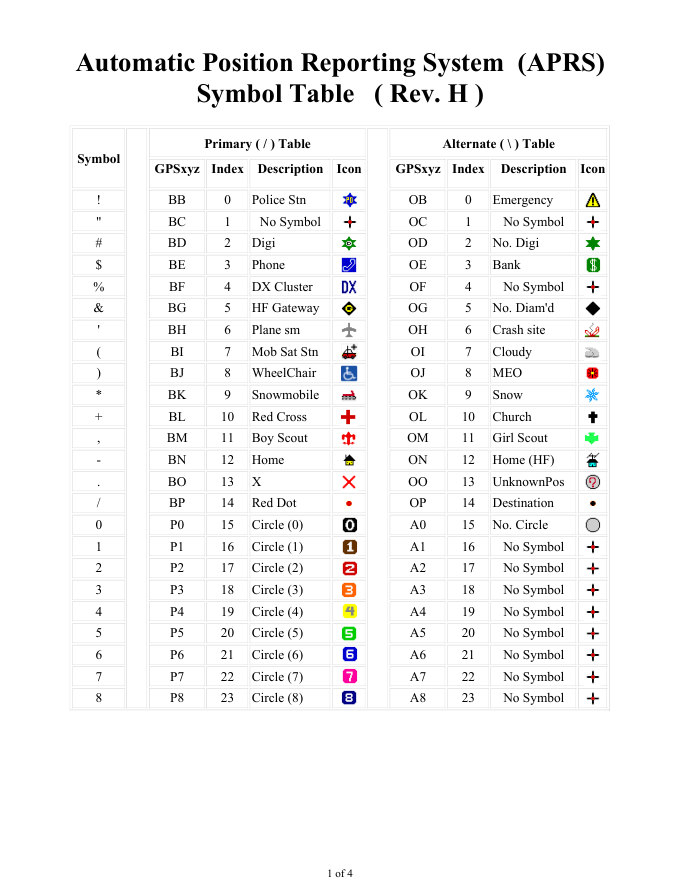
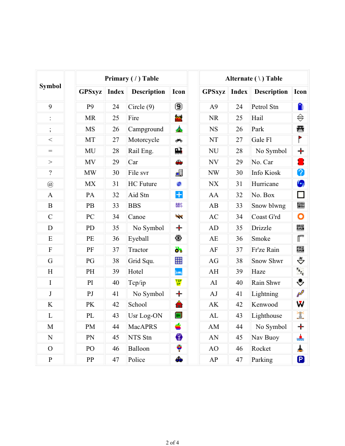
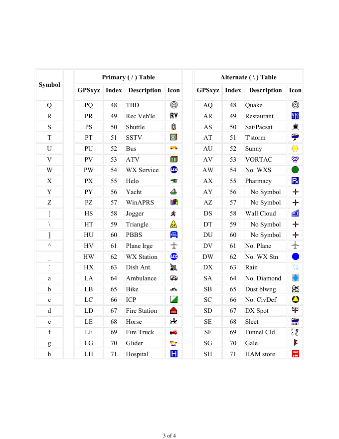
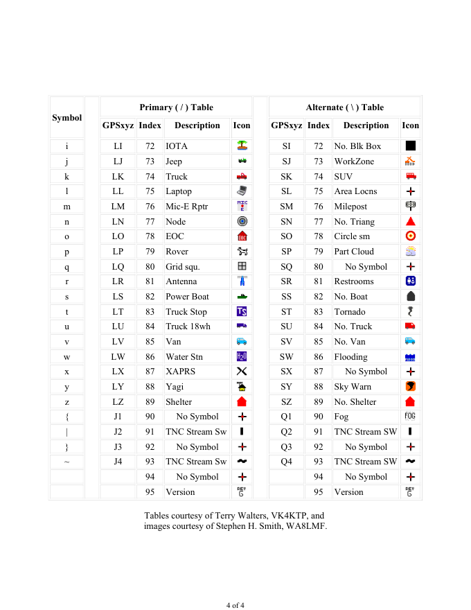

# Automatic Position Reporting System (APRS) Symbol Table ( Rev. H )

!!! info "Source"
    Originally published by Norman Williams on hamradiosouthernrepeaters.co.uk. [Original PDF](../originals/images/Anytone/APRS_Symbol_Chart.pdf) · [Source](https://hamradiosouthernrepeaters.co.uk/images/Anytone/APRS_Symbol_Chart.pdf) Hub item 11.

| Symbol | Index | Primary ( / ) GPSxyz | Primary description | Alternate ( \ ) GPSxyz | Alternate description |
|---|---|---|---|---|---|
| &#33; | 0 | BB | Police Stn | OB | Emergency |
| &#34; | 1 | BC | No Symbol | OC | No Symbol |
| &#35; | 2 | BD | Digi | OD | No. Digi |
| &#36; | 3 | BE | Phone | OE | Bank |
| &#37; | 4 | BF | DX Cluster | OF | No Symbol |
| &#38; | 5 | BG | HF Gateway | OG | No. Diam'd |
| &#39; | 6 | BH | Plane sm | OH | Crash site |
| &#40; | 7 | BI | Mob Sat Stn | OI | Cloudy |
| &#41; | 8 | BJ | WheelChair | OJ | MEO |
| &#42; | 9 | BK | Snowmobile | OK | Snow |
| &#43; | 10 | BL | Red Cross | OL | Church |
| &#44; | 11 | BM | Boy Scout | OM | Girl Scout |
| &#45; | 12 | BN | Home | ON | Home (HF) |
| &#46; | 13 | BO | X | OO | UnknownPos |
| &#47; | 14 | BP | Red Dot | OP | Destination |
| &#48; | 15 | P0 | Circle (0) | A0 | No. Circle |
| &#49; | 16 | P1 | Circle (1) | A1 | No Symbol |
| &#50; | 17 | P2 | Circle (2) | A2 | No Symbol |
| &#51; | 18 | P3 | Circle (3) | A3 | No Symbol |
| &#52; | 19 | P4 | Circle (4) | A4 | No Symbol |
| &#53; | 20 | P5 | Circle (5) | A5 | No Symbol |
| &#54; | 21 | P6 | Circle (6) | A6 | No Symbol |
| &#55; | 22 | P7 | Circle (7) | A7 | No Symbol |
| &#56; | 23 | P8 | Circle (8) | A8 | No Symbol |
| &#57; | 24 | P9 | Circle (9) | A9 | Petrol Stn |
| &#58; | 25 | MR | Fire | NR | Hail |
| &#59; | 26 | MS | Campground | NS | Park |
| &#60; | 27 | MT | Motorcycle | NT | Gale Fl |
| &#61; | 28 | MU | Rail Eng. | NU | No Symbol |
| &#62; | 29 | MV | Car | NV | No. Car |
| &#63; | 30 | MW | File svr | NW | Info Kiosk |
| &#64; | 31 | MX | HC Future | NX | Hurricane |
| &#65; | 32 | PA | Aid Stn | AA | No. Box |
| &#66; | 33 | PB | BBS | AB | Snow blwng |
| &#67; | 34 | PC | Canoe | AC | Coast G'rd |
| &#68; | 35 | PD | No Symbol | AD | Drizzle |
| &#69; | 36 | PE | Eyeball | AE | Smoke |
| &#70; | 37 | PF | Tractor | AF | Fr'ze Rain |
| &#71; | 38 | PG | Grid Squ. | AG | Snow Shwr |
| &#72; | 39 | PH | Hotel | AH | Haze |
| &#73; | 40 | PI | Tcp/ip | AI | Rain Shwr |
| &#74; | 41 | PJ | No Symbol | AJ | Lightning |
| &#75; | 42 | PK | School | AK | Kenwood |
| &#76; | 43 | PL | Usr Log-ON | AL | Lighthouse |
| &#77; | 44 | PM | MacAPRS | AM | No Symbol |
| &#78; | 45 | PN | NTS Stn | AN | Nav Buoy |
| &#79; | 46 | PO | Balloon | AO | Rocket |
| &#80; | 47 | PP | Police | AP | Parking |
| &#81; | 48 | PQ | TBD | AQ | Quake |
| &#82; | 49 | PR | Rec Veh'le | AR | Restaurant |
| &#83; | 50 | PS | Shuttle | AS | Sat/Pacsat |
| &#84; | 51 | PT | SSTV | AT | T'storm |
| &#85; | 52 | PU | Bus | AU | Sunny |
| &#86; | 53 | PV | ATV | AV | VORTAC |
| &#87; | 54 | PW | WX Service | AW | No. WXS |
| &#88; | 55 | PX | Helo | AX | Pharmacy |
| &#89; | 56 | PY | Yacht | AY | No Symbol |
| &#90; | 57 | PZ | WinAPRS | AZ | No Symbol |
| &#91; | 58 | HS | Jogger | DS | Wall Cloud |
| &#92; | 59 | HT | Triangle | DT | No Symbol |
| &#93; | 60 | HU | PBBS | DU | No Symbol |
| &#94; | 61 | HV | Plane lrge | DV | No. Plane |
| &#95; | 62 | HW | WX Station | DW | No. WX Stn |
| &#96; | 63 | HX | Dish Ant. | DX | Rain |
| &#97; | 64 | LA | Ambulance | SA | No. Diamond |
| &#98; | 65 | LB | Bike | SB | Dust blwng |
| &#99; | 66 | LC | ICP | SC | No. CivDef |
| &#100; | 67 | LD | Fire Station | SD | DX Spot |
| &#101; | 68 | LE | Horse | SE | Sleet |
| &#102; | 69 | LF | Fire Truck | SF | Funnel Cld |
| &#103; | 70 | LG | Glider | SG | Gale |
| &#104; | 71 | LH | Hospital | SH | HAM store |
| &#105; | 72 | LI | IOTA | SI | No. Blk Box |
| &#106; | 73 | LJ | Jeep | SJ | WorkZone |
| &#107; | 74 | LK | Truck | SK | SUV |
| &#108; | 75 | LL | Laptop | SL | Area Locns |
| &#109; | 76 | LM | Mic-E Rptr | SM | Milepost |
| &#110; | 77 | LN | Node | SN | No. Triang |
| &#111; | 78 | LO | EOC | SO | Circle sm |
| &#112; | 79 | LP | Rover | SP | Part Cloud |
| &#113; | 80 | LQ | Grid squ. | SQ | No Symbol |
| &#114; | 81 | LR | Antenna | SR | Restrooms |
| &#115; | 82 | LS | Power Boat | SS | No. Boat |
| &#116; | 83 | LT | Truck Stop | ST | Tornado |
| &#117; | 84 | LU | Truck 18wh | SU | No. Truck |
| &#118; | 85 | LV | Van | SV | No. Van |
| &#119; | 86 | LW | Water Stn | SW | Flooding |
| &#120; | 87 | LX | XAPRS | SX | No Symbol |
| &#121; | 88 | LY | Yagi | SY | Sky Warn |
| &#122; | 89 | LZ | Shelter | SZ | No. Shelter |
| &#123; | 90 | J1 | No Symbol | Q1 | Fog |
| &#124; | 91 | J2 | TNC Stream Sw | Q2 | TNC Stream SW |
| &#125; | 92 | J3 | No Symbol | Q3 | No Symbol |
| &#126; | 93 | J4 | TNC Stream Sw | Q4 | TNC Stream SW |
| | 94 | | No Symbol | | No Symbol |
| | 95 | | Version | | Version |

Tables courtesy of Terry Walters, VK4KTP, and images courtesy of Stephen H. Smith, WA8LMF.

## Original chart pages

