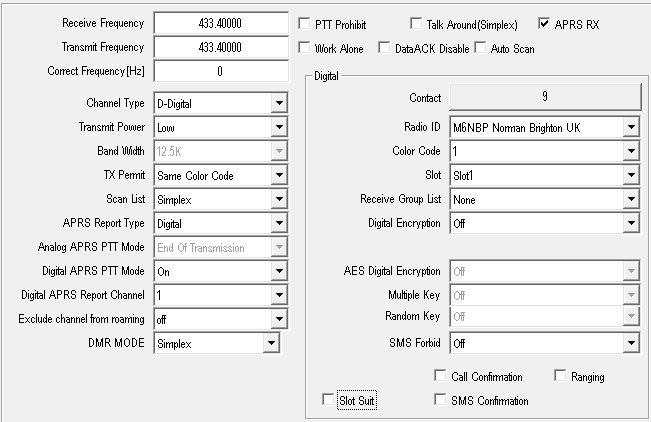
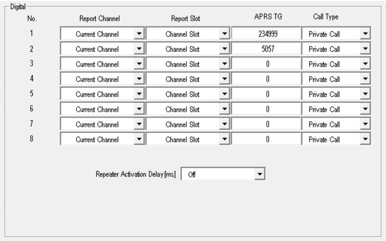
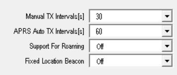
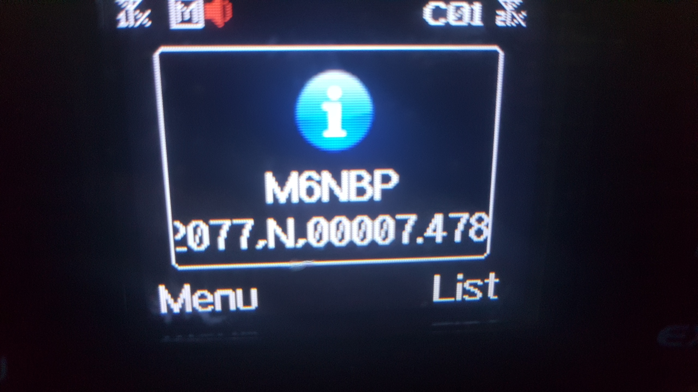
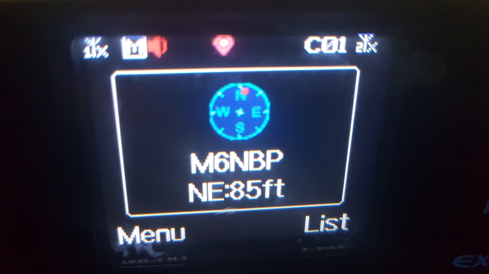

# Digi APRS RX

!!! info "Source"
    Originally published by Norman Williams on hamradiosouthernrepeaters.co.uk. [Original PDF](../originals/images/Anytone/Digi_APRS_RX.pdf) · [Source](https://hamradiosouthernrepeaters.co.uk/images/Anytone/Digi_APRS_RX.pdf) Hub item 85.

This lets you RX/TX GPS distance from/to other radios you wish to stay in contact with.

## 1. Setting we need to go over -

Each Channel we need to turn on.

*Channel Type = D-Digital; APRS Report Type = Digital; Digital APRS PTT Mode = On; Digital APRS Report Channel = 1; APRS RX ticked.*

Digi APRS RX
APRS report Type – Digital
Digital APRS PTT Mode – On
Digital APRS Report Channel – 1  (Remember this for the next section)

## 2. Now we need to setup the Digital APRS

We have set the channels to use No 1
The APRS TG I have set to 234999 and that is the UK Brandmeister APRS
Call Type we should always use Private

If the radio is only used for non Ham Radio activity like mountain rescue.
You can swap out the 234999 for your own number.

*Row 1: Current Channel, Channel Slot, APRS TG 234999, Private Call. Row 2: APRS TG 5057, Private Call. Rows 3 to 8: APRS TG 0.*

Each radio has to have the same settings as above.

## 3.This next section you can setup to what is best for your needs.

*Manual TX Intervals[s] = 30; APRS Auto TX Intervals[s] = 60; Support For Roaming = Off; Fixed Location Beacon = Off.*

Remember to save the codeplug and send it to the radio.

## 4. Now how to use.

Turn the radio to channel you wish to use and now you can RX radios sending out GPS locations and it will be displayed on your radio.

If your GPS is turned **OFF**. All you get is the Lat and Long

*Radio display: callsign M6NBP with a latitude/longitude position.*

If GPS is turned **ON**. You get direction and distance.

*Radio display: callsign M6NBP with a compass, NE:85ft.*

When your GPS is turned on, you will also send out your info when you have ended a PTT or at the times you setup in step 3.

**Note.**
At this time while you use the below settings in each channel as outlined in Step 1 -
Digi APRS RX
Ranging

**The following will not work -**
SMS messages to your radio.
Measure Period
Get GPS Info

I have asked Anytone to look into this and find a fix.

You might want to look at this document as well - [Ranging](../operating/ranging.md)
