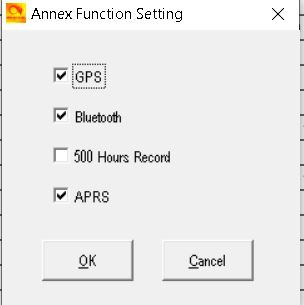
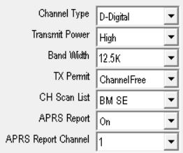
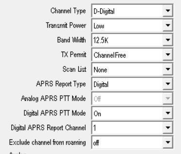
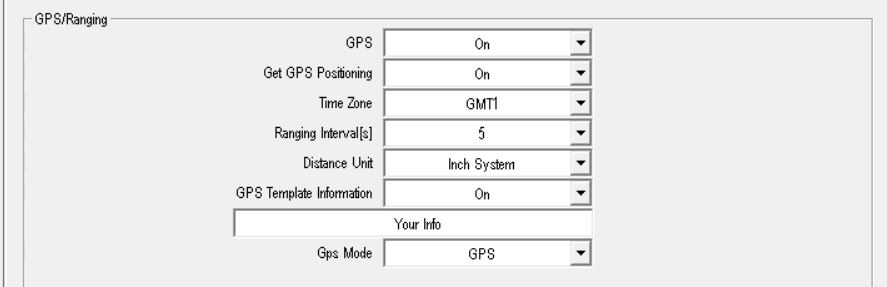
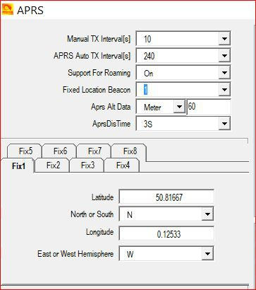
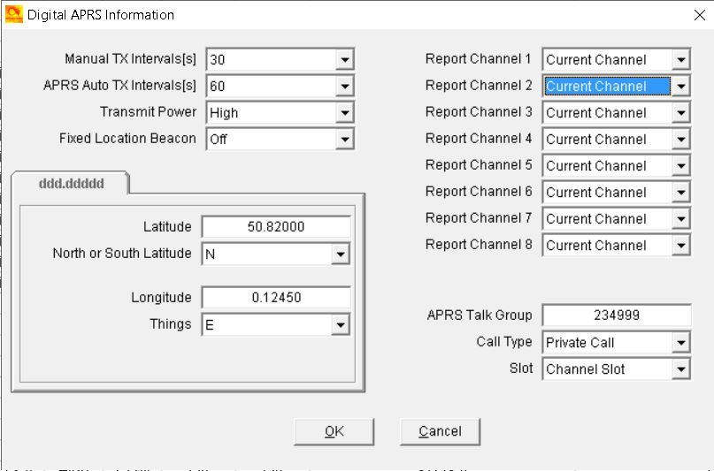
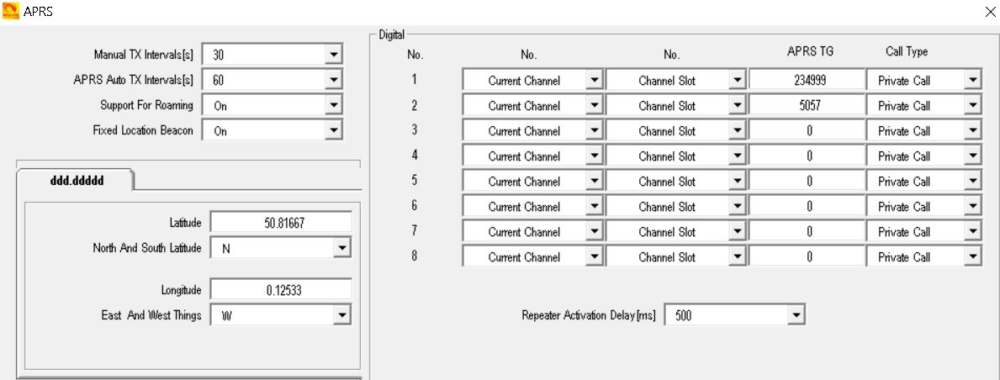
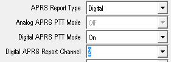

# Setting Up DMR APRS – D168/868/878/578 Radio V9

!!! info "Source"
    Originally published by Norman Williams on hamradiosouthernrepeaters.co.uk. [Original PDF](../originals/images/PDF/Digital_APRS_Settings_D868_Anytone.pdf) · [Source](https://hamradiosouthernrepeaters.co.uk/images/PDF/Digital_APRS_Settings_D868_Anytone.pdf) Hub item 3.

Turn on APRS in the CPS.

**CPS → Tool → Options**

*Annex Function Setting: GPS, Bluetooth and APRS ticked; 500 Hours Record unticked.*

## Step One:

Setup a Channel for APRS

You must designate one of your channels as the default APRS Channel. This will be used for the Frequencies, Color Code and Time Slot to use that matches the Repeater or Hotspot you are using.

Open this Channel’s settings screen and select:

- APRS Report to “ON”
- APRS Report Channel to “1”

868 Channel

*868 channel: Channel Type D-Digital, Transmit Power High, Band Width 12.5K, TX Permit ChannelFree, CH Scan List BM SE, APRS Report On, APRS Report Channel 1.*

578 878 & plus Channel

*578/878 channel: Channel Type D-Digital, Transmit Power Low, Band Width 12.5K, TX Permit ChannelFree, Scan List None, APRS Report Type Digital, Digital APRS PTT Mode On, Digital APRS Report Channel 1, Exclude channel from roaming off.*

Click OK.

Repeat this procedure for each channel.

## Step Two:

Go to Optional Settings.
Select GPS/Ranging tab.
Select GPS On. (Some 168 do not have GPS)
Select GPS Mode = GPS or Fix 1 to Fix 8

Select all settings as shown below.

*GPS/Ranging: GPS On, Get GPS Positioning On, Time Zone GMT1, Ranging Interval[s] 5, Distance Unit Inch System, GPS Template Information On ("Your Info"), Gps Mode GPS.*

**Non GPS radios. (168)**
You will need to use Fixed Location

*APRS: Manual TX Interval[s] 10, APRS Auto TX Interval[s] 240, Support For Roaming On, Fixed Location Beacon 1, Aprs Alt Data Meter 60, AprsDisTime 3S; Fix1 tab Latitude 50.81667 N, Longitude 0.12533 W.*

Fixed Location Beacon = 1 to 8
Fill in Fix 1 to Fix 8

## Step Three:

Setup Digital APRS Information Screen

At this screen you set your required settings:

1. Manual Tx Intervals
2. APRS Auto TX Intervals
3. Transmit Power set as High for Repeaters or Low for Hotspots
4. Fixed GPS Beacon (semantics on this is wrong it really means Fixed Beacon on or off
    a. This gets set as “Not Used” if you want to use the actual GPS data as the location, GPS must be on and have a satellite signal lock for APRS to send
    b. This is set to “Used” to transmit as a fixed Beacon and it will use the “dd.mm.nn” settings you enter below instead of the GPS (good for testing with no GPS lock)
5. Current Location which will be used as an APRS Beacon
6. The Report Channels you want to use, in this case select Report Channel 1 as the Channel you set in Step One Above
7. **BrandMeister** – Enter APRS number ( UK is 234999 - USA is 310999 )
    ***You must use the correct xxx999 depending on the BM Master your on.***
    *( IRL = 272999. FR = 208999. AUS = 505999. HU = 216999 etc etc )*
    *It is made up off the Masters 1st three digits and 999 added.*
    **Phoenix –** Enter APRS number 5057

8. Call Type set to Private Call
9. Set Slot that you want to use typically this would match the Step One Channel settings

*Digital APRS Information: Manual TX Intervals[s] 30, APRS Auto TX Intervals[s] 60, Transmit Power High, Fixed Location Beacon Off, Latitude 50.82000 N, Longitude 0.12450 E, Report Channels 1 to 8 all Current Channel, APRS Talk Group 234999, Call Type Private Call, Slot Channel Slot.*

or

*APRS: Manual TX Intervals[s] 30, APRS Auto TX Intervals[s] 60, Support For Roaming On, Fixed Location Beacon On, Latitude 50.81667 N, Longitude 0.12533 W. Digital table: No 1 Current Channel, Channel Slot, APRS TG 234999, Private Call; No 2 Current Channel, Channel Slot, APRS TG 5057, Private Call; Nos 3 to 8 APRS TG 0. Repeater Activation Delay[ms] 500.*

10. Set in each Channel you want to use on ( as in Step One )

*Channel: APRS Report Type Digital, Digital APRS PTT Mode On, Digital APRS Report Channel selected.*

2 = No 2 5057
1 = No 1 234999
Pick the number between 1 and 8

## Step 4 BrandMeister

[SelfCare settings](https://brandmeister.network/?page=selfcare)

- Set Brand option to Motorola
- Set APRS Callsign to xxxxx-9 (select from the pull down)
- Set APRS Icon
- APRS Text – Your Name (Joe Smith UK)
  If you do not have an account make one up.

APRS Text is also used for [Talker Alias](https://wiki.brandmeister.network/index.php/Talker_Alias)
Talker Alias (Your Name) gets displayed on Hytera, MD380 and other radios without the need of a Data Base in your radio.

[More info on sending Talker Alias](../networks-hotspots/sending-talker-alias.md)

## Step 5 Phoenix UK

For those getting to grips with GPS to APRS. There are a few different private talk groups you can send the data to which produce different behaviour on APRS.

RRS & Radio IDs:
5050 = without SSID
5055 = House QTH
5056 = Camping
5057 = walking with handheld radio
5058 = boat
5059 = car

Works on Repeaters and Hotspots

This is for Phoenix UK ONLY and will not work on (Brandmeister see step 4)

## [APRS SSID Recommendations 6 Feb 2012](http://www.aprs.org/aprs11/SSIDs.txt)

| SSID | Description |
|---|---|
| -0 | Your primary station usually fixed and message capable |
| -1 | Generic additional station, digi, mobile, wx, etc |
| -2 | Generic additional station, digi, mobile, wx, etc |
| -3 | Generic additional station, digi, mobile, wx, etc |
| -4 | Generic additional station, digi, mobile, wx, etc |
| -5 | Other networks (Dstar, Iphones, Androids, Blackberry's etc) |
| -6 | Special activity, Satellite ops, camping or 6 meters, etc |
| -7 | Walkie talkies, HT's or other human portable |
| -8 | Boats, sailboats, RV's or second main mobile |
| -9 | Primary Mobile (usually message capable) |
| -10 | Internet, Igates, echolink, winlink, AVRS, APRN, etc |
| -11 | Balloons, aircraft, spacecraft, etc |
| -12 | APRStt, DTMF, RFID, devices, one-way trackers*, etc |
| -13 | Weather stations |
| -14 | Truckers or generally full time drivers |
| -15 | Generic additional station, digi, mobile, wx, etc |
