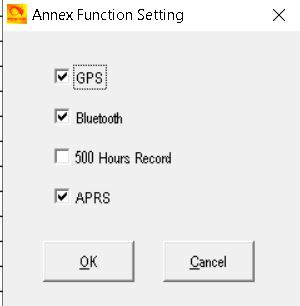

# GPS, APRS and Bluetooth Missing

!!! info "Source"
    Originally published by Norman Williams on hamradiosouthernrepeaters.co.uk. [Original PDF](../originals/images/Anytone/GPS_APRS_and_Bluetooth_Missing.pdf) · [Source](https://hamradiosouthernrepeaters.co.uk/images/Anytone/GPS_APRS_and_Bluetooth_Missing.pdf) Hub item 59.

1. In the CPS, on the top line, go to **Tool → Options**.

    

    *CPS menu: File, Model, Set, Program, Tool, View, Help.*

2. Tick all required, but not 500 Hour Record *(500 Hour Record board is not out yet)*. Then click **OK**.

    

    *GPS, Bluetooth and APRS ticked; 500 Hours Record unticked.*

    They will now show in the CPS.

3. Go to **CPS → Optional Setting → Work Mode**.

    

    *Choose working mode = amateur mode.*

Now the options will show in the radio.
