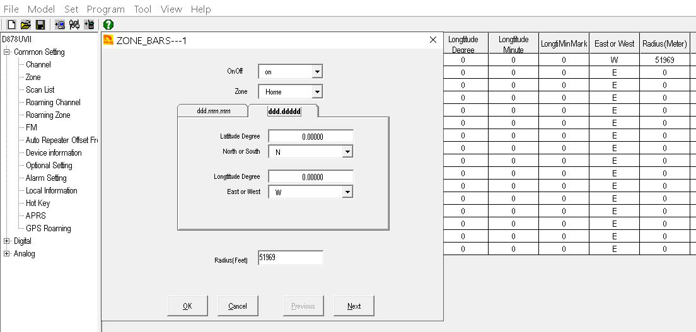
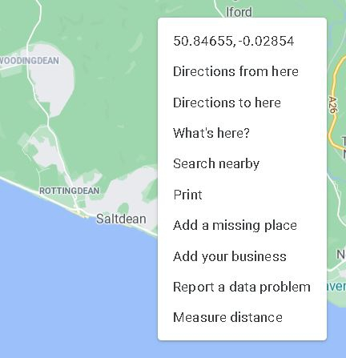
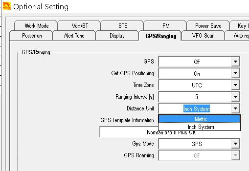
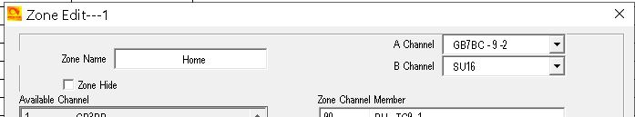

# GPS Roaming v2

!!! info "Source"
    Originally published by Norman Williams on hamradiosouthernrepeaters.co.uk. [Original PDF](../originals/images/Anytone/GPS_Roaming.pdf) · [Source](https://hamradiosouthernrepeaters.co.uk/images/Anytone/GPS_Roaming.pdf) Hub item 157.

*ZONE_BARS: On Off = on, Zone = Home, Latitude Degree = 0.00000 N, Longtitude Degree = 0.00000 W, Radius(Feet) = 51969.*

| Setting | Value |
|---|---|
| On/OFF | Set to ON |
| Zone | Select the zone you want to use |
| ddd.ddddd | Set Lat and Long (ddd.mmm.mmm will auto fill) |
| Radius | When within range it will swap zone |

## To find Latitude and Longitude

Go to <https://www.google.co.uk/maps/>. Find the location on the map and right click. You will see the info at the top of the new box.

## To set Radius to Feet or Meters

**CPS → Options → GPS/Ranging → Distance units**: set as **Inch System** or **Metric**.

*GPS/Ranging: GPS = Off, Get GPS Positioning = On, Time Zone = UTC, Ranging Interval[s] = 5, Distance Unit = Inch System, Gps Mode = GPS, GPS Roaming = Off.*

## Some Radius calculators

- Radius Miles to Meters: <https://www.google.com/search?q=miles+to+meters>
- Radius Miles to Feet: <https://www.google.com/search?q=miles+to+feet>

## Radio via menu

1. Turn on **GPS**.
2. Turn on **GPS Roaming**.

When within range, the radio will move to what you have as Default in each Zone.

*Zone Edit: Zone Name = Home, A Channel = GB7BC - 9 -2, B Channel = SU16.*

!!! tip "878 – tip from Markus Große-Schware"
    If you have set “GPS Roaming“ - willingly or not - to ON, you can have only one active channel. Make sure that you do there what you really want/need.

## See also

- [Roaming](../operating/roaming.md)
- [NXDN Roaming](../models/nxdn-roaming.md)
