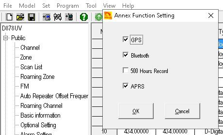

# Missing – GPS, Bluetooth, APRS

!!! info "Source"
    Originally published by Norman Williams on hamradiosouthernrepeaters.co.uk. [Original PDF](../originals/images/Anytone/Missing__GPS_Bluetooth_APRS.pdf) · [Source](https://hamradiosouthernrepeaters.co.uk/images/Anytone/Missing__GPS_Bluetooth_APRS.pdf) Hub item 87.

Go to **CPS → Tool → Options** and turn on:

*GPS, Bluetooth and APRS ticked; 500 Hours Record unticked.*

## See also

- [GPS, APRS and Bluetooth Missing](gps-aprs-and-bluetooth-missing.md)
