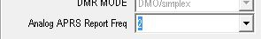
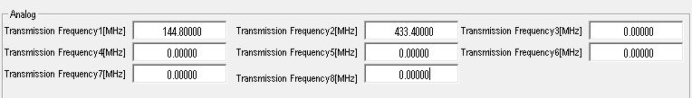

# SMS/Messages via Analogue APRS v2

!!! info "Source"
    Originally published by Norman Williams on hamradiosouthernrepeaters.co.uk. [Original PDF](../originals/images/Anytone/SMS_Messages_via_Analogue_APRS.pdf) · [Source](https://hamradiosouthernrepeaters.co.uk/images/Anytone/SMS_Messages_via_Analogue_APRS.pdf) Hub item 156.

## To send SMS

Menu – APRS – Ana – APRS SMS

New SMS – enter text – Confirm

Input ID – This is the Callsign and SSID they use – M6xxx-7
*You will need to know what SSID the other user has set*

Click Confirm to send SMS

## To RX SMS

Menu – APRS – Ana – APRS SMS – Inbox – Inbox List

You must be within range of a Igate
or
via radio to radio with one of the 7 extra Channels/Frequencies you can setup.

*Analog APRS Report Freq = 2.*

*Transmission Frequency1 = 144.80000 MHz; Transmission Frequency2 = 433.40000 MHz; others 0.00000.*

Also read
Analogue APRS
Analogue APRS RX if your radio offers it.

## Links in the original PDF

- [Also read Analogue APRS](analog-aprs-anytone-878-878plus.md)
- [Analogue APRS Analogue APRS RX](analogue-aprs-rx.md)
