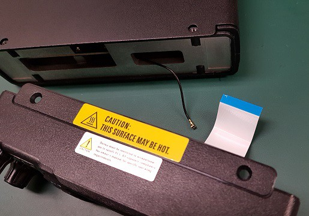
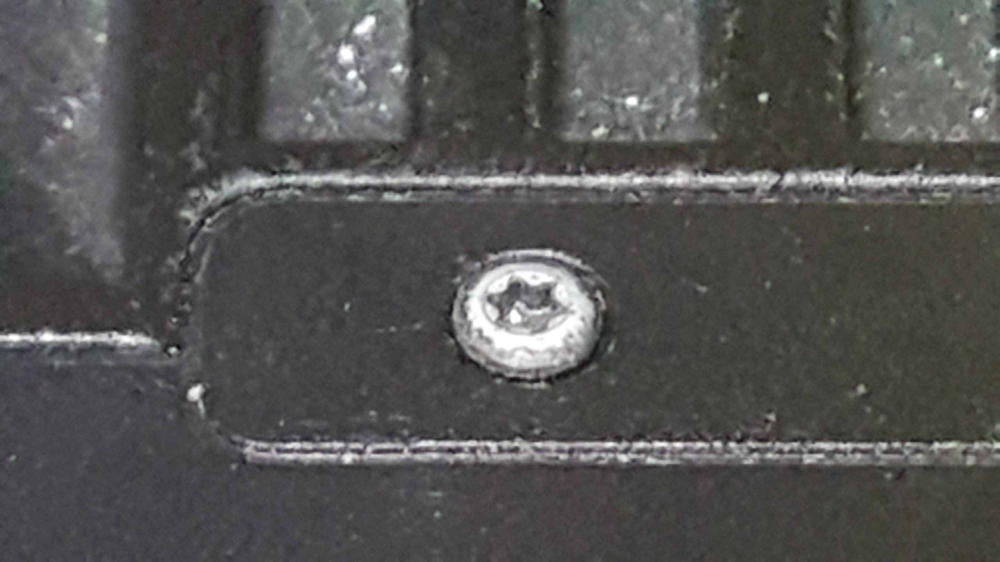

# 578VU Pro can not see the BT module (In menu)

!!! info "Source"
    Originally published by Norman Williams on hamradiosouthernrepeaters.co.uk. [Original PDF](../originals/images/Anytone/578VU_Pro_can_not_see_the_BT_module_In_menu.pdf) · [Source](https://hamradiosouthernrepeaters.co.uk/images/Anytone/578VU_Pro_can_not_see_the_BT_module_In_menu.pdf) Hub item 97.

1. Take the head off.
2. Remove the ribbon at both ends.
3. Refit the ribbon and make sure it is fitted correctly.

The menu will now see the BT module.

You will need a [Torx/Hex Screwdriver](https://www.ebay.co.uk/sch/i.html?_from=R40&_trksid=p2334524.m570.l1313.TR12.TRC2.A0.H1.Xtorx+screwdriver+set.TRS0&_nkw=torx+screwdriver+set&_sacat=0&LH_TitleDesc=0&_osacat=0&_odkw=hex+screwdriver+set).
