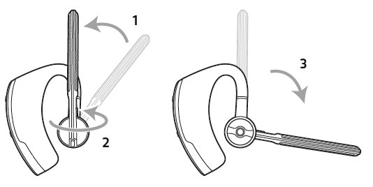

# Q8 BT headset User Guide

!!! info "Source"
    Originally published by Norman Williams on hamradiosouthernrepeaters.co.uk. [Original PDF](../originals/images/Anytone/Anytone_Q8_Bluetooth_Earpiece_User_Guide.pdf) · [Source](https://hamradiosouthernrepeaters.co.uk/images/Anytone/Anytone_Q8_Bluetooth_Earpiece_User_Guide.pdf) Hub item 111.

!!! warning "Important safety note"
    Prolonged exposure to high volume levels can damage your hearing. To avoid injury, set the volume to the lowest comfortable level. If you experience ringing in your ears, or voices sound muffled, stop using the headset. Avoid turning up the volume to block noisy surroundings. It's possible for your ears to adapt to volume that is too high, and this could result in permanent hearing damage without any noticeable discomfort.

- Check with local and state laws regarding cell phone/headset usage while operating a motor vehicle.
- Do not immerse any part of this product in water.
- Plastic bags and small parts may cause choking if ingested. Keep them away from small children and pets.
- Use only the power cords included with this product.
- Avoid temperatures exceeding 140°F (will cause equipment failure).

## 1. Headset overview

| Icon | Function |
|---|---|
|  | Battery charge port / Sub headset connector |
|  | Indicator lights |
|  | Power on/off |
|  | Volume switch / Songs selection |
|  | Call / Play / Pause |
| PTT | PTT |

## 2. How to wear the headset

1. Rotate the microphone rod to the vertical direction.
2. Insert the headset into your ear and make sure it fits your ear well.
3. Rotate the microphone rod to the suitable direction.

## 3. Getting started

### 3.1 Pairing to an Anytone radio or a cell phone

1. Turn the power switch to the  place. The red and blue lights blink in turn: the headset is in pairing mode.

    

2. Put your Anytone radio or cellphone into Bluetooth search/scan mode.

    - **Anytone radio:** **Menu → Bluetooth → BT On/Off → Bluetooth On** to turn the Bluetooth on, then **Menu → Bluetooth → BT Pairing Seek BT** to put the radio in Bluetooth search mode.
    - **iPhone:** **Settings → General → Bluetooth → On**
    - **Android™ cell phone:** **Settings → Wireless & Networks → Bluetooth: ON → Scan of devices**

    *Note: the menus might be different for different brand cellphones.*

3. Select "Q8" to pair. The blue light is blinking when the headset is connected to the radio or cellphone.

### 3.2 Multi-connect to an Anytone radio and a cellphone

The headset allows you to connect to an Anytone radio and a cellphone at the same time.

1. Pair the headset to the Anytone radio.
2. Disconnect the Bluetooth.
3. Pair the headset to the cellphone.
4. Turn on Bluetooth in the radio and cellphone; the headset will connect to both the radio and cellphone.

!!! note
    Make sure the headset connects to the Anytone radio first, otherwise the PTT function on the headset (for the Anytone radio) is invalid.

### 3.3 Make a call or accept a call

#### For Anytone radio use

When the headset is connected to an Anytone radio, it allows you to press the **PTT** button to start a transmit or a receive; press the **PTT** button again to end the transmit or receive.

*Reminder: the PTT function is only valid for Anytone radios; it doesn't support any other two-way radios so far.*

#### For cellphone use

1. **Manually accept/reject an incoming call.** When a call is coming, the cellphone will prompt the incoming call number. Press the  button to accept the call, or press and hold the  button to reject the call.
2. **Voice answer/reject an incoming call.** When a call is coming, you can say “YES” to accept or “NO” to reject.

    *Note: this function may not be reliable in particularly noisy environments.*

3. **Call back the previous call.** Quickly tap the call button  twice to call back the previous call.

### 3.4 Music play/pause, volume switch, songs selection

1. **Play/pause:** when music is playing, click on the  button to pause; click on the  button again to play.
2. **Volume switch:** when music is playing, hold sliding the  button to change the volume.
3. **Songs selection:** when music is playing, slide the  button to select the songs.

### 3.5 Switch the language

Turn on the headset and press and hold the  and  keys. The earpiece will prompt in different languages; release the key when it is the language you want.

## 4. Charging the headset

When the power is low, the headset emits a “didi” beep at 5-minute intervals. After 4 beeps, it will say “Power off”, so please charge the headset in time.

The red light is on when charging the headset. When the battery is fully charged, it will turn to a blue light.

!!! note
    To avoid the battery going dead, make sure you charge the headset once a month if you don't use it.

## 5. Specifications

- Bluetooth 5.0
- Hi-Fi SBC, MP3, ACC, digital audio decode
- S3D enhanced stereo (high quality, Hi-Fi, enhanced digital stereo)
- Voice recognition for call answer or rejection
- Voice dial (needs mobile phone support)
- CVC wideband voice and narrowband voice connection with wind suppression
- Allows connecting the sub headset
- Supported profiles: AVRCP, HFP V1.6 (Wideband Speech), HSP 1.2, mobile phone
- Power supply: 5V DC – 180mA
- Operation temperature: 32°F – 104°F (0 – 40°C)
- Store temperature: 32°F – 104°F (0 – 40°C)
- Charge temperature: 32°F – 104°F (0 – 40°C)

A1.190628
