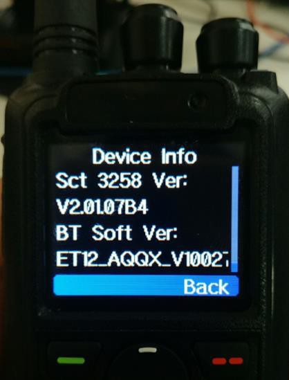
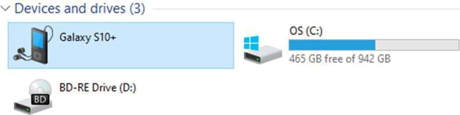
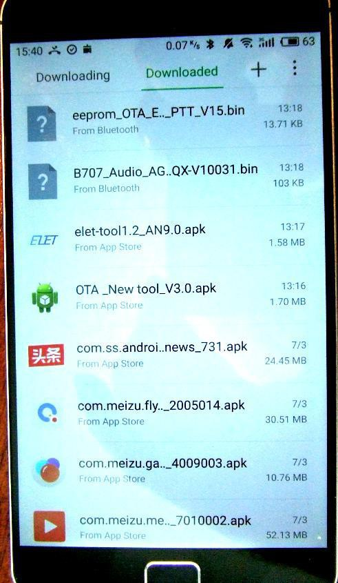
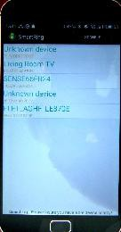
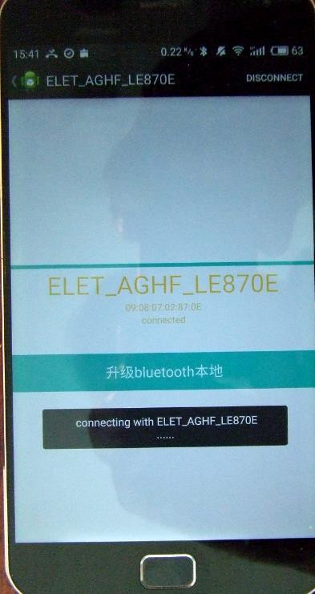
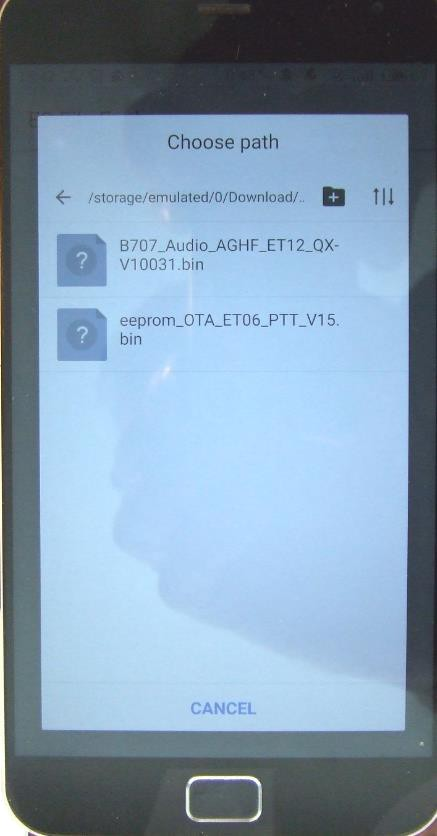
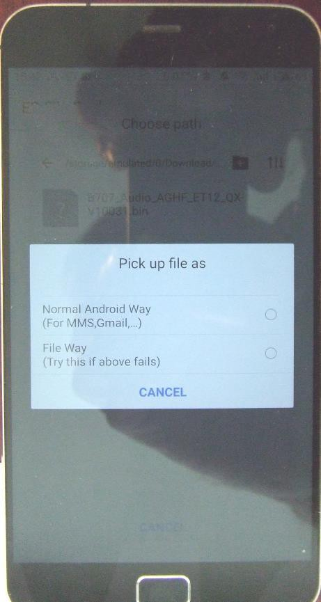
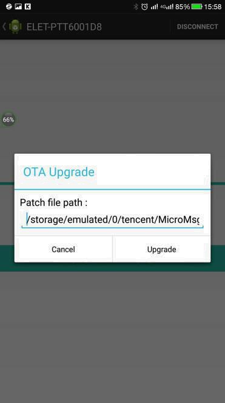

# AnyTone D578UV and D878UV Bluetooth updating

!!! info "Source"
    Originally published by Norman Williams on hamradiosouthernrepeaters.co.uk. [Original PDF](../originals/images/Anytone/BT_FW_Upgrade_for_D578UV_and_D878UV.pdf) · [Source](https://hamradiosouthernrepeaters.co.uk/images/Anytone/BT_FW_Upgrade_for_D578UV_and_D878UV.pdf) Hub item 53.

## How to check BT version?

On the radio open **Menu → Settings → Device Info** and look for the Bluetooth Software Version.

*Device Info screen: BT Soft Ver = ET12_AQQX_V1002 (partly cut off).*

## Upgrade BT to latest version on the D878UV or D578UV radio

1. Connect your Android phone to your computer via a cable.
2. Open the phone folder on the computer and locate the Download folder from your phone, then drag and drop the AnyTone BT files you received to the phone Downloads folder:

    - `OTA_New tool_V3.0.apk` and `elet-tool1.2_AN9.0.apk`, which are 2 applications for the phone
    - `eeprom_OTA_ET06_PTT_Vxx.bin`
    - `B707_Audio_AGHF_ET12_QX-V100xx.bin`

    

3. On your phone, locate the Files or File Documents (or similar) folder, open it and look for the Downloads folder where you placed the programs.
4. Find and install `OTA _New tool_V3.0.apk` on your Android phone.

    

5. Open the OTA program you just installed on your phone. Make sure your AnyTone radio has the Bluetooth function turned on and set it in "pairing" mode. On the phone, click the top right "scanble" text or the 3 dots so that the phone scans for nearby Bluetooth devices. You may see an additional menu first; click either of the 2 selections. You will see the following – select the ELET_xxxx_xxxxx result (which is your radio).

    

    Some phones may have a different text at the upper right corner to start the scanning for nearby Bluetooth devices.

6. The radio will be displayed on the phone as ELERT_xxxx_xxxxxx. (The BT name can be checked in the BT menu on the radio.)
7. Click on the ELET_xxxx name and a new screen will open, showing initially that the phone will connect to the radio (the black ribbon text) and then wait for the next action:

    

8. **Move the `B707_Audio_AGHF_ET12_0X-V100xx.bin` file from the Download folder to the phone's main directory, Internal Storage (My Files / Internal Storage).**
9. Click the blue "升级 bluetooth 本地" ribbon on the display shown above to open the location where you moved the `B707_Audio_AGHF_ET12_0X-V100xx.bin` (or similar looking file name) file you loaded into the phone.
10. Click on the B707_Audio… file, which is the update file.

    !!! note
        Here some Android phones may show an error instead of starting to load the update. We do not know what prevents certain phones from working. Research is being done to try to resolve this situation.

    

11. The phone may display a selection choice; for best results, select the bottom "File Way". Then select "Upgrade", and it will start the firmware upgrade, showing progress.

    

    

12. After the upgrade is done, click on "DISCONNECT" at the top right of the phone display. The Bluetooth firmware upgrade is finished. Power off the radio, and power it on again to check the version in the menu. It should now show the version you loaded via a Bluetooth connection.

[Download B707_Audio_AGHF_ET12_QX-V10033.bin](../originals/images/Anytone/BT_Firmware_All_V10033.zip)
