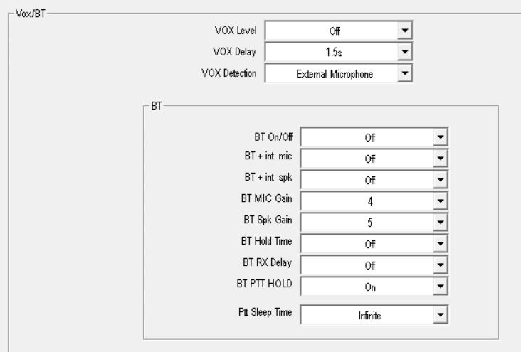
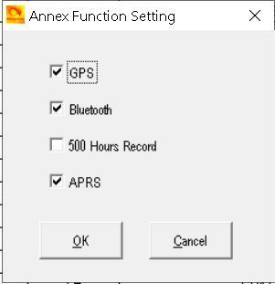
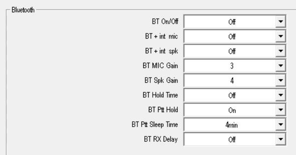

# BT PTT Settings 878 - 578

!!! info "Source"
    Originally published by Norman Williams on hamradiosouthernrepeaters.co.uk. [Original PDF](../originals/images/Anytone/BT_PTT_Settings_878-578.pdf) · [Source](https://hamradiosouthernrepeaters.co.uk/images/Anytone/BT_PTT_Settings_878-578.pdf) Hub item 75.

## 878

**CPS → Option Settings → Vox/BT**

My settings:

*Vox/BT: VOX Level Off, VOX Delay 1.5s, VOX Detection External Microphone; BT On/Off Off, BT + int mic Off, BT + int spk Off, BT MIC Gain 4, BT Spk Gain 5, BT Hold Time Off, BT RX Delay Off, BT PTT HOLD On, Ptt Sleep Time Infinite.*

(If BT is not showing, you need to go to **CPS → Tool → Options** and tick the box.)

*Annex Function Setting: GPS, Bluetooth and APRS ticked; 500 Hours Record unticked.*

For single click to open the PTT and single click to close PTT, make sure you have **BT PTT HOLD** set to ON.

## 578

**CPS → Option Settings → Bluetooth**

My settings:

*Bluetooth: BT On/Off Off, BT + int mic Off, BT + int spk Off, BT MIC Gain 3, BT Spk Gain 4, BT Hold Time Off, BT Ptt Hold On, BT Ptt Sleep Time 4min, BT RX Delay Off.*

(If BT is not showing, you need to go to **CPS → Tool → Options** and tick the box.)

For single click to open the PTT and single click to close PTT, make sure you have **BT PTT HOLD** set to ON.

!!! note
    Sorry to say, at this time **BT Ptt Sleep Time** can only have a max of 4mins. We have requested Infinity, the same as the 878.

## BT PTT keeps dropping connection

1. After you have paired and turned Bluetooth ON in the radio, turn the radio off.
2. Hold the BT PTT in.
3. Turn the radio on and wait till the BT PTT connects, and then you can let go of the PTT.

You should do this every time you wish to use BT.

Video - [Ultimate Anytone Bluetooth guide!](https://www.youtube.com/watch?v=x8uG9ycMvpo)
