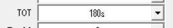
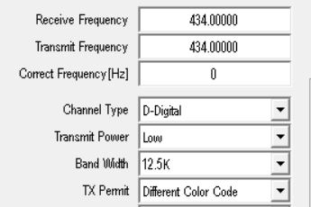
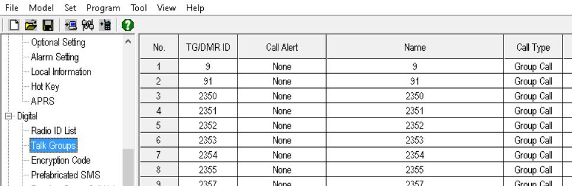
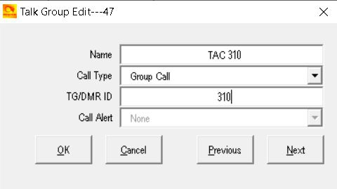
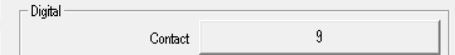
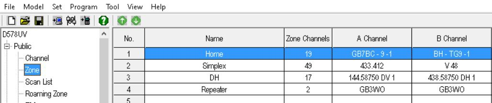
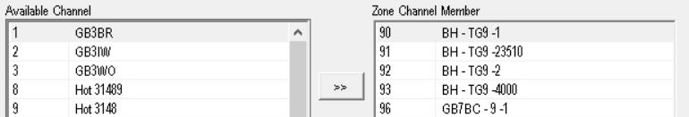

# Add Talk Groups

!!! info "Source"
    Originally published by Norman Williams on hamradiosouthernrepeaters.co.uk. [Original PDF](../originals/images/Anytone/Add_Talk_Groups.pdf) · [Source](https://hamradiosouthernrepeaters.co.uk/images/Anytone/Add_Talk_Groups.pdf) Hub items 32 and J.

## Before you start

**[TOT (Radio Timeout Timer)](../hardware/radio-timeout-timer-180s.md) must be set to 180s:** **CPS → Optional Settings → Other**

*Optional Settings → Other: TOT = 180s.*

**TX Permit** = Same, Channel Free, Different Color Code.

!!! warning
    Never set TX Permit to Always.

*Receive Frequency = 434.00000, Transmit Frequency = 434.00000, Correct Frequency [Hz] = 0, Channel Type = D-Digital, Transmit Power = Low, Band Width = 12.5K, TX Permit = Different Color Code.*

## Adding a talk group

1. First you need to add the Talk Group to **Talk Groups** as a **Group Call**.

    

2. Double click the next empty line and fill in:

    

    *Talk Group Edit: Name = TAC 310, Call Type = Group Call, TG/DMR ID = 310, Call Alert = None (greyed out).*

    - 907 - Group Call
    - 91 - Group Call
    - 4000 - Group Call

3. Save by clicking **OK**.
4. Make up a channel for each Talk Group you wish to use.

    

    *Digital: Contact = 9.*

5. Add each channel to a Zone List.

    

    

6. Save the codeplug.
7. Send the codeplug to the radio.
8. Turn the radio to the required zone and channel.
9. TX to open that Talk Group.

Now you can TX and RX in that Talk Group.

!!! note
    4000 - "Group Call": disconnect from TG.

## More information

- [Brandmeister World Wide Talk Groups](https://brandmeister.network/?page=talkgroups)
- [Add Talkgroup via Keypad](https://www.youtube.com/watch?time_continue=5&v=5C_ah-n0Mng&feature=emb_logo)
