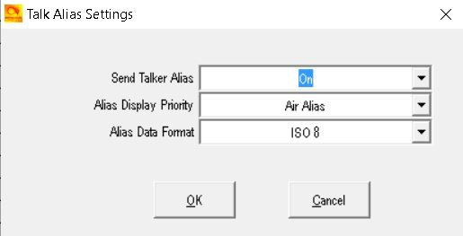
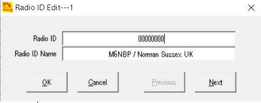

# Anytone 878 Sending / Receive Talker Alias

!!! info "Source"
    Originally published by Norman Williams on hamradiosouthernrepeaters.co.uk. [Original PDF](../originals/images/PDF/Anytone_878_Sending-Receive_Talker_Alias.pdf) · [Source](https://hamradiosouthernrepeaters.co.uk/images/PDF/Anytone_878_Sending-Receive_Talker_Alias.pdf) Hub item 5.

## Talker Alias Settings

*Talk Alias Settings: Send Talker Alias = On, Alias Display Priority = Air Alias, Alias Data Format = ISO 8.*

**Alias Display Priority -**
**Air Alias -** will show up on the radio as Digital Contact List 1st and then swap to TA display.
**Contact Alias -** will show Digital Contact List.
**Alias Data Format -** ISO-8 should be used.

*Radio ID Edit---1: Radio ID 00000000, Radio ID Name "M6NBP / Norman Sussex UK".*

**Radio ID List -**
**Radio ID -** DMR ID Number
**Radio ID Name -**You can have up to 26 characters under ISO-8

The / is required under some country rules like the USA if you add extra text after your Callsign.
I have not read up on the UK rules.
As I talk to the USA a lot I have added the / as I have more text after my Callsign.

**NOTE -**
Not all Networks and DMR Repeaters (Motorola) offer or handle Talk Alias.
Talker Alias does work on Brandmeister and Hotspots.
