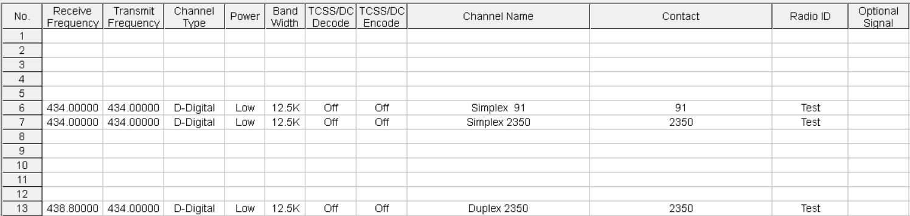
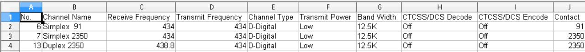
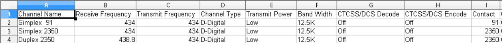
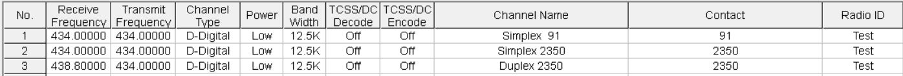

# Remove Spaces

!!! info "Source"
    Originally published by Norman Williams on hamradiosouthernrepeaters.co.uk. [Original PDF](../originals/images/Anytone/Remove_Spaces.pdf) · [Source](https://hamradiosouthernrepeaters.co.uk/images/Anytone/Remove_Spaces.pdf) Hub item 94.

How to remove spaces in Channels, Zones, Scan list etc. The following procedure applies to all; I will just show how to do channels.

## 1. You need to export the Channel CSV file

1. **CPS, top line → Tool → Export**
2. Click on the **Channel** tab.
3. Point to a place you wish to save the CSV and name it.
4. Click **Save**.
5. At the bottom of the page click on **Export**.

## 2. Open the CSV file

1. Delete Column A = No.

    

2. Save the CSV.

## 3. Now import the Channel CSV

1. **CPS, top line → Tool → Import**
2. Click on the **Channel** tab.
3. Point to the place you saved the CSV.
4. Click **Open**.
5. At the bottom of the page click on **Import**.

Now your Channels look like this, with no spaces.

**Save your codeplug.**

You might wish to look at this also: [Export and Import All CSV](../cps-firmware/export-and-import-all-csv.md)

## See also

- [Export and Import All CSV](../cps-firmware/export-and-import-all-csv.md)
- [AES256/ARC4 encryption CSV Export/Import](../encryption/aes256-arc4-encryption-csv-export-import.md)
