# How to Update Your Anytone DMR Contact List

!!! info "Source"
    Originally published by Norman Williams on hamradiosouthernrepeaters.co.uk. [Original PDF](../originals/images/Anytone/Update_your_digital_contacts.pdf) · [Source](https://hamradiosouthernrepeaters.co.uk/images/Anytone/Update_your_digital_contacts.pdf) Hub item 2b.

*By Jim Blocker KF5IW*

1. Open your current codeplug in CPS. As an example, this codeplug has 189,411 contacts:

    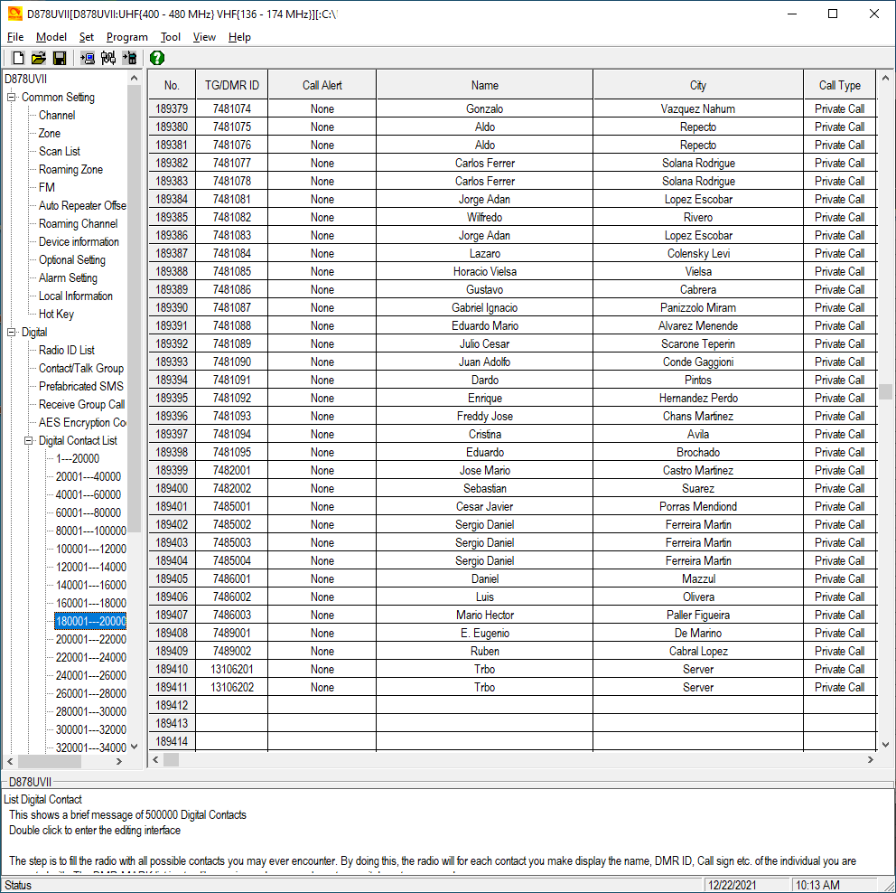

2. Open <https://kf5iw.com/contactdb.php> and click on the "ALL" link to download the complete DMR contact list.

    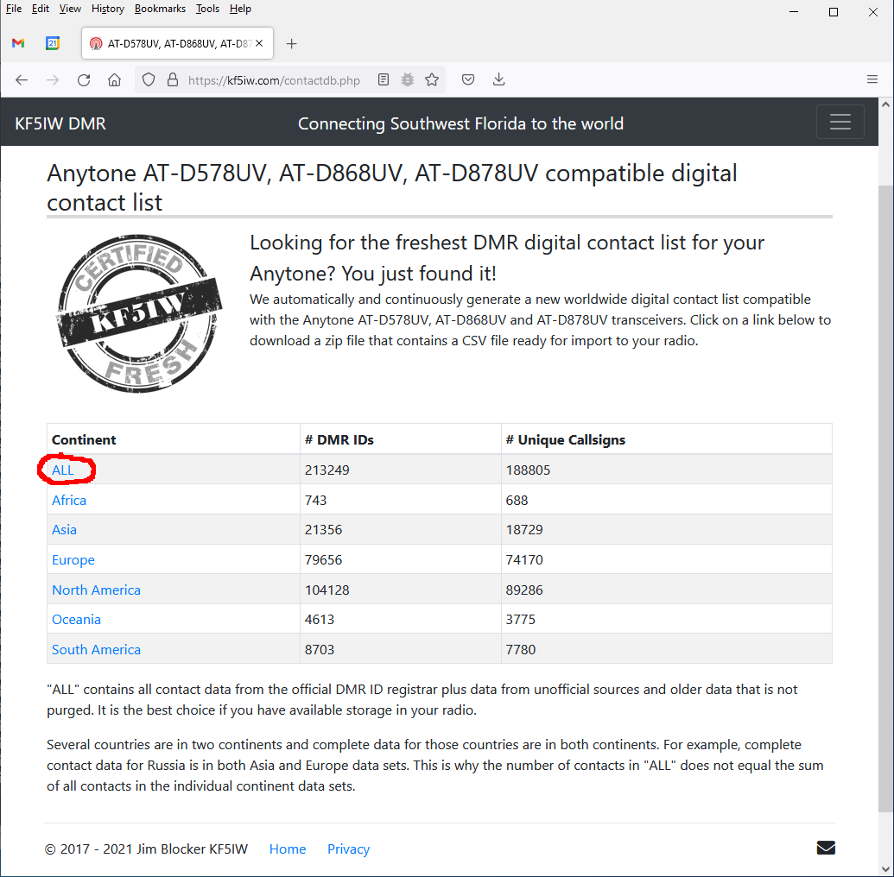

3. Save the .zip file.

    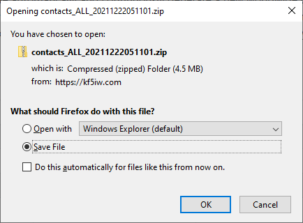

4. Find your downloaded file.

    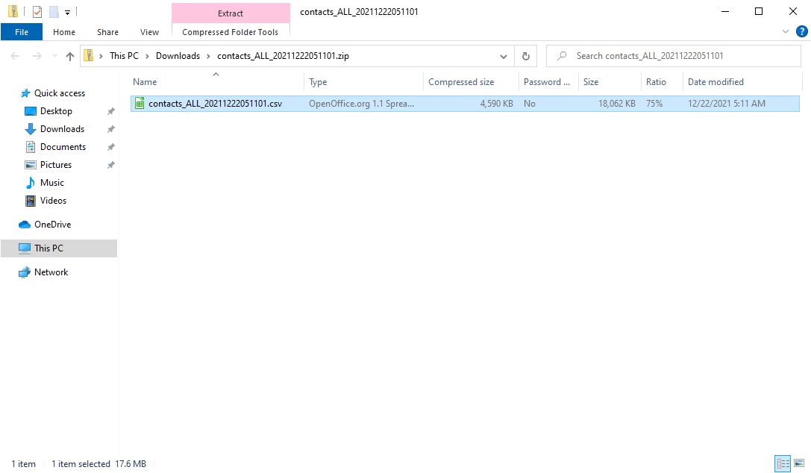

5. Extract the .zip file to a .csv.

    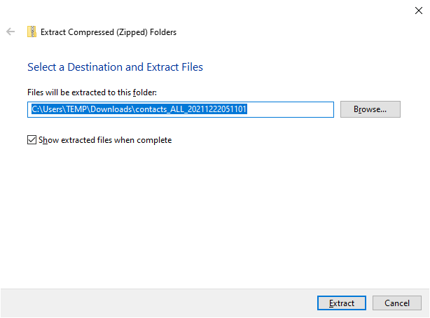

6. You should now have an extracted .csv file.

    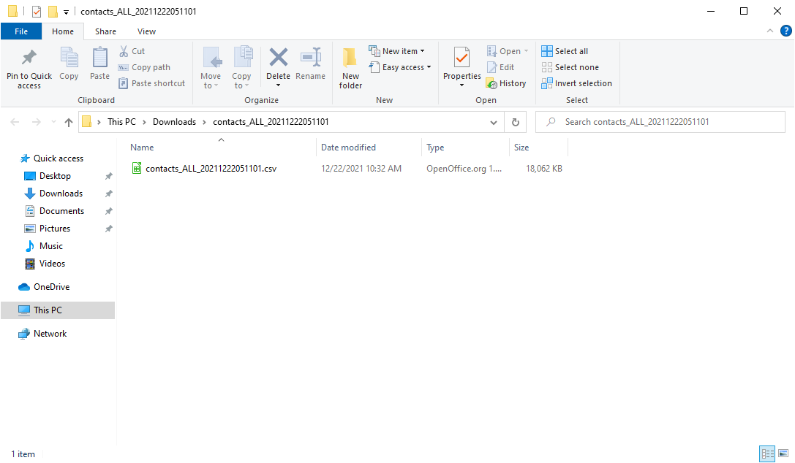

7. Back in CPS, select **Tool → Import**.

    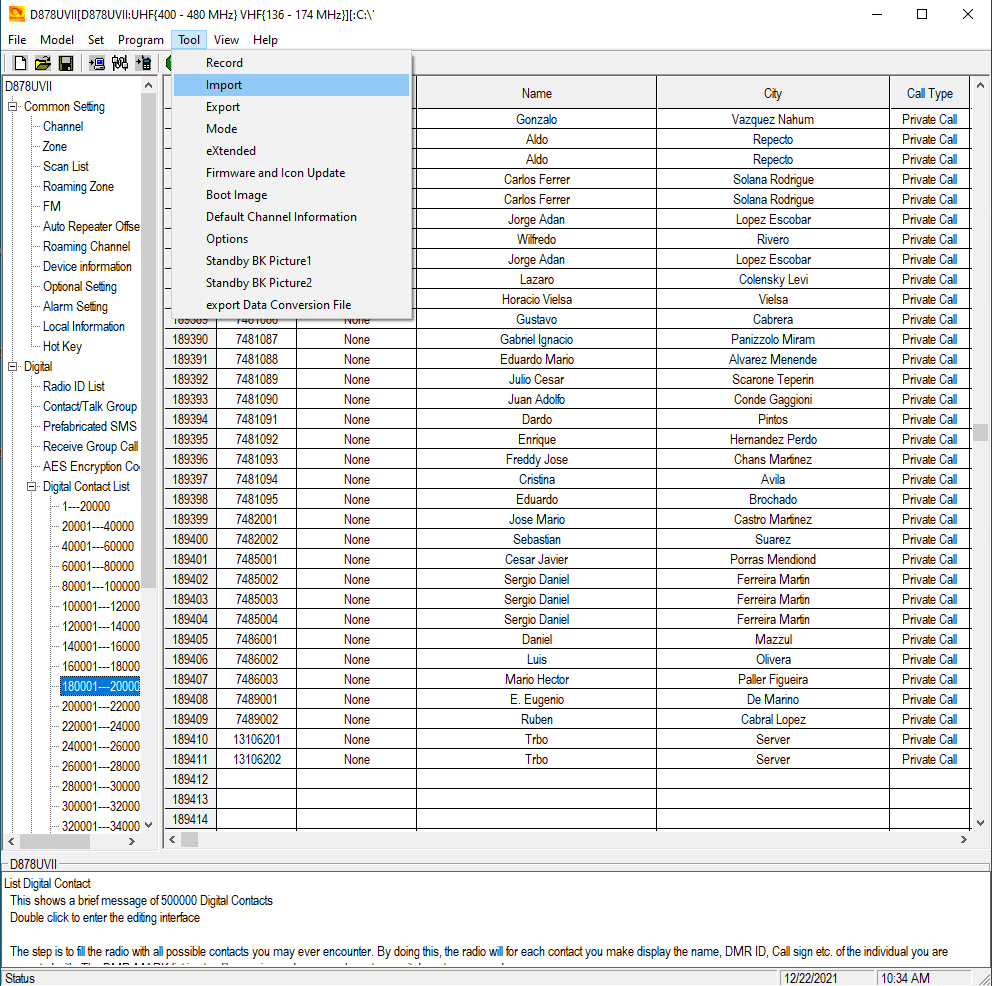

8. In the Import window, click on "Digital Contact List".

    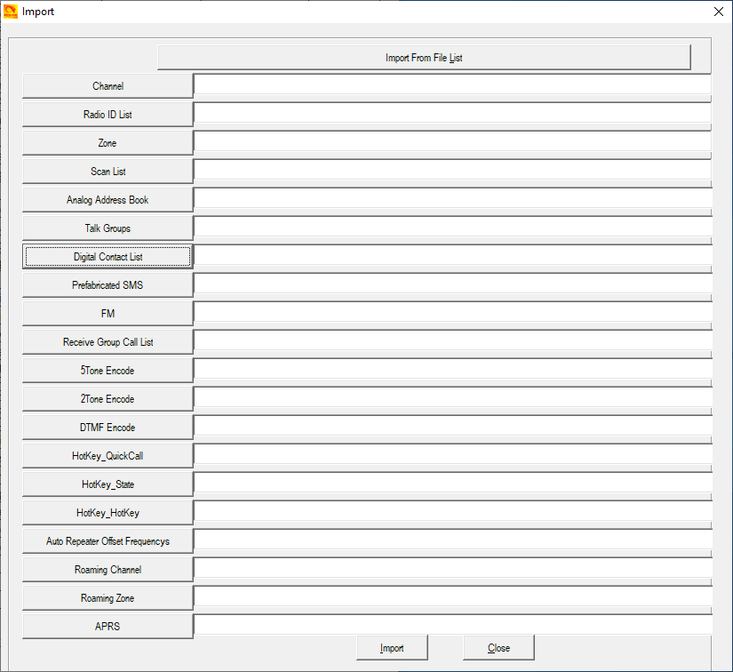

9. Navigate to your CSV that you downloaded from kf5iw.com, select the file and click "Open".

    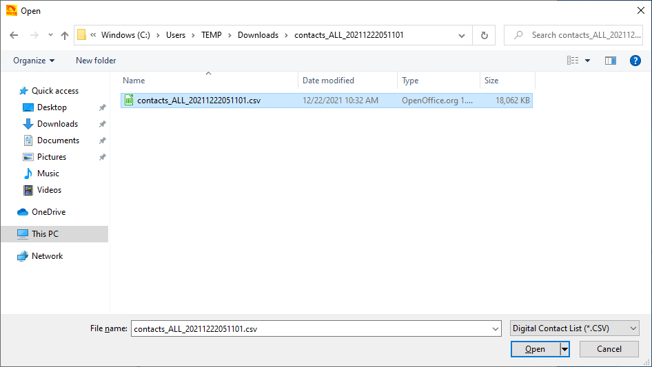

10. The CSV file should now show in the Import window.

    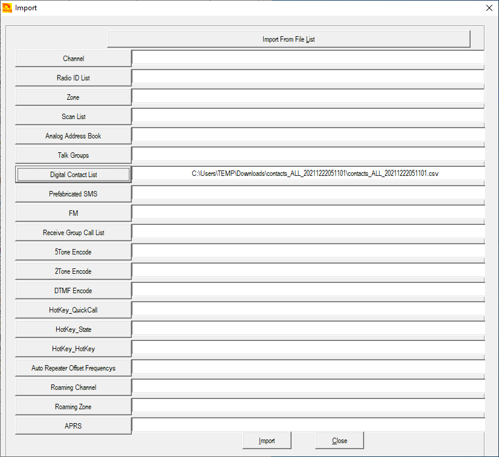

11. Click on "Import" on the bottom of the Import window. You will see a progress indicator. Please be patient for the import process to complete.

    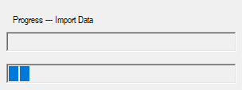

12. Click on "OK" when "Import Complete" appears.

    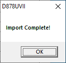

13. Wait for the Digital Contact List display to update.

    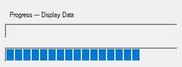

14. Once complete, the number of contacts displayed should match the number of contacts downloaded. The correct number of contacts is displayed on the kf5iw.com contact download page.

    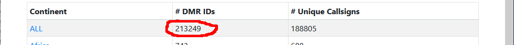

    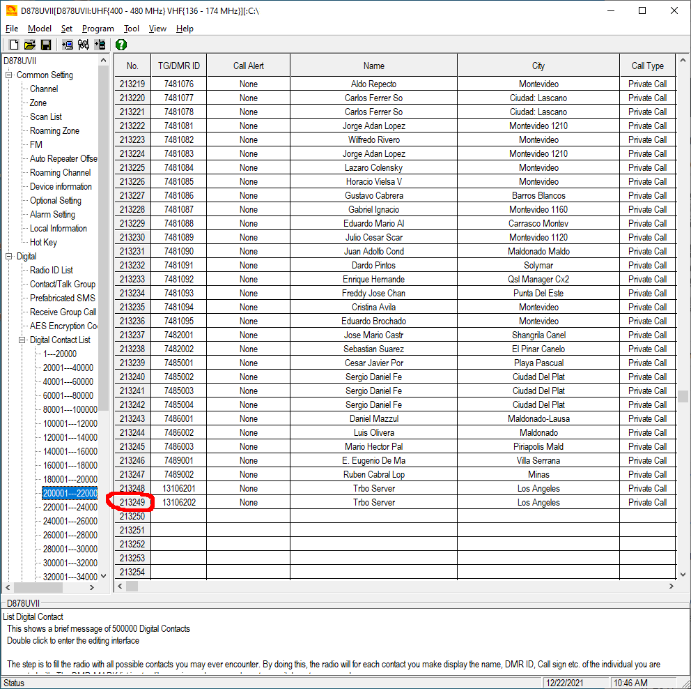

15. **Important:** now select **File → Save As** and save your updated codeplug.

    I save each new version of my codeplug as a new file so that it's easy to go back to a prior version if needed. You can create a unique filename based on today's date. For example, a codeplug created on December 30, 2021 could have a filename of "20211230.rdt".

16. Update your radio's contact list by selecting **Program → Write To Radio**. Make sure that the "Digital Contact List" option is checked.

    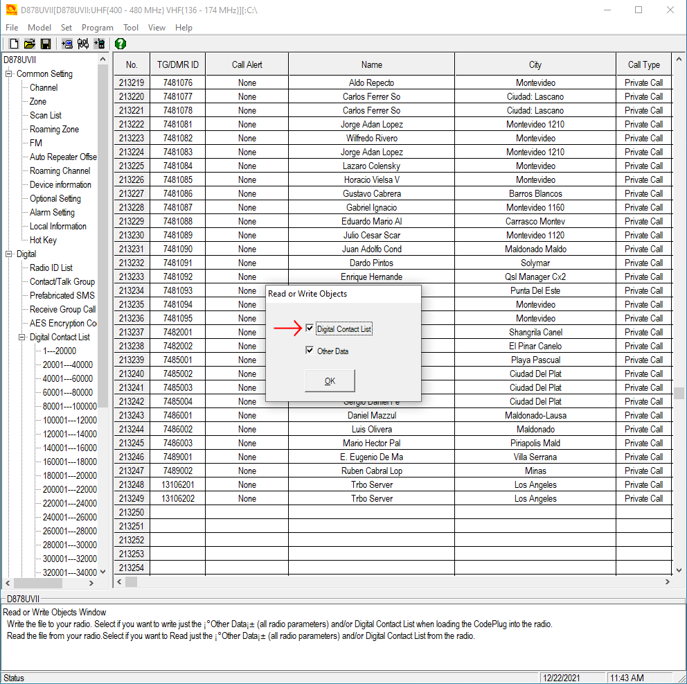

Enjoy having an updated contact list! You should now start seeing callsigns and names instead of just numbers.

*© 2021 Jim Blocker KF5IW · jim@kf5iw.com · Version 20211222*
