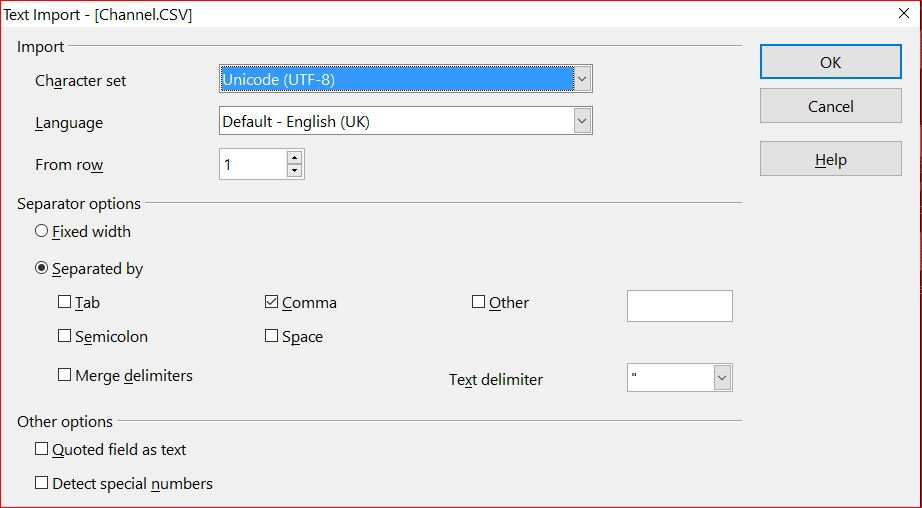
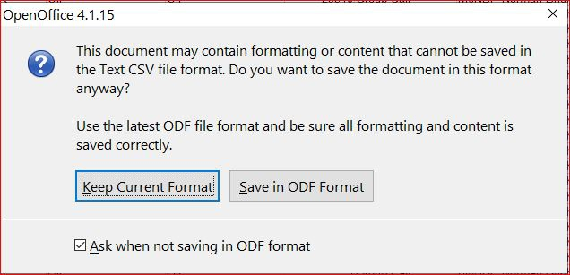

# Anytone D868UV Edit CSV with OpenOffice

!!! info "Source"
    Originally published by Norman Williams on hamradiosouthernrepeaters.co.uk. [Original PDF](../originals/images/PDF/Anytone_D868UV_Edit_CSV_with_OpenOffice.pdf) · [Source](https://hamradiosouthernrepeaters.co.uk/images/PDF/Anytone_D868UV_Edit_CSV_with_OpenOffice.pdf) Hub item 22.

1. Open CSV file. (Comma)

    

    *Text Import: Character set = Unicode (UTF-8), Language = Default - English (UK), From row = 1, Separated by selected, Comma ticked.*

2. Save file. (Keep Current Format)

    
