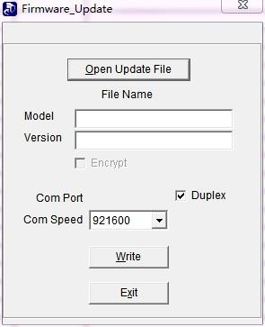

# D168UV Firmware Update

!!! info "Source"
    Originally published by Norman Williams on hamradiosouthernrepeaters.co.uk. [Original PDF](../originals/images/Anytone/AT-D168UV_Firmware_update_and_MCU_Reset.pdf) · [Source](https://hamradiosouthernrepeaters.co.uk/images/Anytone/AT-D168UV_Firmware_update_and_MCU_Reset.pdf) Hub item 13.

1. **Before Starting, BACK UP YOUR CODEPLUG FILE! Also, If your radio model is equipped with APRS and GPS, please make sure they are turned off to prevent CPU or Memory IC damage in the radio.**

    In the CPS Software click → Set → Set Com, choose the correct Com port for your radio.

    

2. Use the USB C cable to connect PC and radio
3. Hold pressing down the PF1 key and PF2 key (two keys below PTT) at the same time, power on radio, the red LED will begin blinking.
4. In CPS → Tool → Firmware and Icon Update, choose “Open Update File” and select the FW or Icon SPI file you want to update to:

    

    *Firmware_Update window: Open Update File and Com Speed = 921600 highlighted.*

5. Click Open Update File and choose appropriate SPI file:

    

    *Firmware_Update: Com Speed = 921600, Duplex ticked.*

    a.) For FW Update use the SPI file from the FW Update Folder

    Note: For Icon Update please see separate Icon Update Instructions

6. Once you have the file selected, click Write to update the radio to the latest firmware. After the Firmware update, the radio will reboot and should return to normal display on screen.
7. **IMPORTANT!!!** You must do a MCU Reboot to the radio to activate the new firmware. Failure to do so can cause erratic behavior or freezes.

**Important Notice:** Again, please make sure before performing the steps below, that your codeplug is backed up off your radio.

## 9.) Rebooting the MCU (radio reset)

After updating the firmware, you need to reset to the radio Main Control Unit (MCU) as follows:

a.) Power off the radio first.

b.) With the radio off, Push the PTT button, and the Button directly below it. That button is also called the PF1 Key. Then While holding both buttons, Turn the power on, and wait for the radio to boot. Don’t release them yet.

**\*\*\* Please Wait – and do not turn the radio off while it restarts \*\*\***

c.) The radio will start up and the display will show:

> Are you sure
> you want to
> Initialize the radio?
> Confirm Exit

**\*\*\* Push the black key with the Green – also known as the MENU key, to confirm the MCU Reboot / Initialization \*\*\***

d.) After the MCU reboot is confirmed, you will have to set the time zone, date and time and information as follows:

- Use the PF1 key to scroll or navigate through the GMT date / time fields
- Note the active field for data set will be shown in Red text
- Up and Down arrow keys will allow you to change the information in the fields
- AFTER you have all the correct information entered, use the Green menu key to confirm the settings and the radio will restart.

e.) You will now have to reload your saved code plug as the final step
