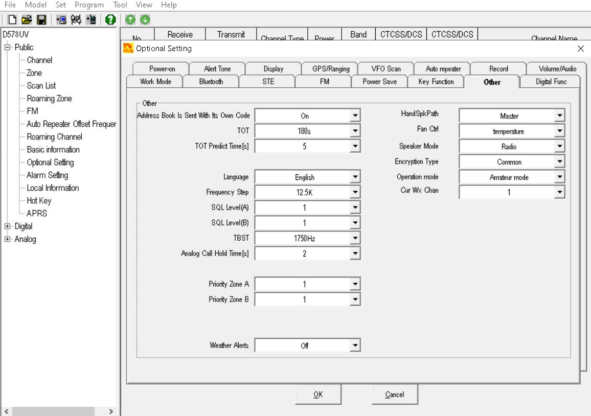

# Change Band/Mode with Existing Codeplug

!!! info "Source"
    Originally published by Norman Williams on hamradiosouthernrepeaters.co.uk. [Original PDF](../originals/images/Anytone/Change_Band-Mode_with_Existing_Codeplug.pdf) · [Source](https://hamradiosouthernrepeaters.co.uk/images/Anytone/Change_Band-Mode_with_Existing_Codeplug.pdf) Hub item 77.

Depending on your needs and codeplug you might only need to do Step 2.

1. Open Existing codeplug and [Export All CSV](export-and-import-all-csv.md) and take note of the \*Optional Settings.
2. Change Band/Mode in Radio. [Page 1 and Page 2 on this link](change-mode-868878578.md) or Page 2 below on this document if your radio lets you do it via the radio. (UK we want to change to Band 0.)
3. Read radio back to CPS. Now you will have a blank codeplug in the correct Band/Mode.
4. [Import All CSV](export-and-import-all-csv.md) to rebuild your codeplug.
5. Go back over your Optional Settings as in Step 1 and set as required.
6. Send Codeplug to radio.
7. Save this as your new working default codeplug.

## \*Optional Settings

**CPS → Left menu → Optional Settings**

*Optional Setting → Other: Address Book Is Sent With Its Own Code = On, TOT = 180s, TOT Predict Time[s] = 5, Language = English, Frequency Step = 12.5K, SQL Level(A) = 1, SQL Level(B) = 1, TBST = 1750Hz, Analog Call Hold Time[s] = 2, Priority Zone A = 1, Priority Zone B = 1, Weather Alerts = Off, HandSpkPath = Master, Fan Ctrl = temperature, Speaker Mode = Radio, Encryption Type = Common, Operation mode = Amateur mode, Cur Wx Chan = 1.*

!!! tip
    Keep a copy of the 16 tabs info. Best to just take photos.

## Page 2

### 868 878 Test/Change Mode

Turn radio off. Hold **PTT** and **1** key in and turn radio on. Change mode. Turn radio off and on.

### 578 Test/Change Mode

Turn radio off. Hold **P4** and **Channel** knob in and turn radio on. Change mode. Turn radio off and on.

!!! warning
    The above procedures have changed in newer radios and will no longer work. If this happens, you now require software as outlined in **Step 2** above.
