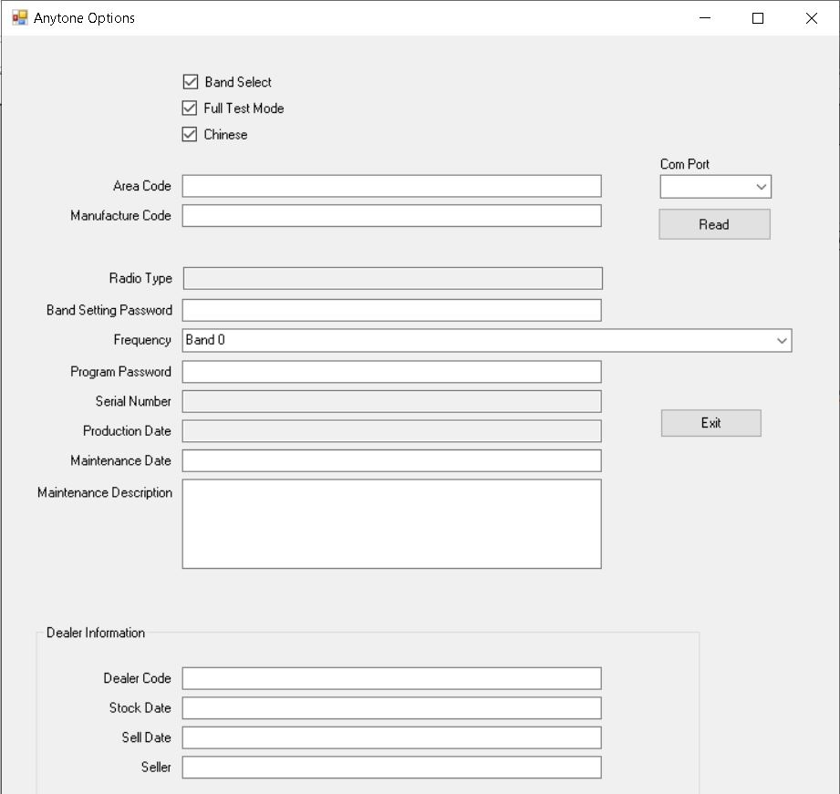
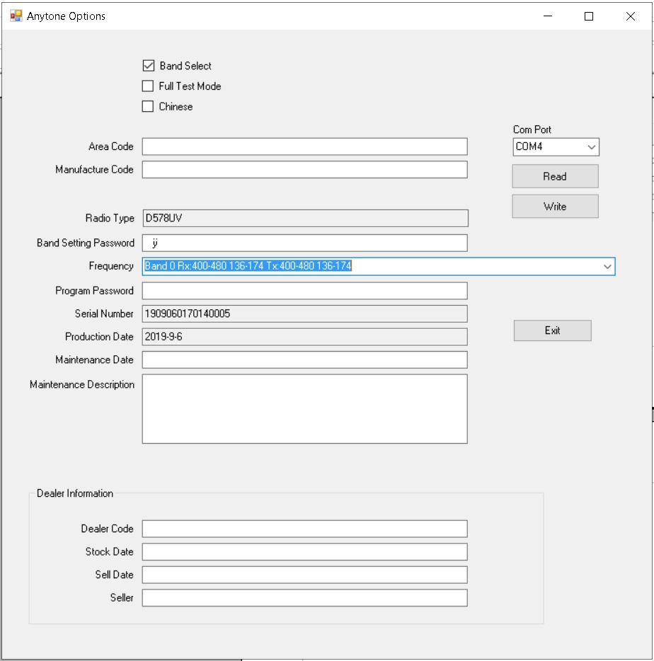
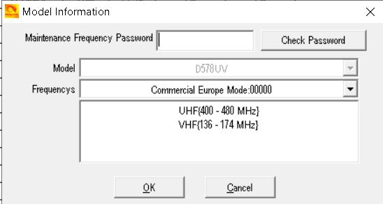

# Change Mode 168-868-878-578-6X2

!!! info "Source"
    Originally published by Norman Williams on hamradiosouthernrepeaters.co.uk. [Original PDF](../originals/images/Anytone/Change_Mode_868878578.pdf) · [Source](https://hamradiosouthernrepeaters.co.uk/images/Anytone/Change_Mode_868878578.pdf) Hub items 37, 61.

!!! warning
    Doing this mod can/will void your warranty.

Download this “[AT Options version 9](../mods/868-878/02-band-error.md)” software and un-Zip with ([7-Zip](https://www.7-zip.org/download.html) – [Video 1](https://www.youtube.com/watch?v=wmY1uIpRRdg&feature=youtu.be&t=64) – [Video 2](https://www.youtube.com/watch?v=-7iq11xxz8k&feature=youtu.be&t=57)).

!!! note
    Software requires Windows 7 or higher.

*Anytone Options: Band Select, Full Test Mode and Chinese ticked; Frequency = Band 0; Com Port empty with a Read button.*

1. Open the software by double clicking on `AT_Options.exe`.
2. Plug the radio into the computer.
3. Set **Com Port**.
4. Then click **Read**. The radio will send info and reboot. The info for that radio is now in the software.
5. Go to **Frequency** and you will see what your radio default is. In the UK we want to change to **Band 0**. Use the pull down to select the band you want.
6. Now **Write** back to the radio.

    

    *Anytone Options: Com Port = COM4, Radio Type = D578UV, Frequency = Band 0 Rx:400-480 136-174 Tx:400-480 136-174, with Read and Write buttons.*

7. Next, in **CPS → Model → Model Information**, make sure the Band displayed matches what you have now set the radio to.

    

    *Model Information: Model = D578UV, Frequencys = Commercial Europe Mode:00000, UHF (400 - 480 MHz), VHF (136 - 174 MHz).*

## Options

1. Read the radio to the CPS and build your codeplug.
2. Via [Import CSV](export-and-import-all-csv.md), rebuild your codeplug.

Remember to save this as your working codeplug.

That is it.
