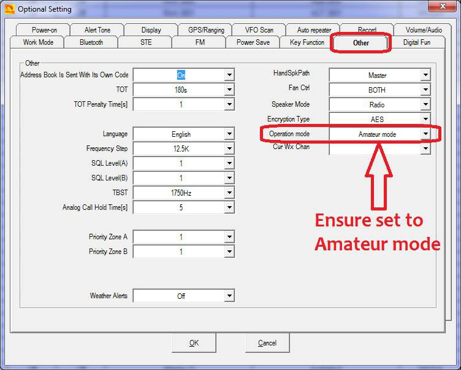

# Codeplug update to New Version of CPS

!!! info "Source"
    Originally published by Norman Williams on hamradiosouthernrepeaters.co.uk. [Original PDF](../originals/images/Anytone/Codeplug_update_to_New_Version_of_CPS.pdf) · [Source](https://hamradiosouthernrepeaters.co.uk/images/Anytone/Codeplug_update_to_New_Version_of_CPS.pdf) Hub item 21.

This is the correct way to update.

Seems like lots of people are suffering lots of **strange or odd things happening** with their Radios. I found this process helps in many cases:

1. In CPS, export everything (**Tool → Export → Export All**)
   \*Also write down or photograph all the Optional Settings.
2. MCU RESET [868/878](http://hamradio.joomla.com/images/Anytone/MCU_Reset__868__878.pdf) & [578](http://hamradio.joomla.com/images/Anytone/D578UV_FW_and_MCU_Reset.pdf) the radio - this step is very important!
3. Close and re-open the CPS. Now read from the freshly reset radio (yes, you are reading a ’blank’ radio, that is OK)
4. Import everything saved from step 1
5. \*Finish off your codeplug by filling in the Optional Settings you took down in No1.
6. Send the freshly rebuilt codeplug to the radio.
7. If you had a custom start up picture or background pictures, send those to the radio now.
8. Finally, save the codeplug and ensure you use this saved file as the basis for any further changes you may make.

## Radio doing some weird things?

Can't program buttons with functions you want / APRS not working / functions you want are not available? And you've already tried a reset too? Try this! "Professional mode" does not give you anything extra - in fact it highly restricts what the radio can do. Picture below shows the setting to tweak in the 578. There's a similar setting for the 878 too.

*Optional Setting → Other: Operation mode = Amateur mode (circled); also TOT = 180s, Language = English, Frequency Step = 12.5K, TBST = 1750Hz, HandSpkPath = Master, Fan Ctrl = BOTH, Speaker Mode = Radio, Encryption Type = AES.*

By Jason Reilly
