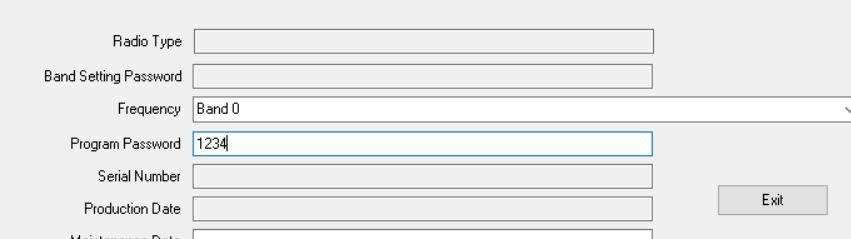

# CPS Programming password lock

!!! info "Source"
    Originally published by Norman Williams on hamradiosouthernrepeaters.co.uk. [Original PDF](../originals/images/Anytone/CPS_Programming_password_lock.pdf) · [Source](https://hamradiosouthernrepeaters.co.uk/images/Anytone/CPS_Programming_password_lock.pdf) Hub item 100.

Apart from the power on password, there is also a hidden programming password that will require a four character password to be entered in the CPS software before it will do any read or write operation. **The password must be four characters, no more or less**, and can be made up of any standard ASCII characters that can be typed on a keyboard. To do this, use Colin's AnyTone Options application (download link below) to enter a Program Password. To disable any program password that may be present, just use the backspace button to delete the password and leave this field blank; then write back to the radio.
Info Taken from -
( [https://hamradiosouthernrepeaters.co.uk/images/878Mods/878techmods.html#Password](../mods/868-878/67-password.md) )

**Download  AnyTone Options application**
[AT_Options 8.zip](https://mega.nz/file/HxVUTbbI#zUdyTNjXF1gOdanSrRALbWiajamGf6Yey_Gcn2z-wqM)

*AnyTone Options: Frequency = Band 0, Program Password = 1234.*

**Password will require four character only**

Use the AnyTone Options software
Read Radio
Set Password ( **four characters** )
Write back to radio
