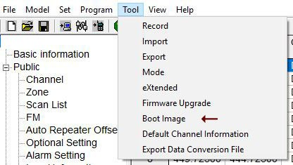
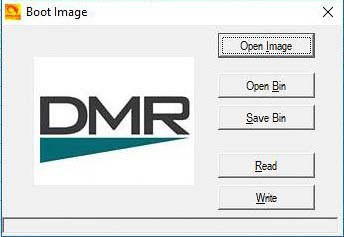
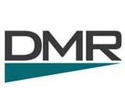

# Customized Opening Screen Made Easy

!!! info "Source"
    Originally published by Norman Williams on hamradiosouthernrepeaters.co.uk. [Original PDF](../originals/images/Anytone/Customized_Opening_Screen_Made_Easy.pdf) · [Source](https://hamradiosouthernrepeaters.co.uk/images/Anytone/Customized_Opening_Screen_Made_Easy.pdf) Hub item 24.

BTech DMR6X2
Anytone D868 / 878UV

**Customized Opening Screen Made Easy**

John 'Miklor' K3NXU

## Create the Initial image

You must first create the desired image with the proper screen ratio.
In this case the ratio is 5x4. (.jpg)

Although the native resolution of the screen is 128x160 pixels, it is recommended to always use a higher resolution when entering the graphic.

800x1000 pixels is a good resolution, and the software will adjust it downward for the clearest image.

## Uploading the Image

Once the image is created, open the software and select:
**Tool → Startup Picture (Boot Image)**

Select 'Open Image' and enter the location of your graphic.
It will appear in the Boot Image window.

With your programming cable connected and the proper COM port selected, Select 'Write'.

To activate the new image, select the following via the keypad.

**Menu → Settings → Radio Set → Intro Display → Customer's Pic (customized)**

Here's the DMR image that you can use for practice.

That's all there is to it. Enjoy...

## Links in the original PDF

- [http://www.miklor.com/DMR/images/Startup%20Images/DMR.jpg](http://www.miklor.com/DMR/images/Startup%20Images/DMR.jpg)
