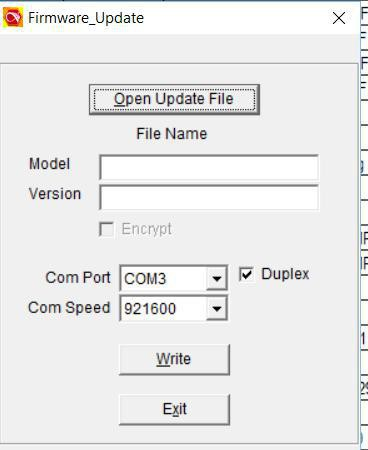
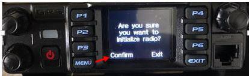
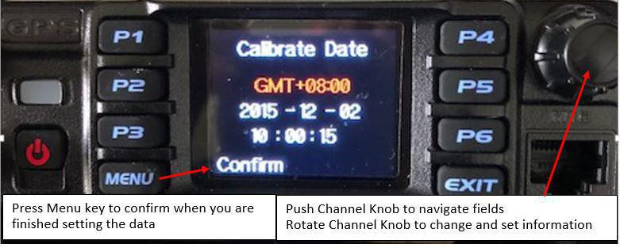

# D578UV Mobile Radio Firmware Update Instructions

!!! info "Source"
    Originally published by Norman Williams on hamradiosouthernrepeaters.co.uk. [Original PDF](../originals/images/Anytone/D578UV_FW_and_MCU_Reset.pdf) · [Source](https://hamradiosouthernrepeaters.co.uk/images/Anytone/D578UV_FW_and_MCU_Reset.pdf) Hub item 14.

\* Note: Once the radio is put in the FW update mode you must complete the FW Update Write to prevent the radio from staying in the Update Mode \*\*

1. Power the radio "ON".
2. Press and Hold both the MENU and EXIT keys.
   Now power the radio "OFF"
3. The red LED light should now blinking, and the radio has entered into firmware update mode.
4. Use the USB cable to connect radio to your PC.
5. Open the radio Computer Programming Software (CPS) and go to **TOOLS → Firmware Update**

    

    *Firmware_Update: Com Port = COM3, Com Speed = 921600, Duplex ticked, Encrypt greyed out.*

6. Select the Open File button and select the appropriate D578UV.spi file in the FW Update folder
7. Check and Set the Com Port that is correct for your PC connected to the radio.
8. Select the Write button to write the new FW to the radio.
9. After the firmware update is finished, you must perform a Reset of the Radio (MCU Reboot).

## Radio Reset / MCU Reboot

1. To Reset the Radio: Press and Hold the two front panel keys P2 and the Channel Knob (the one above the microphone connector) Hold these two keys while turning on the radio and it will reboot the radio into the Reset Mode.
2. The radio Reset Screen will appear and ask you to Confirm the reset by pressing the Menu key on the front panel. The reset itself will take a minute or more.

    

3. After completing the reset, the Calibration Date settings screen will open. You need to set the correct information by using the Channel Knob. Pushing the Channel Knob will navigate through the GMT, Date and Time fields, Rotating the Channel Knob will allow you to change the settings. When finished setting the data, use the Menu button to Confirm and the radio will reboot.

    

4. After successfully resetting the radio, your codeplug will be gone and the factory smaller version loaded. You should now load your saved Code Plug into the radio. Check the Com Port, and from the CPS write your codeplug into the radio. No special set-up is required to write a codeplug into the radio.

## If the radio does not let you do a MCU Reset.

**Make sure Power-on Password is turned off**

Save Codeplug
Now Send codeplug to radio

Follow instruction as above in second part off this document.
