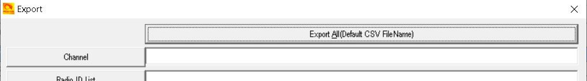
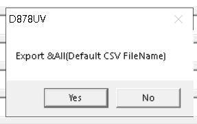
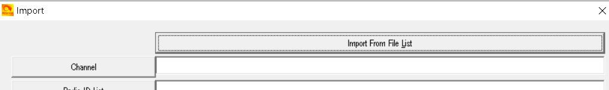
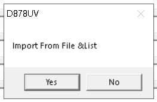

# Export and Import All CSV

!!! info "Source"
    Originally published by Norman Williams on hamradiosouthernrepeaters.co.uk. [Original PDF](../originals/images/Anytone/Export_and_Import_All_CSV.pdf) · [Source](https://hamradiosouthernrepeaters.co.uk/images/Anytone/Export_and_Import_All_CSV.pdf) Hub item 44.

## Export

1. **CPS (top line) → Tool → Export**
2. Click in centre tab – **Export All (Default File Name)**.

    

    *Export window: Export All (Default CSV FileName) button.*

3. Give the file a name and save to a folder you can find again.

    

    *Dialog: Export &All(Default CSV FileName), Yes / No.*

[VIDEO](https://www.youtube.com/watch?v=5H_JOV00ZFE)

## Import

1. **CPS (top line) → Tool → Import**
2. Click in centre tab – **Import From File List**.

    

    *Import window: Import From File List button.*

3. Go to the saved file you did in the step above and import.

    

    *Dialog: Import From File &List, Yes / No.*

[VIDEO](https://www.youtube.com/watch?v=5H_JOV00ZFE)

## After importing

- **Optional Settings:** you will have to go back over each tab to make sure it has the setting you want.
- **APRS:** you will have to make sure all is correct.
- **Hotkeys:** you will have to make sure all is correct.
