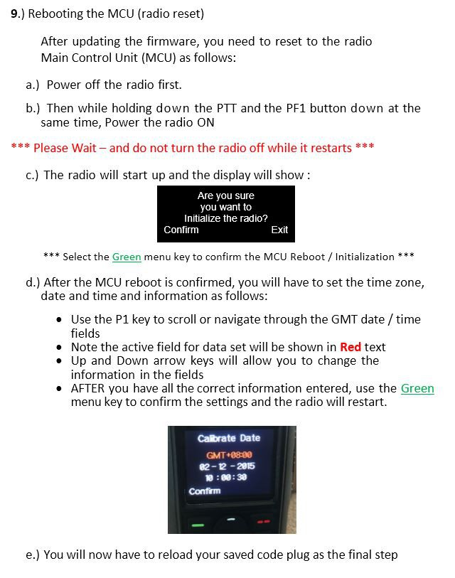
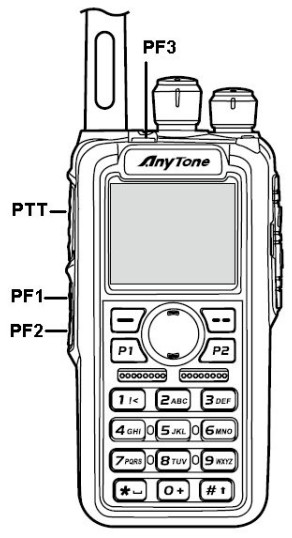

# MCU Reset – 868 & 878

!!! info "Source"
    Originally published by Norman Williams on hamradiosouthernrepeaters.co.uk. [Original PDF](../originals/images/Anytone/MCU_Reset__868__878.pdf) · [Source](https://hamradiosouthernrepeaters.co.uk/images/Anytone/MCU_Reset__868__878.pdf) Hub item 13.

## 9. Rebooting the MCU (radio reset)

After updating the firmware, you need to reset the radio Main Control Unit (MCU) as follows:

1. Power off the radio first.
2. Then, while holding down the **PTT** and the **PF1** button at the same time, power the radio on.

    !!! warning
        Please wait, and do not turn the radio off while it restarts.

3. The radio will start up and the display will show the initialise prompt. Select the green **MENU** key to confirm the MCU reboot / initialisation.
4. After the MCU reboot is confirmed, you will have to set the time zone, date and time information as follows:

    - Use the **P1** key to scroll or navigate through the GMT date / time fields.
    - The active field for data set will be shown in red text.
    - The **Up** and **Down** arrow keys will allow you to change the information in the fields.
    - After you have all the correct information entered, use the green **MENU** key to confirm the settings and the radio will restart.

5. You will now have to reload your saved codeplug as the final step.

## If the radio does not let you do a MCU reset

You need to turn it on in the CPS. See how below.

!!! note
    Also make sure Power-on Password is turned off.

1. Go to **CPS → Optional Settings → Power on** and set Startup Reset = ON.

    

    *Startup Reset = On.*

2. Save the codeplug.
3. Now send the codeplug to the radio.
4. Follow the instructions as above in the first part of this document.

*Drawing labelling PTT, PF1, PF2 and PF3.*
