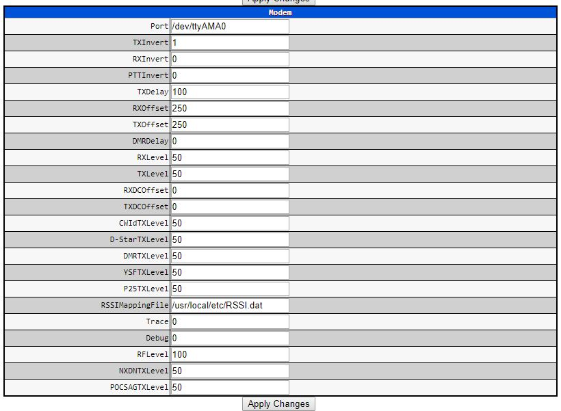

# Hotspot Offset Calibration

!!! info "Source"
    Originally published by Norman Williams on hamradiosouthernrepeaters.co.uk. [Source](https://hamradiosouthernrepeaters.co.uk/dmr-info/2-uncategorised/63-hotspot-offset-calibration.html)

To use pistar-mmdvmcal to calculate TXoffset:

**A. Preliminaries:** Set DMR rig to desired hotspot [\*frequency](hotspot-offset-calibration.md), CC1 Slot1 TG9. Call it Fd (in Hz). In Pi-Star set TXoffset and RXoffset to zero, otherwise they'll screw up the calculation.

**B.** Connect to your Pi-Star setup with SSH.

**C.** Type `sudo pistar-mmdvmcal` and press **Enter**.

**D.** Tap the **E** key and enter the TX frequency, Fd, of your hotspot in Hz.

**F.** Tap the **M** key. The hotspot generates a DMR tone.

**G.** Tap **Space**. The hotspot transmits the tone. You should hear the tone on the rig.

**H.** Repeat presses on the **f** key until the tone disappears. Note this frequency as f.

**I.** Repeat presses on the **F** key until the tone reappears; keep going until it disappears again. Note this frequency as F.

**J.** **Q** to quit.

## The calculation

You have 3 frequencies, Fd, f and F, to play with. f is the lower edge of the hotspot transmission and F is the upper edge of the hotspot transmission. Assuming the transmission is symmetrical around its peak value, the average of f & F gives the peak frequency of the hotspot transmission, i.e. where it is actually transmitting.

So the hotspot is TXing at freq. {(F+f)/2} Hz.

TXoffset is the difference between rig and hotspot TX frequencies:

`TXoffset = Fd - {(F+f)/2}`

TXOffset & RXoffset don't have to be the same, but for starters set both to the calculated value. If BER isn't good, vary RXoffset only until it is. That's about it.

Thanks to Vic Simpson for this.

You might also want to look at this [link](http://www.k9npx.com/2019/02/hotspot-offset-calibration.html?&m=1).

## \*UK hotspot frequencies

| Frequency | Use |
|---|---|
| 434.000 | [Low Power Non-NoV Personal Hot-Spot](https://rsgb.services/public/bandplans/html/rsgb_band_plan_2019.htm) |
| 438.800 | [Low Power Non-NoV Personal Hot-Spot](https://rsgb.services/public/bandplans/html/rsgb_band_plan_2019.htm) |

## See also

- [Hotspot Offsets](../networks-hotspots/hotspot-offsets.md)
- [Hotspot Users BER rate V2](../networks-hotspots/hotspot-users-ber-rate.md)
