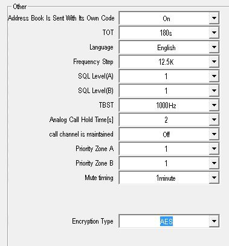
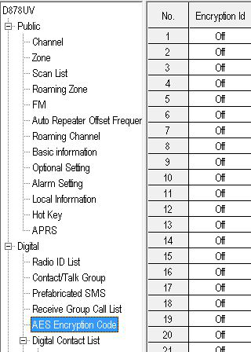
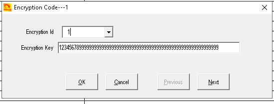
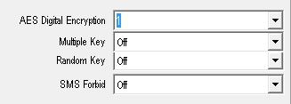

# Anytone encryption to Motorola / Hytera

!!! info "Source"
    Originally published by Norman Williams on hamradiosouthernrepeaters.co.uk. [Original PDF](../originals/images/Anytone/Anytone_encryption_to_Motorola_Hytera.pdf) · [Source](https://hamradiosouthernrepeaters.co.uk/images/Anytone/Anytone_encryption_to_Motorola_Hytera.pdf) Hub item 128.

Read this first: [https://hamradiosouthernrepeaters.co.uk/images/878Mods/878techmods.html#Encryption](../mods/868-878/21-encryption.md)

If you want a Motorola and an Anytone to work together on an encrypted channel, you have to set both radios to AES256 (open standard) and of course let them use the same key. The Anytones all support that with their actual firmware, but not every Motorola does.

## 878 & 578 Anytone settings (not offered on 868)

1. First set Encryption Type to AES in **CPS → Optional Setting → Other**.

    

    *Other tab: Encryption Type = AES.*

2. Second, set the key in **AES Encryption Code**.

    

    

    *Encryption Code dialog: Encryption Id = 1; a long Encryption Key entered.*

    Take note of the Encryption ID number you have allocated (= 1). We will use this ID in the next step.

    The Encryption Key will be the same one you use in the Anytone, Motorola or Hytera.

!!! note
    Be aware that both radios fill the key with leading zeros if the key is shorter than the maximum. Motorola doesn't show them, the AnyTone CPS does. But they work together anyway.

!!! warning
    If security really matters, please realize that SMS and transmitted GPS data will be sent without encryption.

## Channel Settings

*AES Digital Encryption = 1; Multiple Key = Off; Random Key = Off; SMS Forbid = Off.*

AES Digital Encryption – you will see it is set to 1, as we used that in the step above. If the Encryption ID was 2 you would set 2 in the channel, etc.

Thanks to [Markus Große-Schware](https://www.facebook.com/profile.php?id=100000065562093) for help on this.
