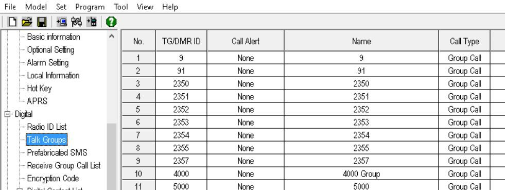
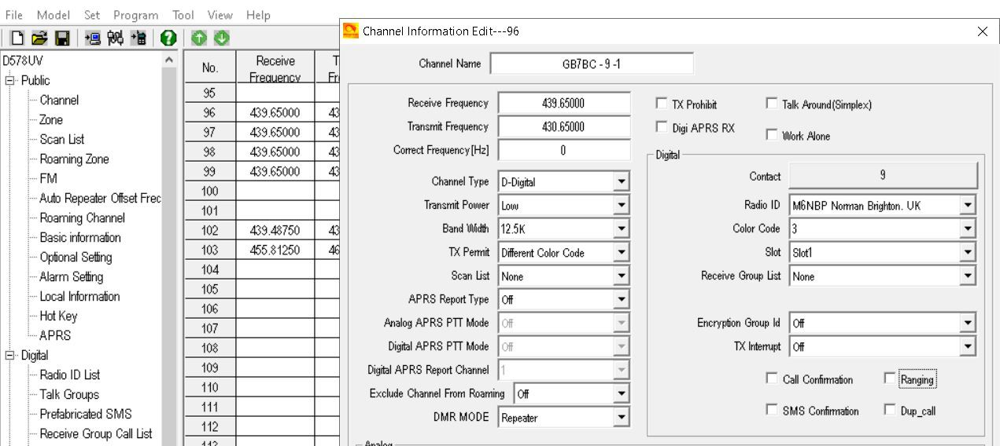
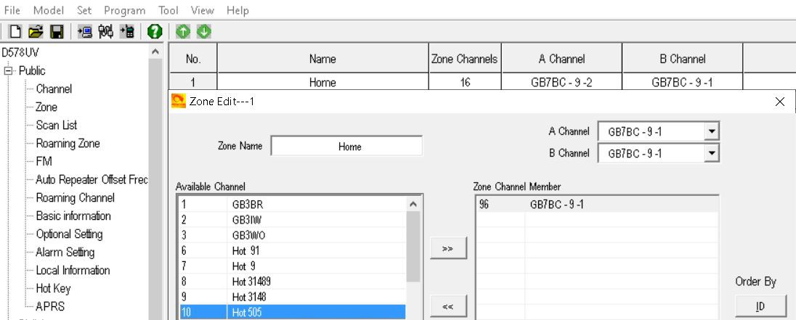
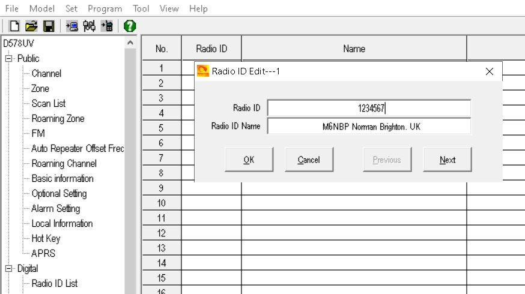

# DMR is like making a phone call V3

!!! info "Source"
    Originally published by Norman Williams on hamradiosouthernrepeaters.co.uk. [Original PDF](../originals/images/PDF/DMR_is_like_making_a_phone_call_2.pdf) · [Source](https://hamradiosouthernrepeaters.co.uk/images/PDF/DMR_is_like_making_a_phone_call_2.pdf) Hub item 39.

[Talk Groups](http://hamradio.joomla.com/dmr-info/2-uncategorised/61-access-talk-groups.html) is just like phone numbers.

Zones is your Address book, A to Z

Channels is the Frequency you wish to talk over.
This could be your local repeater, Simplex or Hotspot.

DMR Repeater is like having 2 phone lines. Line 1 and Line 2
Line 1 is called Slot 1
Line 2 is called Slot 2

DMR Simplex Hotspot has one phone line. Line 2 normally
Line 2 is called Slot 2

DMR Duplex Hotspot has two phone lines. Line 1 and Line 2
Line 1 is called Slot 1
Line 2 is called Slot 2

Talk Group is all the Phone numbers you wish to call.
TG9, TG2350, TG2351, TG2352, TG310, TG91 etc

## Now for the fun part and making a call

So we will work a local DMR repeater and at this point we need to know -

1. What phone (DMR) network we will be using.
2. This could be FreeDMR, BrandMeister, Phoenix, DMR+, or another provider.
3. The networks do not talk to other networks in general.
4. You need to know, do they use Talk Groups.
5. As a rule Talk Groups is on Line 1 (Slot 1) but some networks use Slot 2 also.
   *(Simplex / Duplex Hotspots can use Slot 2 for Reflectors or Talk Groups)*
6. All Reflectors only work on Line 2 (Slot2)
7. You will also need to know what Color Code the Repeater is using.

**In this next stage, I will do an example that will work on all Networks.**

1. We need to know the Frequency of the repeater RX and TX
2. We need to know what Talk Groups it offers
3. (Example) Talk Group 9 is normally the default for local talk to all within range off the repeater.
4. We need to know the Repeaters Colour Code

(TG9 via Hotspots is not required, unless you use Reflectors on Slot 2)

(Example) First we need to add 9 to the Talk Group list (9 is the phone number)
Talk Groups is always added as a **Group Call**

*Talk Groups: 9, 91, 2350 to 2355, 2357, 4000 (named "4000 Group") and 5000, all with Call Alert = None and Call Type = Group Call.*

Second we need to make a channel for the repeater.
We will be talking on Talk Group 9 for local chat on Slot 1

*Channel GB7BC - 9 -1: Receive Frequency 439.65000, Transmit Frequency 430.65000, Channel Type = D-Digital, Transmit Power = Low, Band Width = 12.5K, TX Permit = Different Color Code, Contact = 9, Color Code = 3, Slot = Slot1, DMR MODE = Repeater.*

You will see in the right hand box – Contact
This is where you point to the Talk Group you wish to talk on. (Phone Number)
Again in this example it is 9.
It can be any number you have added in the step above.
We also want it to be on Slot 1 (Line 1)

Name the Channel what is beset for you -
I have used the Repeater Name – 9 the Talk Group – 1 as it is on slot 1

I will skip over all the other setting.
You can use the ones as shown in the photo above.
Apart from the FREQ, Color Code,

**Radio ID I will go over later in this document.**

**Now we need to add that Channel to your Address Book (Zone)**

*Zone Edit: Zone Name = Home, A Channel and B Channel = GB7BC - 9 -1; Zone Channel Member 96 GB7BC - 9 -1.*

That is it.
Save the file “Codeplug” and Send to the Radio.
So now via the radio you can go to the Zone.
Select the channel that lets you talk on Slot 1 to Talk Group 9
When you PTT the radio you will be talking on Talk Group 9 via that repeater.

If you wish to talk on another Talk Group, you just follow the steps above.

## Radio ID List.

This is your Personal Phone number. [(Request your DMR ID Number)](https://www.radioid.net/register#!)
It is made up off 7 digits
This is the ID number that is sent out every time you press the PTT.
Radio ID Name – Is what you want your Radio Called
**WITHOUT a VALID ID number you CAN NOT use Ham Radio DMR Networks.**

*Radio ID Edit: Radio ID = 1234567, Radio ID Name = M6NBP Norman Brighton. UK.*
