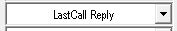
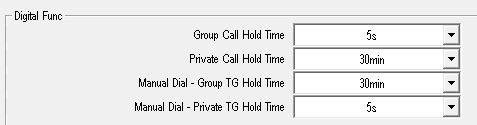

# How to use Radio v3

!!! info "Source"
    Originally published by Norman Williams on hamradiosouthernrepeaters.co.uk. [Original PDF](../originals/images/Anytone/How_to_use_Radio.pdf) · [Source](https://hamradiosouthernrepeaters.co.uk/images/Anytone/How_to_use_Radio.pdf) Hub item 19.

OK some help for users with the Moonraker Code Plug

Your on TG9 (or any other Talk Group) with **Digi moni on**.

Set a Key Function for LastCall Reply

*Key function = LastCall Reply.*

You pick up a call on another Talk Group and wish to talk back.
Press the function key.
A window will pop up ( Last Call reply Set Success )
Now you can talk on that Talk Group.

Depending on what hold time settings you have set in Digital Fun, will be how long you stay on that talk group. (30mins/Infinity)

*Digital Func: Group Call Hold Time = 5s, Private Call Hold Time = 30min, Manual Dial - Group TG Hold Time = 30min, Manual Dial - Private TG Hold Time = 5s.*

If you wish to save it as a channel use the # key After RX.
It will save to the first available channel in the Zone you select.
You can go back and name the channel later.

---

## Key Function

**0 key** - Hold down to go to Private ID (Newer Firmware Talk Group ID)

**0 key** - Hold down and then # to go to Talk Group ID (Newer Firmware Private ID)

**# key** - When in menu this will go back to the display rather than going back-back-back

**# Key** - After RX it will save to the first available channel in the Zone you select

**\* key** - Long hold will lock the keypad
**Menu then \* key** - Unlock the keypad

---

Now you have saved lets say 10 channels.
Read the radio back to the CPS.
Go to the new channels and Name. (Should be the last entries in the Channel)
Go to Zone and put in the order you wish them.
Send Code Plug Back to the radio.

Personally I never save channels.
I just use manual dial (\* #) or the \* key to get the Talk Group I Wish to use.

The Anytone you do not need 30 channels per repeater and this is why you can work all with two channels per repeater and using the functions the Anytone Radio offers.

---

To make a call on a Talk Group not in your channels.
0 key Hold down and then # to go to Talk Group ID
Type in the TG number you wish ( 840 )
Press the PTT and talk as your now on that Talk Group.

Depending on what hold time settings you have set in Digital Fun will be how long you stay on that talk group. (30mins/Infinity)

---

The Anytone replaces the Hacked MD380 as all Features come as standard to use the Radios for Ham use.

Two to 4 channels per repeater/hotspot is all that is required.
Slot 1 TG9 = Local use on a Repeater.
Slot 2 TG9 + Local use on a Repeater - Unless your on a network that uses Reflectors
*(TG9 can be Any Talk Group you wish example 3100 etc)*

You can add 4000 disconnect Channels is you so wish.
4000 as a Private Call will ONLY disconnect Reflectors (Hytera and Motorola Repeaters)
4000 as a Group Call will discontent Reflectors and Talk Groups (Hotspots and Repeaters Slot 1)
4000 will not Disconnect Static Talk Groups

Depending on what DMR Networking your using, you should look up and see if a 4000 disconnect is Group or Private.
