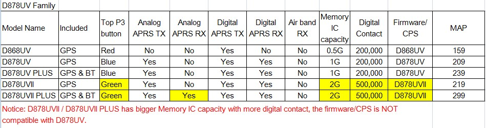
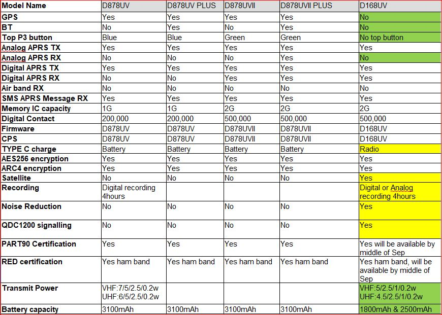
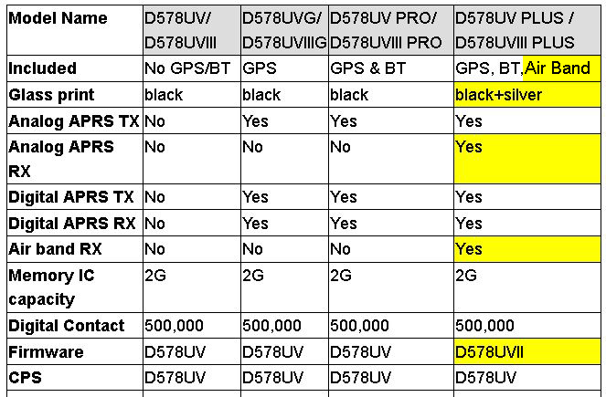

# Questions & Answers 868 - 878 - 578

!!! info "Source"
    Originally published by Norman Williams on hamradiosouthernrepeaters.co.uk. [Source](https://hamradiosouthernrepeaters.co.uk/50-questions-answers.html) Hub item 1.

Short URL to this page [http://tiny.cc/AnytoneDMR-QA](http://tiny.cc/AnytoneDMR-QA)

1\. **Why my 168/868/878/578 does not show people’s name and call sign, instead it’s just showing DMR id.**  
A. [You need to load the User Data Base to your radio.](https://kf5iw.com/contactdb.php)

2\. **Aanalogue frequencies are nothing but noise, how do you alter the squelch?**  
A.  CPS - Optional Setting - Other - SQL A and B **or** Radio Menu - Settings - Radio Set - No 21 Ana Sq Level.

3\. **Windows 10 and 11 Drivers.**  
A. ***DO NOT   DO NOT   DO NOT Install the DRIVERS.***  
    Via the USB cable, Plug your radio into the USB on your Windows 10/11 machine.  
    Turn Radio on and let Windows 10/11 install the drivers.  
    You might have to run windows update so it can find the drivers.

4\. **How to update Firmware and CPS.**  
A. In the folder you download. You will find PDF files with full instructions.

5\. **UK can I use this type of radio on PMR 446.**
A. The Simple answer is NO. [Analogue and Digital PMR446 Information Sheet.](https://www.ofcom.org.uk/__data/assets/pdf_file/0025/85156/ir_2009_analogue_and_digita1.pdf)

6\. **BT PTT keeps dropping connection.**  
A. Turn Bluetooth on in the radio. Turn Radio off. Hold down the PTT on the BT Button and turn the radio on.  
    Keep holding down the PTT until the radio say BT PTT connected.

7\. **Radio Freezes up.**  
A. Turn off Date & Time. **Turn off Power Save.** If scanning turn off Sub Channel.  
    In CPS - Digital Fun - *Prewave Time* and *Wake Head Period* = 0ms  
    [Also have a look at this PDF as it could be a bad Codeplug.  
](../cps-firmware/codeplug-update-to-new-version-of-cps.md)    This is the [setting](settings-i-use.md) I use.

8\. **578 - UK can I use Cross Band on a Foundation or Intermediate License.**  
A. The Simple Answer is NO. You would have to get the TX power under 500mW to stay within your license.  
    You also can not leave it untended if you do get it under 500mW.  
    No 3rd party traffic permitted.  
    Intermediate can look into getting a NOV for a Simplex Gateway.

9\. **How do you program, that you can scroll through all 4000 channels manually using the rotary knob.**  
A. You can not.  
    You need to use Zones. Zones can hold up to 250 channels. For 4000 channels you would need 16 zones.

10\. **UK - What frequencies should I use for my Hotspot.**  
A.   434.0000 and 438.8000 Low Power Non-NoV Personal Hot-Spot.

11\. **All of a sudden an alarm activates and the screen flashes "Alarming" how do I stop it?**  
A.  Lone worker alarm..... turn it off in the code plug.

12\. **How do you know if APRS is work.**  
A.  Look yourself up on [APRS.fi.](https://aprs.fi/)

13\. **How do you change from both bands to just one band on the display.**  
A.  Set up a side or front key via CPS - Optional Settings - Key Function for Sub Ch On/Off.

14\. **What aftermarket antennas people are using.**  
A.  Nagoya 701 (But cheap copies around) or [MRW-205R 2/70cm.](https://www.moonraker.eu/mrw-205r-2-70cm-supergainer-with-reverse-sma)

15\. **How to take off the recorded audio files**.  
A.  In the CPS under Tools - Record.

16\. **How to add Zones purely using the keypad?**  
A.  Menu - Zones - Key UP - Add Zone.

17\. **Can the radios be used on standard FM and repeaters.**  
A.  YES.

18\. **Difference between 168 - 868 - 878 - 878plus. 578**  
A.   **868** - DMR APRS.  
      **878** - DMR & Analog APRS, Talker Alias, AES Encryption, Roaming, CCTS/DCS scan  
      **878Plus** - DMR & Analog APRS, Digi APRS RX, Talker Alias, AES Encryption, Roaming, CCTS/DCS Scan, Bluetooth.  
      All 878s have many more features over the 868  
      **878IIPlus** - Same as 878Plus. With Analog APRS RX added.

  

**     578pro** - DMR & Analog APRS, Digi APRS RX, Talker Alias, AES Encryption, Roaming, CCTS/DCS Scan, Bluetooth  
     **578plus** - Same as Pro. With Analog APRS RX and AM AIR Band RX added.  

19\. **What is Roaming.**  
A.  [Google Videos & Info.](https://www.google.com/search?client=firefox-b-d&q=Anytone+878+roaming)

20\. **868 878 Test/Change Mode.**  
A.  Turn radio off. Hold PTT and 1 key in and Turn radio on. Change mode. Turn radio off and on.  
     update - ***This has changed in newer radios and now requires Software. How to use [Document](../cps-firmware/change-mode-868878578.md).***  
     Doing this Mod Can void your warranty.

21\. **578 Test/Change Mode.**  
A.  Turn radio off. Hold P4 and Channel knob in and Turn radio on. Change mode. Turn radio off and on.  
     update - ***This has changed in newer radios and now requires Software. How to use [Document](../cps-firmware/change-mode-868878578.md).***  
     Doing this Mod Can void your warranty.

22\. **Icons missing.**  
A.  [This could help fix the issue.](../cps-firmware/codeplug-update-to-new-version-of-cps.md)

23\. **Icon R is missing when Roaming is on.**  
A   If you activate Bluetooth from CPS or via keyboard, the R icon disappear...  
     The BT icon is in the same place as R

24\. **How many Channels to a Zone.**  
A.  The radio has 250 Zones. A Zone can have the maximum of 160 analog and/or digital channels.

25\. **Please Charge the Battery!  when you PTT.**  
A.  This is due to RF. You most likely changed to a different antenna. [More info on this link](../hardware/correct-antenna-for-anytone-868-878-878plus.md).

26\. **Can not MCU Reset 868 or 878.**
A.   Read 2nd part of this [Document](../cps-firmware/mcu-reset-868-878.md).

27\. **Can not write Code Plug to the radio.**  
A.  Turn off - APRS, GPS, BT in the radio.  
     In CPS make sure you have - Set - Set COM - Select the Com port number.

28\. **Green Irregular Blinking Led.**  
A.  [All it means is RF is being detected.](../troubleshooting/green-irregular-blinking-led.md)

29\. **Where do I put my Callsign in the software.**  
A.  Radio ID List. [Also read this for Talker Alias on the 878 and 578](../contacts-talkgroups/anytone-878-sending-receive-talker-alias.md)

30\. **How to scan between two sets of frequencies.**  
A.  [Read this Document](../scanning-monitoring/how-to-scan-between-two-sets-of-frequencies.md)

31\. **How to do a 4000 Disconnect.**  
A.  4000 as a ***Private Call*** will ONLY disconnect Reflectors (Hytera and Moto Repeaters)  
     4000 as a ***Group Call*** will discontent Reflectors and Talk Groups (Hotspots and Repeaters Slot 1)  
     4000 will not Disconnect [Static Talk Groups](../networks-hotspots/dynamic-talkgroup-and-static-talkgroup-on-brandmeister.md)

32\. **Echo/Parrot via 9990.**
A.  This is down as a Private call. Not a group call  

33\. **SetCommDataByOptionError, SetCommDataBy2toneError, SetCommDataByAutoRepFreqsError.**  
A.  All mean a Bad/Corrupt Codeplug. [Try this and it should fix](../cps-firmware/codeplug-update-to-new-version-of-cps.md).  

34\. **Manual input your DMR ID**.  
A.  Menu - Settings - Chan Set - Radio ID - Select - Option - Edit ID - **Enter new ID** - Confirm - Save - Select Radio ID  

35\. **Bluetooth App issues.**  
A.  APP supports Android 4.3 or higher version.  
     Also does not work on Samsung S10. Anytone is working on a fix.

36\. **Bluetooth App how to use.**  
A.  All info is in the download file
