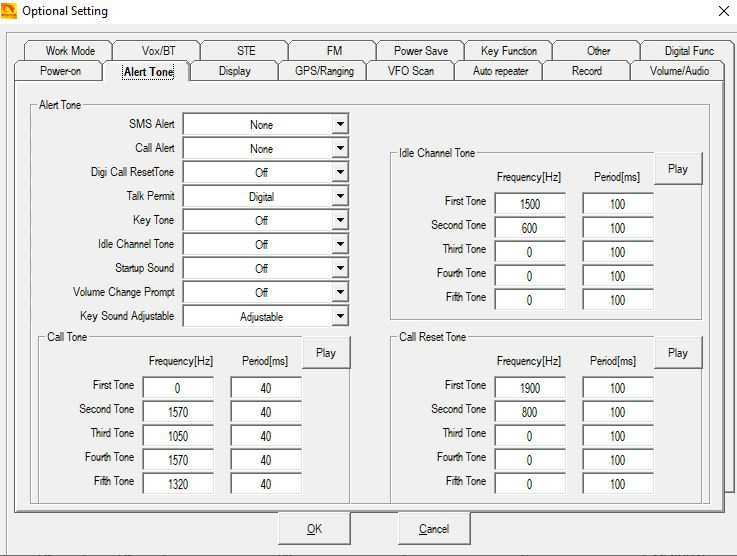
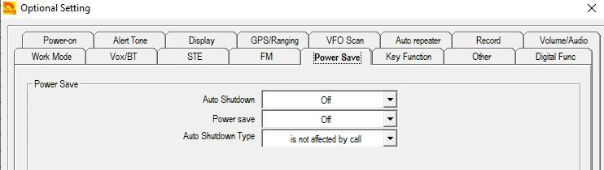
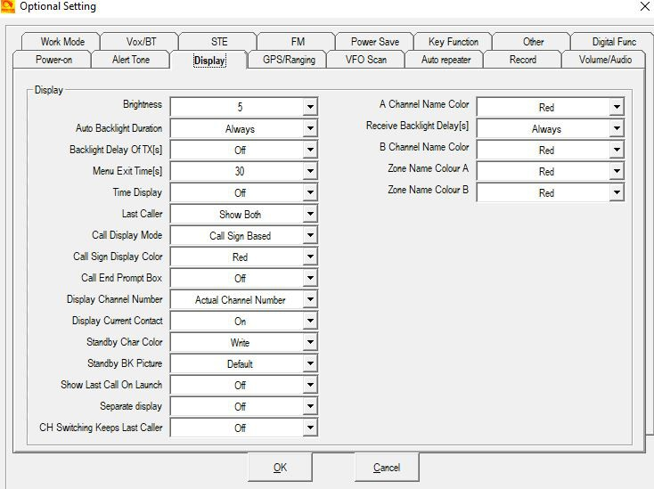
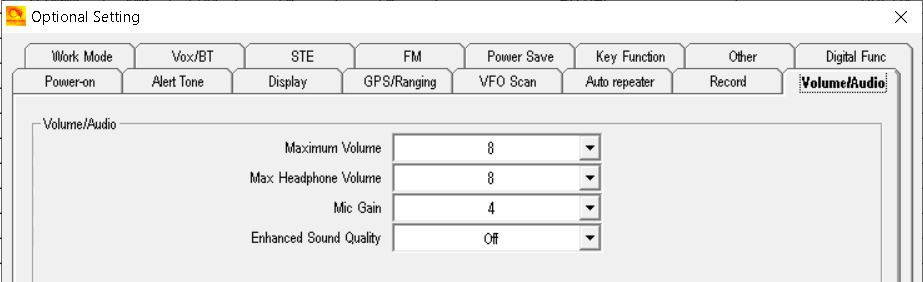
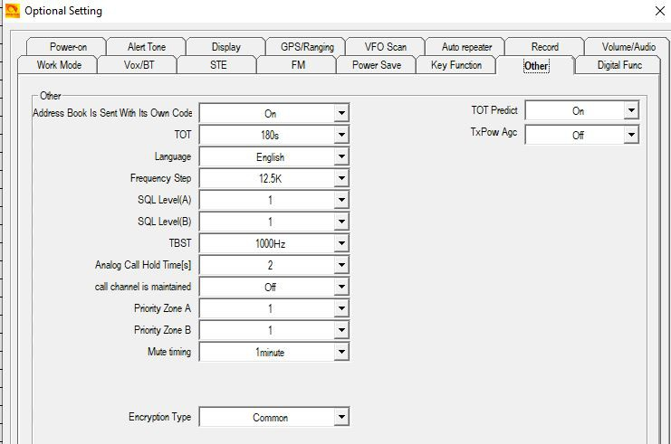
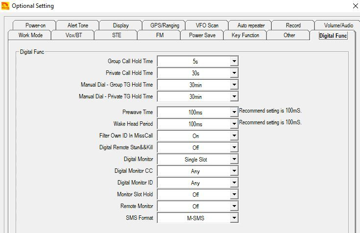

# Settings I Use

!!! info "Source"
    Originally published by Norman Williams on hamradiosouthernrepeaters.co.uk. [Original PDF](../originals/images/Anytone/Settings_I_Use.pdf) · [Source](https://hamradiosouthernrepeaters.co.uk/images/Anytone/Settings_I_Use.pdf) Hub item 50.

## CPS → Optional Setting

### Alert Tone

| Setting | Value |
|---|---|
| SMS Alert | None |
| Call Alert | None |
| Digi Call ResetTone | Off |
| Talk Permit | Digital |
| Key Tone | Off |
| Idle Channel Tone | Off |
| Startup Sound | Off |
| Volume Change Prompt | Off |
| Key Sound Adjustable | Adjustable |
| Call Tone | 0 / 1570 / 1050 / 1570 / 1320 Hz, each 40 ms |
| Idle Channel Tone (tones) | 1500 Hz and 600 Hz, 100 ms |
| Call Reset Tone | 1900 Hz and 800 Hz, 100 ms |

### Power Save

| Setting | Value |
|---|---|
| Auto Shutdown | Off |
| Power save | Off |
| Auto Shutdown Type | is not affected by call |

### Display

| Setting | Value |
|---|---|
| Brightness | 5 |
| Auto Backlight Duration | Always |
| Backlight Delay Of TX[s] | Off |
| Menu Exit Time[s] | 30 |
| Time Display | Off |
| Last Caller | Show Both |
| Call Display Mode | Call Sign Based |
| Call Sign Display Color | Red |
| Call End Prompt Box | Off |
| Display Channel Number | Actual Channel Number |
| Display Current Contact | On |
| Standby Char Color | Write |
| Standby BK Picture | Default |
| Show Last Call On Launch | Off |
| Separate display | Off |
| CH Switching Keeps Last Caller | Off |
| A and B Channel Name Color, Zone Name Colour A and B | Red |
| Receive Backlight Delay[s] | Always |

### Volume/Audio

| Setting | Value |
|---|---|
| Maximum Volume | 8 |
| Max Headphone Volume | 8 |
| Mic Gain | 4 |
| Enhanced Sound Quality | Off |

### Other

| Setting | Value |
|---|---|
| Address Book Is Sent With Its Own Code | On |
| TOT | 180s |
| Language | English |
| Frequency Step | 12.5K |
| SQL Level(A) | 1 |
| SQL Level(B) | 1 |
| TBST | 1000Hz |
| Analog Call Hold Time[s] | 2 |
| call channel is maintained | Off |
| Priority Zone A | 1 |
| Priority Zone B | 1 |
| Mute timing | 1minute |
| Encryption Type | Common |
| TOT Predict | On |
| TxPow Agc | Off |

### Digital Func

| Setting | Value |
|---|---|
| Group Call Hold Time | 5s |
| Private Call Hold Time | 30s |
| Manual Dial - Group TG Hold Time | 30min |
| Manual Dial - Private TG Hold Time | 30min |
| Prewave Time | 100ms (marked "Recommend setting is 100mS.") |
| Wake Head Period | 100ms (marked "Recommend setting is 100mS.") |
| Filter Own ID In MissCall | On |
| Digital Remote Stun&&Kill | Off |
| Digital Monitor | Single Slot |
| Digital Monitor CC | Any |
| Digital Monitor ID | Any |
| Monitor Slot Hold | Off |
| Remote Monitor | Off |
| SMS Format | M-SMS |
