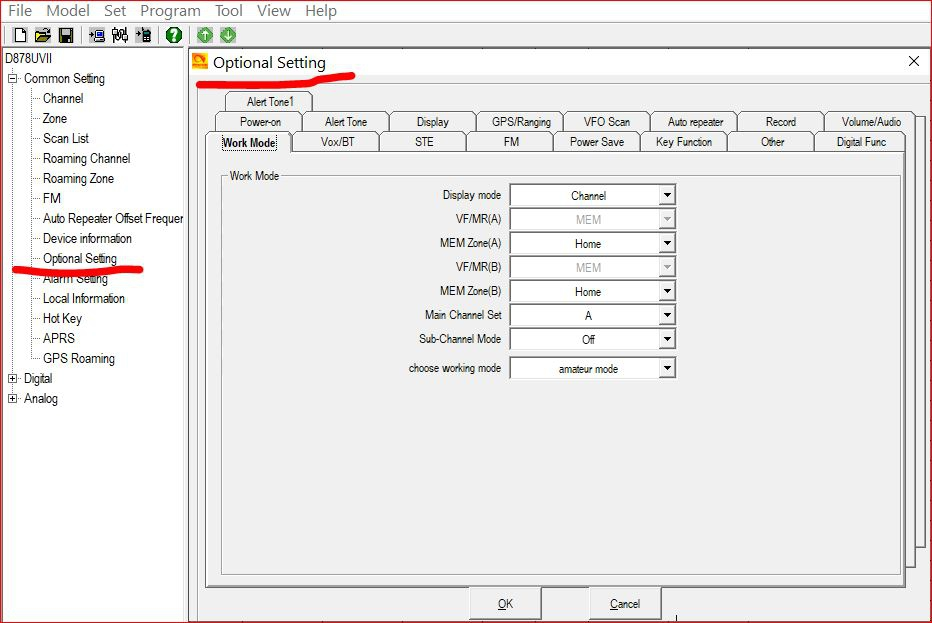

# Why you need a Windows PC

!!! info "Source"
    Originally published by Norman Williams on hamradiosouthernrepeaters.co.uk. [Original PDF](../originals/images/Anytone/Why_you_need_a_Windows_PC.pdf) · [Source](https://hamradiosouthernrepeaters.co.uk/images/Anytone/Why_you_need_a_Windows_PC.pdf) Hub item 1c.

1. You **MUST** set the radio up via the software “CPS”.
2. The CPS will only work on Windows.
3. You can not run the radio without setting up all the **Optional settings**. There is no way round this. It is a must.

    

    *CPS Optional Setting → Work Mode: Display mode Channel, MEM Zone(A) Home, MEM Zone(B) Home, Main Channel Set A, Sub-Channel Mode Off, choose working mode amateur mode.*

4. Most Optional Settings can only be set via the CPS.
5. When you have done this and sent your code plug to the radio, only then can you do some things via the radio.
6. If you make changes via the radio, you **must** read the radio back to the CPS, so you have them saved in your Code Plug.

You should look over this [website](../hub-index.md) for more info on how to set up.
