# Antenna Trim for 878

!!! info "Source"
    Originally published by Norman Williams on hamradiosouthernrepeaters.co.uk. [Original PDF](../originals/images/Anytone/Antenna_trim_for_878.pdf) · [Source](https://hamradiosouthernrepeaters.co.uk/images/Anytone/Antenna_trim_for_878.pdf) Hub item 41a.

There is an “issue” about Anytone 878 (UVII Plus in my case) radio that not many people are aware of, I’ll try to explain in detail what is wrong and how to solve it. Please note that this can be helpful for every radio so you might use this technique to perfectly match your antennas to your handheld radios.

Quite often, when discussion about accessory antennas for Anytone 878 starts, the conclusion is the same: the original antenna is a great piece of equipment and changing it for Diamond, Nagoya or any other antenna will not give you extraordinary range or gain but often limits radio efficiency.

Technically that’s true but that’s not caused purely by the quality of the original antenna - which is very good anyway - but by the construction of SMA connector in the radio and original antenna.

It’s not a popular knowledge but some of you might have already noticed that Anytone original antenna SMA socket is longer than most other antennas. You might also notice that some antenna producers add o-rings that need to be added if it doesn’t sit flat in the radio.

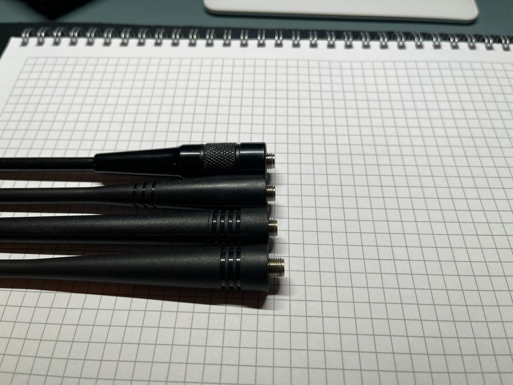

*Anytone 878UVII antenna on the bottom.*

Measuring purely the threaded connectors from the bottom to the top, not from the lip (collar, flange) to the top, I noticed that Anytone stock SMA has exactly 6,7mm when Nagoya, Diamond or Baofeng antennas are within the range from 5 to 5,5mm. On the photograph you may notice that 878 stock antenna has longer socket threads than the others.

“So what?” you ask?

Let’s start with drawings of antenna and the socket to give you a better perspective.

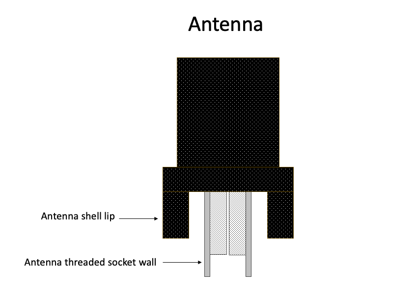

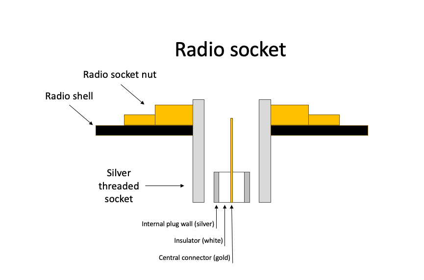

When the antenna connector is “standard” – shorter than in stock Anytone antenna - it might not fully seat in the radio socket in Anytone 878. When it does not fully seat, there will be a gap, airspace between the internal connectors. When the antenna connector is too short, there is no good contact and it will result in poor reception and overheating the transmitter which causes lower range and can surely damage your radio.

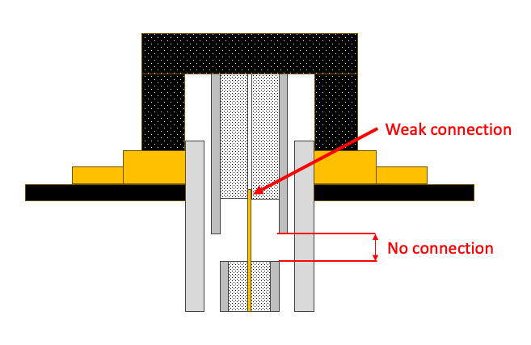

Let me show you what you can do to check and perfectly adapt any antenna for your Anytone 878 radio.

After this short operation I noticed that I receive repeaters that are located twice as far away as before the adaptation.

All you need is:

- Fine file – nail file is sufficient but if you have some professional file, it will make your operation bit easier.
- Nonpermanent marker – whiteboard marker is preferred but anything that leaves a mark that can be wiped out easily is a go-to tool.
- Flashlight or any other good light source.
- Flat-head screwdriver or anything pointy and stiff (you will get what I mean in further steps).
- Tape and black permanent marker – only if perfection is your choice.

If you just want to check the connection – you need nonpermanent marker, good light source and flathead screwdriver (or similar tool) only.

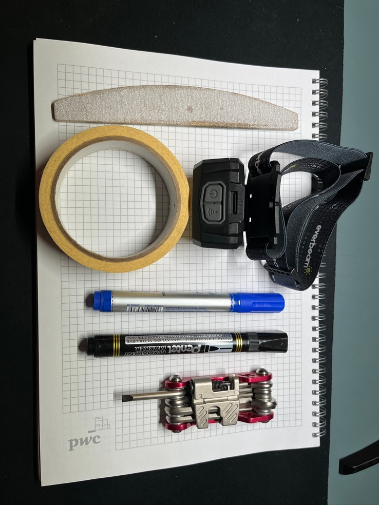

Please note that I’m using a Diamond antenna that I fitted perfectly as an example but that can be any other antenna – the process stays the same.

## Preparation: tighten the socket screw

Radio socket has an outer ring that needs to be tightened as we use it as a reference point. You can use a flathead screwdriver or anything that is pointy and stiff to check if that’s tight. To do that, place the screwdriver against the teeth in the nut and try to tighten it down clockwise using **reasonable** force.

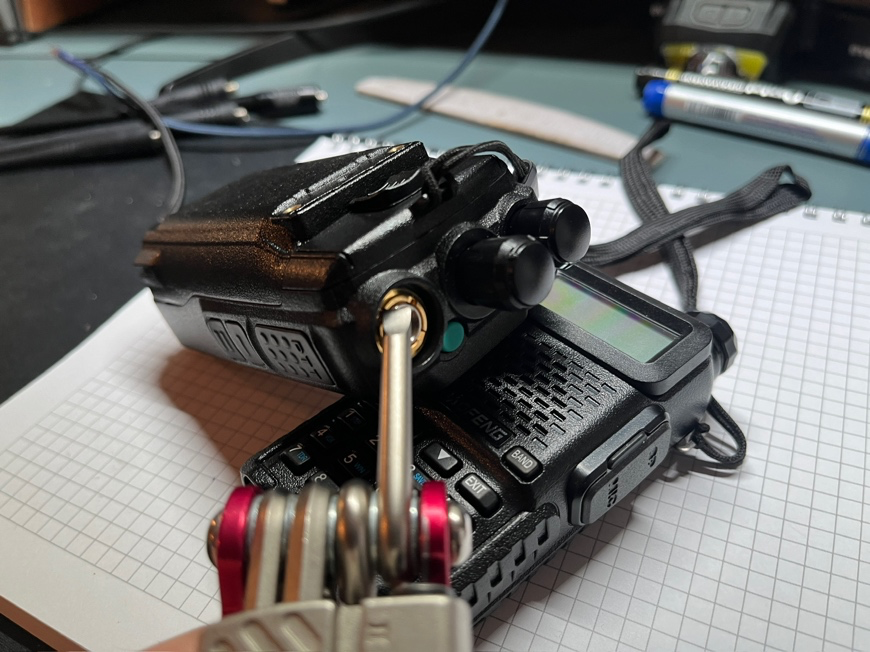

## Step A: Marking

Take your antenna of choice and use a non-permanent marker to temporarily leave the solid mark on the internal antenna white insulation – as shown. We are doing that to confirm that there is or there is no proper connection between antenna and radio socket.

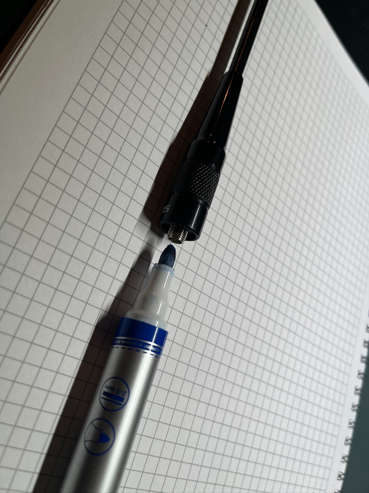

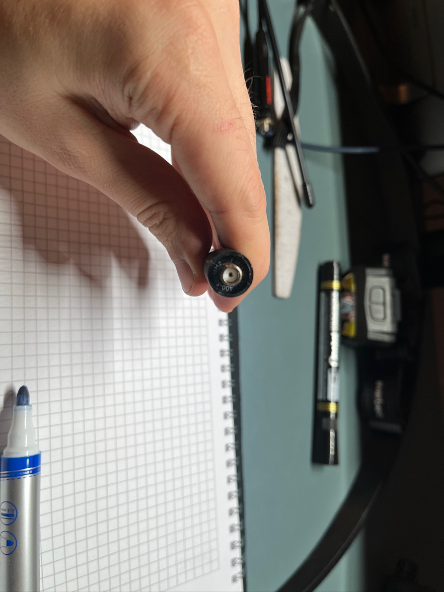

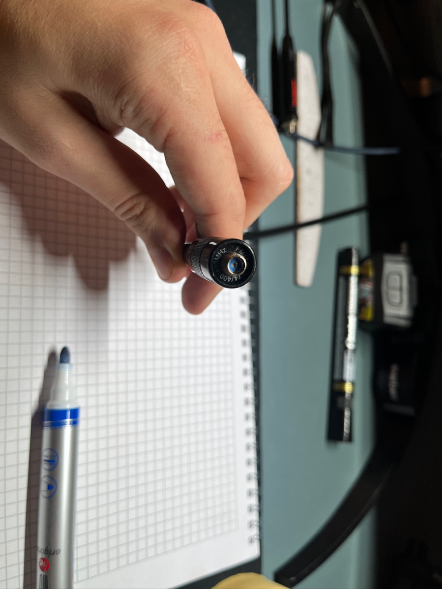

Screw in the antenna to the radio using reasonable force. Unscrew the antenna.

Use the flashlight to check if any marks are visible on the internal antenna connector.

### Option 1: visible stamp

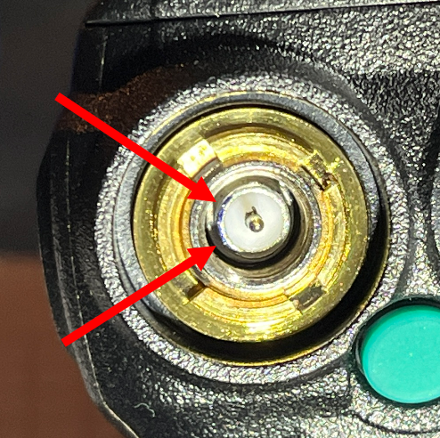

If there is a mark, even the lightest, least visible on the silver ring or on white isolation, it is the sign that good connection was reached as on the drawing below:

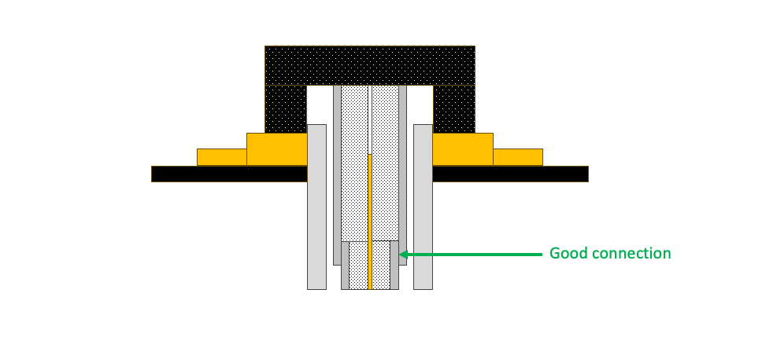

If there is no stamp/mark, follow the instruction on the next pages.

### Option 2: stamp not visible

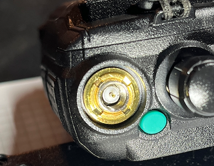

If there is no stamp/mark at all, you have no or you have weak connection, it will decrease radio efficiency or can even damage your radio.

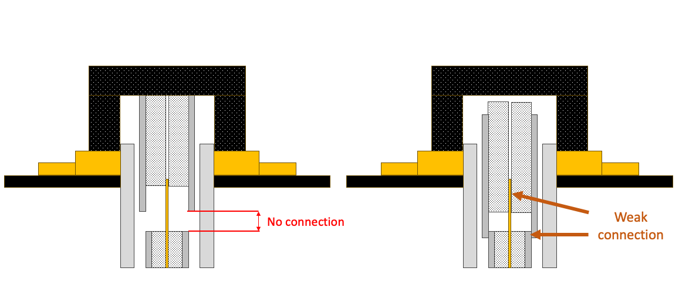

Go to step B on the next page.

## Step B: Trimming

If there is weak or no connection, we will be trimming down the lip (collar, flange) of the antenna and by that, threaded socket will be able to screw in further to achieve perfect connection with radio socket.

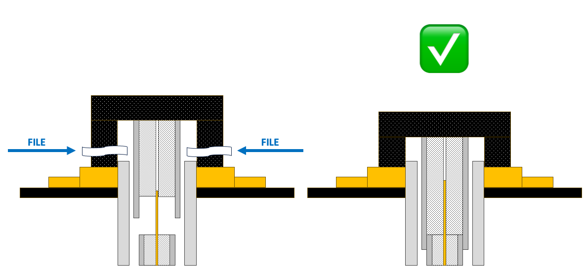

Follow below steps:

a) Use your tape to cover the antenna socket – not required but suggested, so you would not damage antenna socket threads. Use your tape to cover the antenna shell – optional, so you would not scratch it.

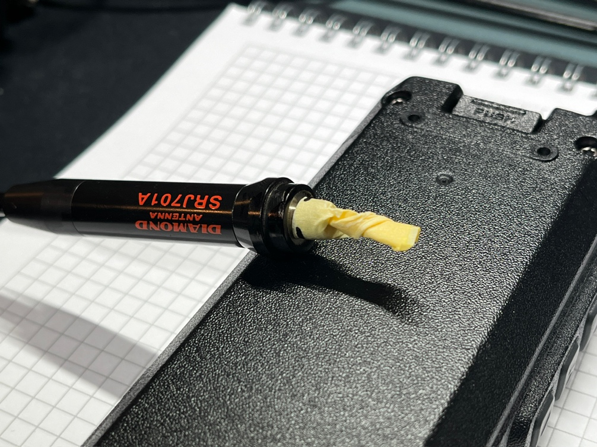

b) Take the file and carefully and precisely remove **less than half of a millimeter** of shell lip. Try to evenly trim the lip on every side, around.

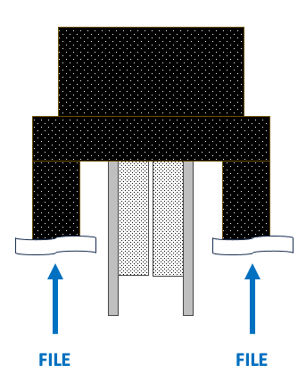

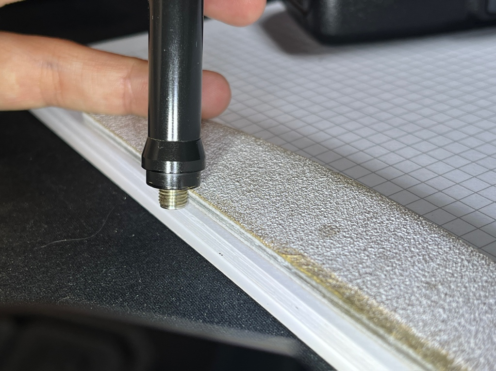

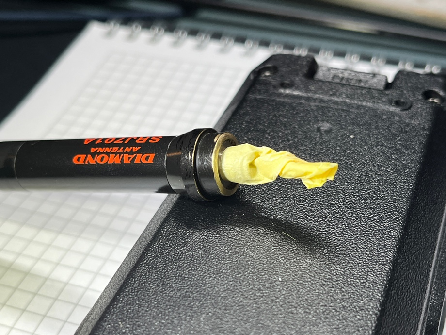

c) Remove the tape from the socket.

d) Use non-permanent or permanent markers to leave the mark on the antenna lip covering the filed surface.

e) Screw in and unscrew the antenna.

f) Check where marks on the antenna lip were removed. Parts with removed marks are not leveled properly. Trim down parts with removed marks just a little bit to have your lip evenly filed. If over a half of the marked lip circle is removed - antenna seats properly on radio socket nut. Do not aim for perfection here because then you might trim the lip too much. Good enough is the new perfect.

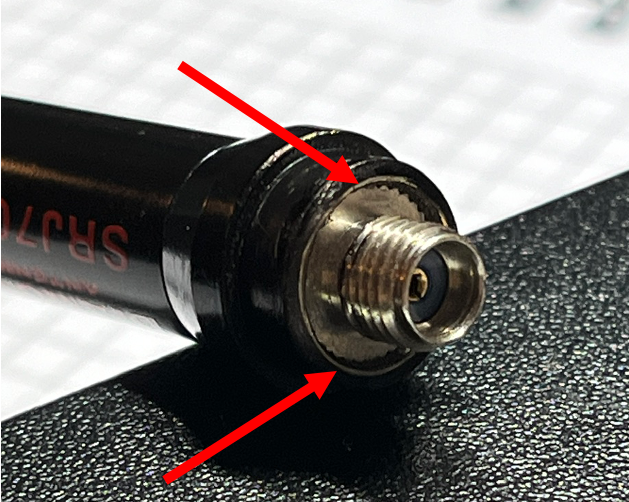

g) Now perform marking and checking as explained in Step A and (if needed) repeat trimming process (Step B). Keep doing that to the point that stamping is visible.

Keep in mind that you should trim (Step B) and check (Step A) iteratively so you should be moving between step A and B few or many times, removing just a fraction of millimeter in every trimming step. From my experience, you can perform around 10 iterations to reach proper connection.

If you trim the lip too much, the antenna lip will not sit on the socket nut and all the forces acting on the antenna during normal use, will be directed to the antenna and radio socket – not on the lip. It is not the end of the world; many antennas are mounted that way. Instruction shows how to reach watchmaker precision.

After the operation you can use permanent marker to paint filed/scratched surfaces black.

My Diamond SRJ701A antenna had also a rubber dust cover over the bottom of antenna shell. It was needed to be removed for the trimming process and after achieving perfect fitment - trimmed down also as it was pushing against the radio socket nut and antenna was hard to screw it down.

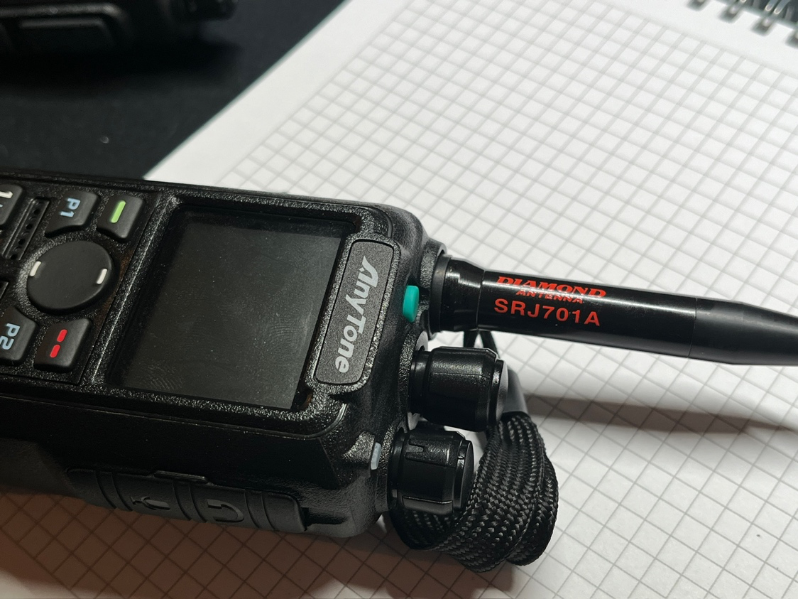

If you have older Anytone radio, you should know that Anytone provided new High Gain Antenna and buying it is a great idea, as it’s improved, has great gain, very low SWR and works great with this radio. In many discussions it is stated that new antenna is competitive to most accessory antennas available on the market.

Thanks,
SP5AQX
73
