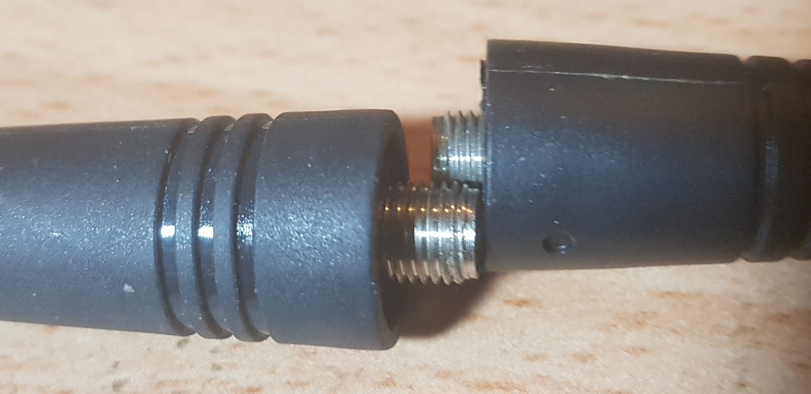
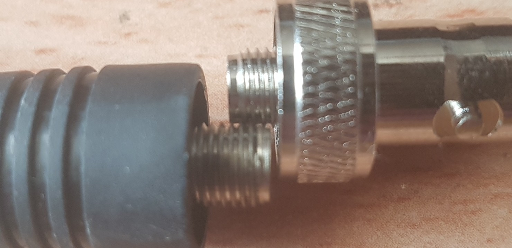

# Correct Antenna for Anytone 868/878/878plus v2

!!! info "Source"
    Originally published by Norman Williams on hamradiosouthernrepeaters.co.uk. [Original PDF](../originals/images/Anytone/Correct_Antenna_for_Anytone_868-878-878plus.pdf) · [Source](https://hamradiosouthernrepeaters.co.uk/images/Anytone/Correct_Antenna_for_Anytone_868-878-878plus.pdf) Hub item 41.

Anytone stock antenna is on the left with the longer threaded shaft.

The photo is for demonstration only and to show the difference in the lengths of the threaded shaft.

Make sure you buy the correct type.
It must have the longer threaded shaft. The same as the Anytone stock antenna.
The shorter threaded shaft version as in the photo above on the right. Should never be used on the radios.

Most replacement antennas have a shorter threaded shaft, and leave the centre pin exposed.
Others come with a rubber washer that needs to be removed to make the threaded shaft long enough.

The shorter thread shaft version will lead to RF issues.

This also applies to SMA adaptors.
Make sure you buy the correct type.

The photo is for demonstration only and to show the difference in the lengths of the threaded shaft.
