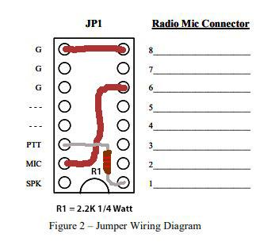

# SignaLink USB for AnyTone D578

!!! info "Source"
    Originally published by Norman Williams on hamradiosouthernrepeaters.co.uk. [Original PDF](../originals/images/Anytone/SignaLink_USB_with_AT-D578UV.pdf) · [Source](https://hamradiosouthernrepeaters.co.uk/images/Anytone/SignaLink_USB_with_AT-D578UV.pdf) Hub item 162.

W1BKW – Brian Wall

In order to use a SignaLink USB with the AnyTone 578 without any modifications, follow the instructions and diagram below.

AnyTone AT-D578UVIII Pro/Plus

SignaLink USB Item # SLUSBRJ4 w/RJ 45 (If you have an existing SignaLink the Radio Cable Needed = SLCABRJ4)

In order to use the front panel microphone jack on the 578 you must set the HandOpMode to Level Detect in the CPS. Optional Setting, Other Tab, HandOpMode, Level Detect.

Or you can do it via the Radio front panel as follows: Menu, Settings, Radio Set, Other Func, Hand Type, Volt-Detc.

I use an RJ-45 A/B Switch with a standard straight through RJ45 cable.

The jumper configuration for the SignaLink USB is as noted in the diagram below.

*Figure 2 – Jumper Wiring Diagram. JP1 rows labelled G, G, G, - - -, - - -, PTT, MIC, SPK; R1 = 2.2K 1/4 Watt; radio mic connector pins 8 down to 1.*

You must use a ¼ watt 2.2K resistor across PTT to Pin 1. Other wattage sizes will either be too small and fall out of the JP1 socket, or larger wattages will be too large and damage the socket.

SPK - Do NOT install this jumper wire. \*\*See SPK note below\*\*

\*\*SPK - The mic jack on this radio uses differential audio which CANNOT be used with the SignaLink, or you'll damage the radio's audio amplifier. Instead, attach the supplied audio cable between the SignaLink's rear SPKR jack and one of the radio's External Speaker jacks (the top jack disconnects the radio's built-in speaker, the bottom jack does not).
