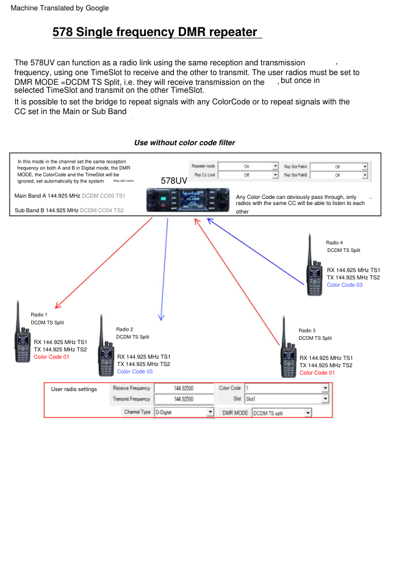
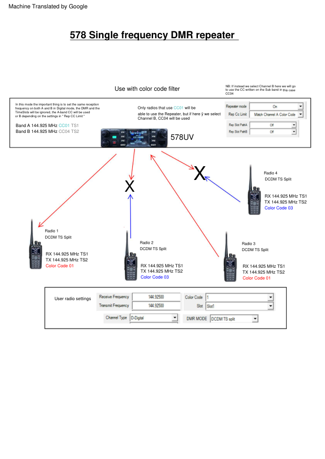
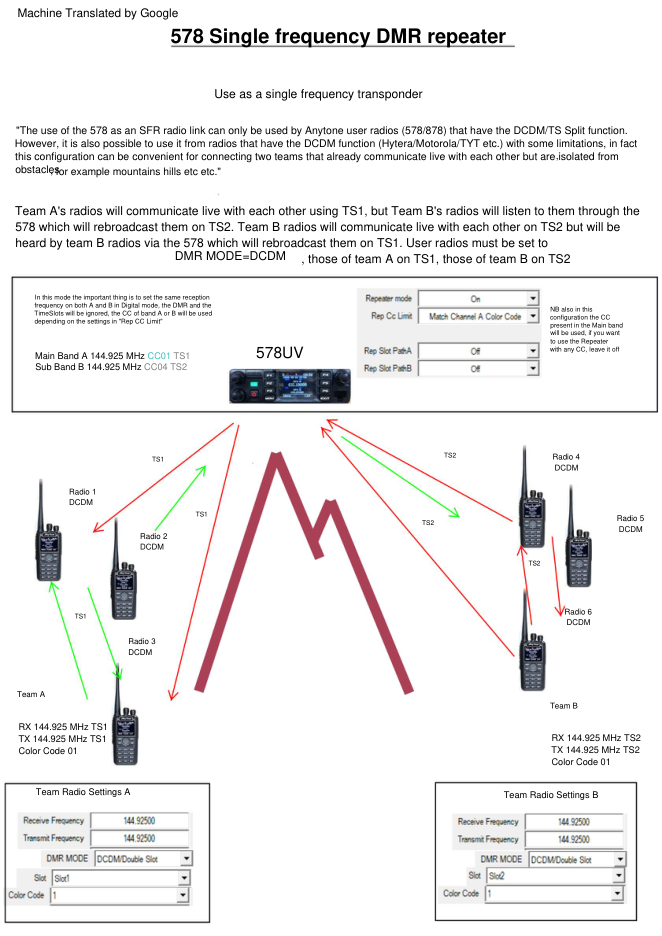

# 578 Single Frequency DMR Repeater (English)

!!! info "Source"
    Originally published by Norman Williams on hamradiosouthernrepeaters.co.uk. [Original PDF](../originals/images/Anytone/578_SFR_Prpeater_EN.pdf) · [Source](https://hamradiosouthernrepeaters.co.uk/images/Anytone/578_SFR_Prpeater_EN.pdf) Hub item 159. Machine translated by Google from the Italian [578 SFR Repeater IT](578-sfr-repeater-it.md).

## 578 Single frequency DMR repeater

The 578UV can function as a radio link using the same reception and transmission frequency, using one TimeSlot to receive and the other to transmit. The user radios must be set to DMR MODE =DCDM TS Split, i.e. they will receive transmission on the selected TimeSlot and transmit on the other TimeSlot.

It is possible to set the bridge to repeat signals with any ColorCode or to repeat signals with the CC set in the Main or Sub Band

### Use without color code filter

In this mode in the channel set the same reception frequency on both A and B in Digital mode, the DMR MODE, the ColorCode and the TimeSlot will be ignored, set automatically by the system

- Main Band A 144.925 MHz DCDM CC00 TS1
- Sub Band B 144.925 MHz DCDM CC04 TS2

Any Color Code can obviously pass through, only radios with the same CC will be able to listen to each other

*Repeater mode = On; Rep Cc Limit = Off; Rep Slot PathA/PathB = Off. Radio 1 and Radio 3: RX 144.925 MHz TS1, TX 144.925 MHz TS2, Color Code 01. Radio 2 and Radio 4: same frequencies, Color Code 03. User radio settings: Receive/Transmit Frequency 144.92500, Color Code 1, Slot Slot1, Channel Type D-Digital, DMR MODE DCDM TS split.*

### Use with color code filter

In this mode the important thing is to set the same reception frequency on both A and B in Digital mode, the DMR and the TimeSlots will be ignored, the A-band CC will be used or B depending on the settings in "Rep CC Limit"

- Band A 144.925 MHz CC01 TS1
- Band B 144.925 MHz CC04 TS2

Only radios that use CC01 will be able to use the Repeater, but if here we select Channel B, CC04 will be used

NB: If instead we select Channel B here we will go to use the CC written on the Sub band in this case CC04

*Repeater mode = On; Rep Cc Limit = Match Channel A Color Code; Rep Slot PathA/PathB = Off. Radios 1 and 3 (Color Code 01) reach the repeater; Radios 2 and 4 (Color Code 03) are crossed out. User radio settings: Receive/Transmit Frequency 144.92500, Color Code 1, Slot Slot1, Channel Type D-Digital, DMR MODE DCDM TS split.*

### Use as a single frequency transponder

"The use of the 578 as an SFR radio link can only be used by Anytone user radios (578/878) that have the DCDM/TS Split function. However, it is also possible to use it from radios that have the DCDM function (Hytera/Motorola/TYT etc.) with some limitations, in fact this configuration can be convenient for connecting two teams that already communicate live with each other but are isolated from obstacles, for example mountains hills etc etc."

Team A's radios will communicate live with each other using TS1, but Team B's radios will listen to them through the 578 which will rebroadcast them on TS2. Team B radios will communicate live with each other on TS2 but will be heard by team B radios via the 578 which will rebroadcast them on TS1. User radios must be set to DMR MODE=DCDM, those of team A on TS1, those of team B on TS2

In this mode the important thing is to set the same reception frequency on both A and B in Digital mode, the DMR and the TimeSlots will be ignored, the CC of band A or B will be used depending on the settings in "Rep CC Limit"

NB also in this configuration the CC present in the Main band will be used, if you want to use the Repeater with any CC, leave it off

- Main Band A 144.925 MHz CC01 TS1
- Sub Band B 144.925 MHz CC04 TS2

*Repeater mode = On; Rep Cc Limit = Match Channel A Color Code. Rep Slot PathA/PathB = Off. Team A radios (1 to 3): RX/TX 144.925 MHz TS1, Color Code 01. Team B radios (4 to 6): RX/TX 144.925 MHz TS2, Color Code 01. Team Radio Settings A: Receive/Transmit Frequency 144.92500, DMR MODE DCDM/Double Slot, Slot Slot1, Color Code 1. Team Radio Settings B: Receive/Transmit Frequency 144.92500, DMR MODE DCDM/Double Slot, Slot Slot2, Color Code 1.*
