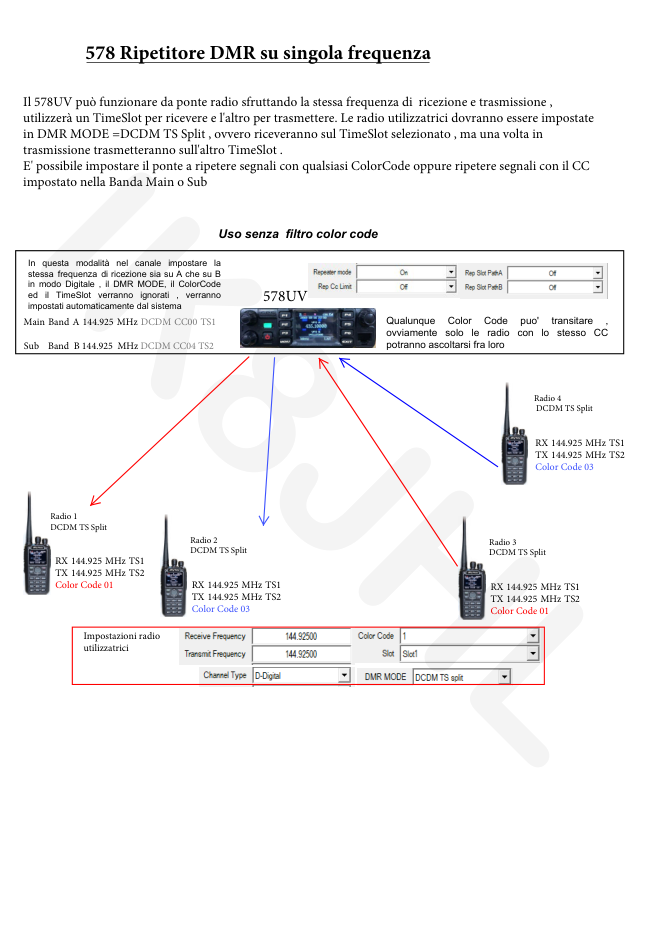
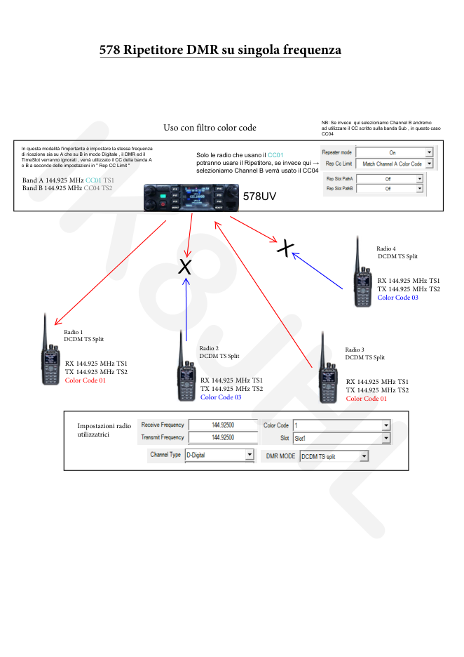
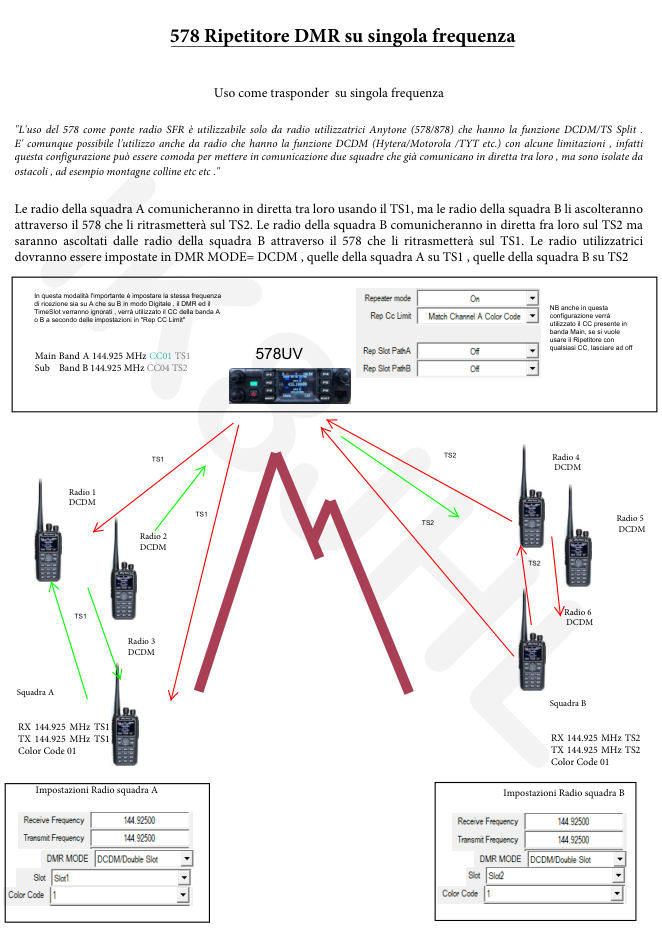

# 578 Ripetitore DMR su singola frequenza (Italiano)

!!! info "Source"
    Originally published by Norman Williams on hamradiosouthernrepeaters.co.uk. [Original PDF](../originals/images/Anytone/578_SFR_Repeater_IT.pdf) · [Source](https://hamradiosouthernrepeaters.co.uk/images/Anytone/578_SFR_Repeater_IT.pdf) Hub item 159. An English machine translation is [578 SFR Repeater EN](578-sfr-prpeater-en.md).

Il 578UV può funzionare da ponte radio sfruttando la stessa frequenza di ricezione e trasmissione, utilizzerà un TimeSlot per ricevere e l'altro per trasmettere. Le radio utilizzatrici dovranno essere impostate in DMR MODE =DCDM TS Split, ovvero riceveranno sul TimeSlot selezionato, ma una volta in trasmissione trasmetteranno sull'altro TimeSlot. E' possibile impostare il ponte a ripetere segnali con qualsiasi ColorCode oppure ripetere segnali con il CC impostato nella Banda Main o Sub

### Uso senza filtro color code

In questa modalità nel canale impostare la stessa frequenza di ricezione sia su A che su B in modo Digitale, il DMR MODE, il ColorCode ed il TimeSlot verranno ignorati, verranno impostati automaticamente dal sistema

- Main Band A 144.925 MHz DCDM CC00 TS1
- Sub Band B 144.925 MHz DCDM CC04 TS2

Qualunque Color Code puo' transitare, ovviamente solo le radio con lo stesso CC potranno ascoltarsi fra loro

*Repeater mode = On; Rep Cc Limit = Off; Rep Slot PathA = Off; Rep Slot PathB = Off. Radio 1 and Radio 3: RX 144.925 MHz TS1, TX 144.925 MHz TS2, Color Code 01. Radio 2 and Radio 4: RX 144.925 MHz TS1, TX 144.925 MHz TS2, Color Code 03. Impostazioni radio utilizzatrici: Receive/Transmit Frequency 144.92500, Color Code 1, Slot Slot1, Channel Type D-Digital, DMR MODE DCDM TS split.*

### Uso con filtro color code

In questa modalità l'importante è impostare la stessa frequenza di ricezione sia su A che su B in modo Digitale, il DMR ed il TimeSlot verranno ignorati, verrà utilizzato il CC della banda A o B a secondo delle impostazioni in " Rep CC Limit "

- Band A 144.925 MHz CC01 TS1
- Band B 144.925 MHz CC04 TS2

Solo le radio che usano il CC01 potranno usare il Ripetitore, se invece qui selezioniamo Channel B verrà usato il CC04

!!! note
    NB: Se invece qui selezioniamo Channel B andremo ad utilizzare il CC scritto sulla banda Sub, in questo caso CC04

*Repeater mode = On; Rep Cc Limit = Match Channel A Color Code; Rep Slot PathA/PathB = Off. Radios 1 and 3 (Color Code 01) reach the repeater; Radios 2 and 4 (Color Code 03) are crossed out.*

### Uso come trasponder su singola frequenza

"L'uso del 578 come ponte radio SFR è utilizzabile solo da radio utilizzatrici Anytone (578/878) che hanno la funzione DCDM/TS Split. E' comunque possibile l'utilizzo anche da radio che hanno la funzione DCDM (Hytera/Motorola /TYT etc.) con alcune limitazioni, infatti questa configurazione può essere comoda per mettere in comunicazione due squadre che già comunicano in diretta tra loro, ma sono isolate da ostacoli, ad esempio montagne colline etc etc."

Le radio della squadra A comunicheranno in diretta tra loro usando il TS1, ma le radio della squadra B li ascolteranno attraverso il 578 che li ritrasmetterà sul TS2. Le radio della squadra B comunicheranno in diretta fra loro sul TS2 ma saranno ascoltati dalle radio della squadra B attraverso il 578 che li ritrasmetterà sul TS1. Le radio utilizzatrici dovranno essere impostate in DMR MODE= DCDM, quelle della squadra A su TS1, quelle della squadra B su TS2

In questa modalità l'importante è impostare la stessa frequenza di ricezione sia su A che su B in modo Digitale, il DMR ed il TimeSlot verranno ignorati, verrà utilizzato il CC della banda A o B a secondo delle impostazioni in "Rep CC Limit"

!!! note
    NB anche in questa configurazione verrà utilizzato il CC presente in banda Main, se si vuole usare il Ripetitore con qualsiasi CC, lasciare ad off

- Main Band A 144.925 MHz CC01 TS1
- Sub Band B 144.925 MHz CC04 TS2

*Repeater mode = On; Rep Cc Limit = Match Channel A Color Code; Rep Slot PathA/PathB = Off. Impostazioni Radio squadra A: 144.92500 receive and transmit, DMR MODE DCDM/Double Slot, Slot1, Color Code 1. Impostazioni Radio squadra B: same, Slot2, Color Code 1. Squadra A (Radios 1 to 3): RX/TX 144.925 MHz TS1, Color Code 01. Squadra B (Radios 4 to 6): RX/TX 144.925 MHz TS2, Color Code 01.*

IK8JHL
