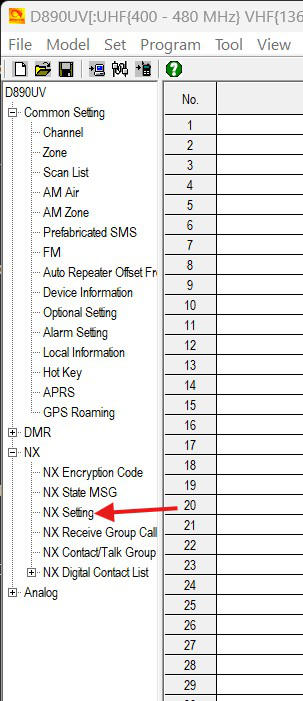
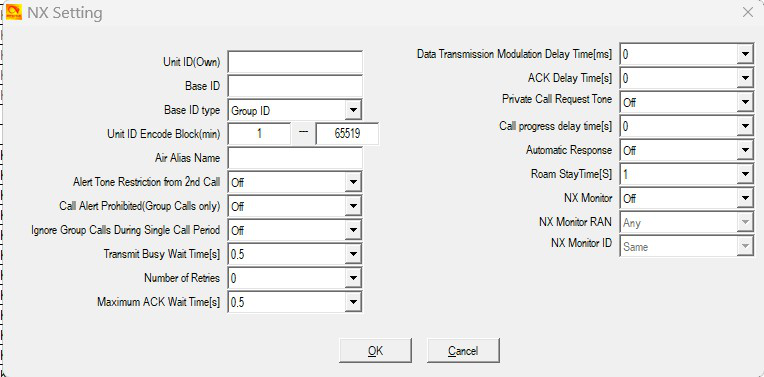
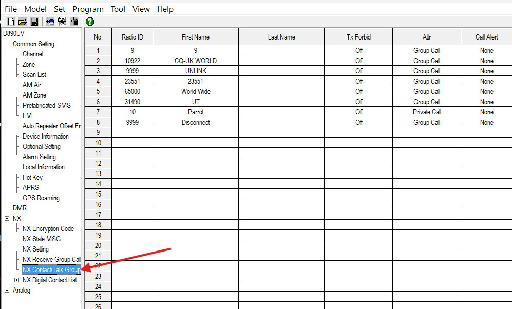
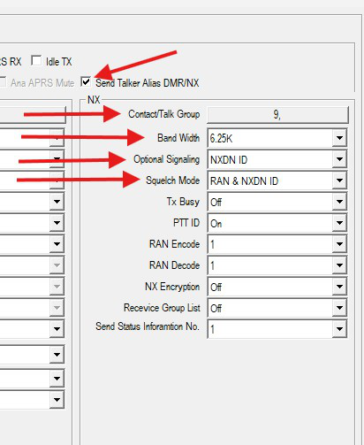
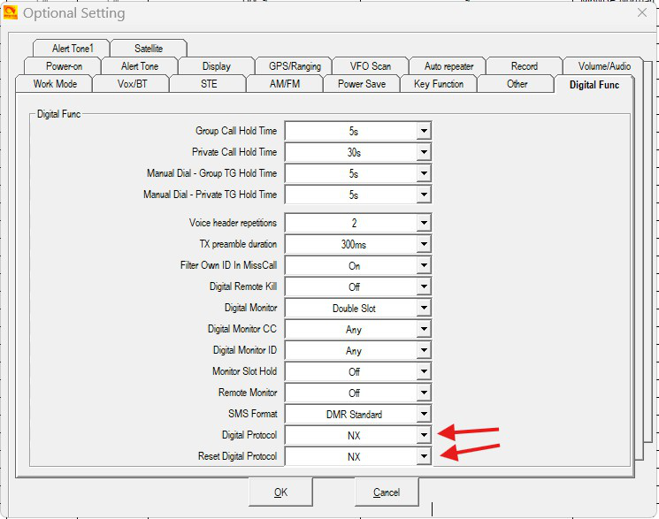

# Anytone AT-D890UV NXDN settings

!!! info "Source"
    Originally published by Norman Williams on hamradiosouthernrepeaters.co.uk. [Original PDF](../originals/images/Anytone/AT-D890UV_NXDN.pdf) · [Source](https://hamradiosouthernrepeaters.co.uk/images/Anytone/AT-D890UV_NXDN.pdf) Hub item 177.

Open CPS and go to NX Setting.

**Fill in each -**

- Unit ID (Own) = With your Ham Radio NXDN ID “ <https://radioid.net/> ”
- Base ID = With your Ham Radio NXDN ID
- Air Lias Name = Your Ham Radio Callsign

*NX Setting: Unit ID(Own), Base ID and Air Alias Name blank; Base ID type = Group ID; Unit ID Encode Block(min) = 1 – 65519.*

**Next go to NX Contact Talk Group**
Add what you need

**Now go to Channels.**

- Send Talker Alias DMR/NX = This can be ON or OFF. Up to you.
- Contact/Talk Group = Set to what you want on that channel.
- The next three set as shown.
- PTT ID = On
- RAN Encode / Decode = 1 to 63

*Channel: Send Talker Alias DMR/NX ticked, Contact/Talk Group = 9, Band Width = 6.25K, Optional Signaling = NXDN ID, Squelch Mode = RAN & NXDN ID, PTT ID = On, RAN Encode = 1, RAN Decode = 1, NX Encryption = Off.*

Save Channel
Add to Zone

## Change radio from DMR to NXDN

**From Radio -**
Menu – Settings – Radio Set – Other Func – Protocol – and NXDN

**From Function Key -**
Set a key to – Digital Protocol

**Via CPS you can set to startup in DMR or NXDN**

*Optional Setting → Digital Func: Digital Protocol = NX, Reset Digital Protocol = NX.*
