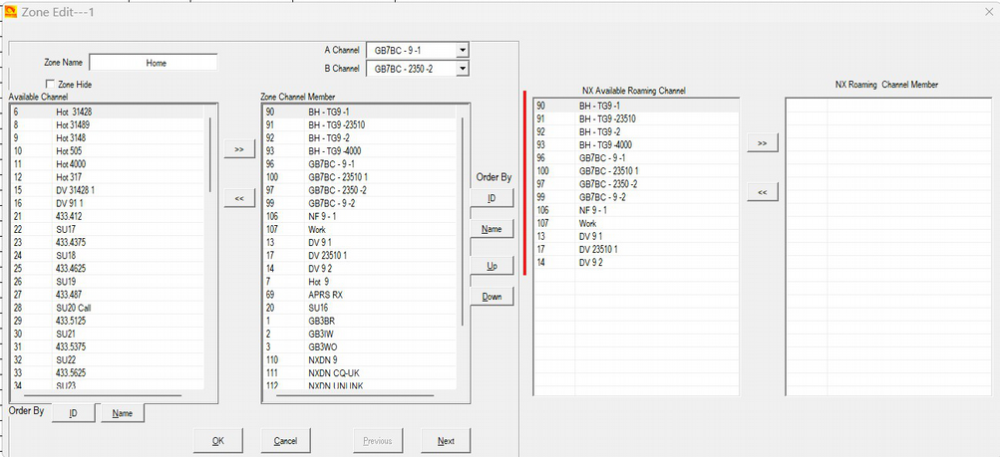
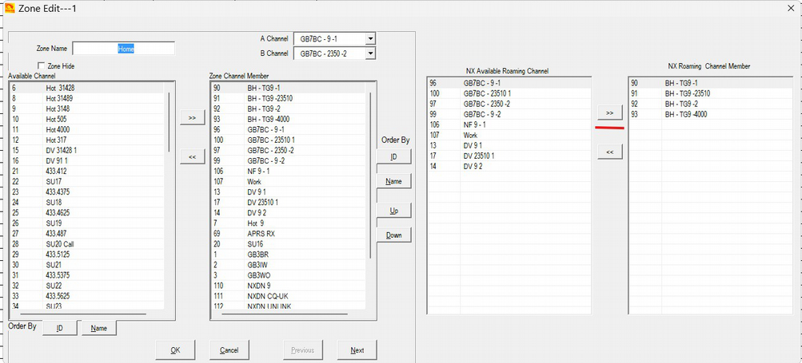

# NXDN Roaming

!!! info "Source"
    Originally published by Norman Williams on hamradiosouthernrepeaters.co.uk. [Original PDF](../originals/images/Anytone/NXDN_Roaming.pdf) · [Source](https://hamradiosouthernrepeaters.co.uk/images/Anytone/NXDN_Roaming.pdf) Hub item 181.

1. Make your NXDN channels for all the repeaters you want.
2. Add them to a Zone.
3. Open the Zone with your NXDN repeaters.

    !!! note
        In this section I have only DMR repeaters as there are no NXDN repeaters in my area, but it would be the same for your NXDN repeaters.

    You will see on the right a list of Split Frequency Repeaters.

    

    *Zone Edit: Zone Name = Home, A Channel = GB7BC - 9 -1, B Channel = GB7BC - 2350 -2; NX Available Roaming Channel lists 90 to 93 BH - TG9, 96, 100, 97, 99 GB7BC, 106 NF 9 - 1, 107 Work, 13 DV 9 1, 17 DV 23510 1, 14 DV 9 2; NX Roaming Channel Member is empty.*

    Move across the NXDN repeaters you wish to roam.

    

    *NX Roaming Channel Member: 90 BH - TG9 -1, 91 BH - TG9 -23510, 92 BH - TG9 -2, 93 BH - TG9 -4000.*

4. Save the Zone and send it to the radio.
5. Via the radio, go to the Zone you want.
6. Turn on Roaming.
