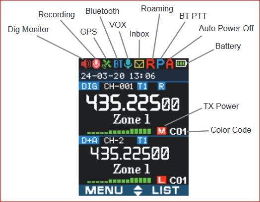

# 168 Icon

[← All 168 mods](index.md)

!!! info "Source"
    Originally published by Norman Williams on hamradiosouthernrepeaters.co.uk. [Original page](https://hamradiosouthernrepeaters.co.uk/anytone-dmr/anytone-168-mods.html#Icon168)

Also refer to [this](../868-878/30-icons.md).

