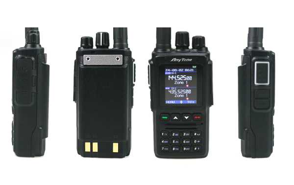

# AnyTone 168 mods, hints & tips

!!! info "Source"
    Originally published by Norman Williams on hamradiosouthernrepeaters.co.uk. [Original page](https://hamradiosouthernrepeaters.co.uk/anytone-dmr/anytone-168-mods.html)

**Modifications, hints, tips and technical information for the

AnyTone AT-D168UV**

dual band DMR digital handheld radio.

------------------------------------------------------------------------

**General warnings to all users:**

- Codeplug version, CPS programming software version and firmware version present in the radio must all match in version number. If not, very strange things happen. You must [REBUILD](../868-878/81-prevent.md) your codeplug every time a new CPS or firmware version is installed. This keeps the underlying data sent to the radio consistent in version.
- **For the same reason above, I would caution anyone from sharing and using other people’s codeplugs. While it might be convenient, you can’t be guaranteed what version the shared codeplug was built under, and therefore whether it would work properly under the firmware version installed in your radio. You just can’t tell, the CPS won’t tell you unless it is a very early version codeplug. Save yourself a lot of headaches and [REBUILD](../868-878/81-prevent.md) the codeplug before writing it to your radio.**
- Be very careful not to accidentally hit the PTT (Push to Talk) button while you have the USB cable plugged in to the radio, or while it is sitting in the charger. Doing so can cause RF to be picked up by the USB cable or charger, and cause damage to the hardware - both radio and charger. This has happened to some unfortunate 878 owners previously.
- Don't have the USB cable inserted when you have any channel that may autonomously transmit, such as APRS, roaming or lone worker feature is active (credit to Jerry Kuhn)
- Keep the radio 1 foot away from your cellular / mobile phone, cordless phone and Wi-Fi devices at ALL times.
- Use caution if writing non standard data to the radio in some of the advanced modifications listed below. It is possible to cause the radio to cease functioning correctly if instructions are not carried out with care.

If you have any more information or modifications that you'd like to share here, please contact me at [Facebook Group](https://www.facebook.com/groups/1798919343492370) (Norman) and I will make sure you receive credit for your work, though you are welcome to remain anonymous if you wish.

------------------------------------------------------------------------

------------------------------------------------------------------------

**Page index:**

- Refer back to [878](../868-878/index.md) Mods, as the 168 has many things in common.
-  [Home page](../../external-resources.md).
- [Facebook page](https://www.facebook.com/groups/1798919343492370).
- [Band Error and five ways you can fix it.](../868-878/02-band-error.md)
- [AT Options version 9](https://mega.nz/folder/SZlhCTKK#l8MPa7CYcU8tsHZvsPHIrA). Changing the band mode of the radio. (V9, now includes the D168UV) (The D168 does not offer 220 MHz.) *[Reference back to the 878](../868-878/51-220mhz.md)*.
- Enabling full test / self adjustment mode. ([Refer back to the 878 for more info,](../868-878/65-atoptions.md) even tought the 168 does differ.)
- The 168 uses a [3288](https://cmlmicro.com/Content/Product%20Downloads/Digital%20Analogue%20Two%20way%20radio/SCT3288_ds.pdf) base band chip. The 878 and 578 uses a 3258.
- [168 Icons](01-icon168.md).
- [168 CPS - German Language file updated by Achim, DJ3UE](02-german.md).
- FCC [https://fcc.report/FCC-ID/T4K-D168UV](https://fcc.report/FCC-ID/T4K-D168UV)
- Can the 168 be used as a scanner? [Same as the 868 and 878](../868-878/54-scanner.md).

 

 

------------------------------------------------------------------------

------------------------------------------------------------------------

## Sections

- [168 Icon. (Also refer to this(http://anytonetechzone.byethost7.com/878techmods.htmIcons))](01-icon168.md)
- [German language file for the CPS 1.04 by Achim, DJ3UE. Has corrections that AT will use in](02-german.md)
