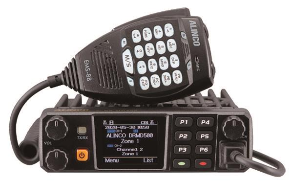

[← All 578 mods](index.md)

!!! note "Author: Jason Reilly VK7ZJA (silent key, January 2023)"
    © Jason Reilly 2018–2022. Jason's pages were preserved by Norman Williams on hamradiosouthernrepeaters.co.uk and are reproduced here, unchanged, so that his work stays available. They will be removed on request from his family. [Original page](https://hamradiosouthernrepeaters.co.uk/images/578Mods/578techmods.html#578vsMD500)

**What is the difference between the AnyTone AT-D578UV and Alinco DR-MD500 / DR-MD520?**
The only difference between the AnyTone AT-D578UV and Alinco DR-MD500 / DR-MD520 is that the front panel layout has changed and uses a slightly different microphone (same pinout though), otherwise all the internal electronics remain the same. The Alinco DR-MD500 is equivalent to a basic AnyTone AT-578UV dual band only, 300,000 contacts, no Bluetooth, no analog APRS RX and no AM airband, while the Alinco DR-MD520 is equivalent to the AnyTone 578 Plus model tri-band 144 / 222 / 440 MHz, 500,000 contacts, Bluetooth, analog APRS RX, and AM airband reception. You can see the some technical data relating to the Alinco DR-MD500 / MD520 at the FCC webpage if you search for FCC ID PH3DR-MD500T and PH3DR-MD520T respectively.

------------------------------------------------------------------------
