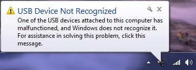

# Trouble getting the drivers to install or work properly on Win 7 or 10

[← All 578 mods](index.md)

!!! note "Author: Jason Reilly VK7ZJA (silent key, January 2023)"
    © Jason Reilly 2018–2022. Jason's pages were preserved by Norman Williams on hamradiosouthernrepeaters.co.uk and are reproduced here, with light formatting and spelling edits for readability, so that his work stays available. They will be removed on request from his family. [Original page](https://hamradiosouthernrepeaters.co.uk/images/578Mods/578techmods.html#DriverTrouble)

*(Credit to Carsten Bauer VK6PCB, Chris Pyle & Duane Reese)*

Some people have had problems with the drivers AnyTone / GigaDevice supplies to get the USB communicating with the radio when using Windows, especially Windows 10. Check these solutions to see if they can help you:

- If you have troubles with what Windows installs by default, create a Windows restore point first (just to be safe) and then download and update to the latest GD32 drivers here: [http://www.connectsystems.com/products/top/radios/DS878UV_SOFTWARE/GD_VirtualComDriver%20v2.0.2.4944.zip (921kb)](http://www.connectsystems.com/products/top/radios/DS878UV_SOFTWARE/GD_VirtualComDriver%20v2.0.2.4944.zip), then select the x64 folder for 64 bit Windows, or x86 for 32 bit Windows operating systems.
- **Win 7:** when Windows starts, hold **F8** to get into the 'advanced boot options' and select 'Disable Driver Signature Enforcement: Loads installed software that has invalid or missing signatures.'
- **Win 10:** press and hold the **Shift** key on your keyboard and click the Restart button. Select **Troubleshoot → Advanced options → Startup Settings** and then click the Restart button. When your computer restarts, you'll see a list of options; press **F7** to select Disable driver signature enforcement. Once the computer restarts, go and install the AnyTone driver.
- An out of date or invalid `usbser.sys` system file in the `c:\windows\system32\drivers` folder can also cause problems. Find a new version 6.1.7601.17xxx of `usbser.sys`, manually copy it into your system32 drivers folder after booting into MS DOS mode, and restart the computer.
- Some computers' USB controllers can have trouble detecting the USB connection to the 578 if the radio is connected via its programming cable while turned off, then turned on after the cable is connected. If you find you have this problem, try plugging the USB cable into the PC while your radio is powered up. Normally that's a big no-no, as you can induce spurious transitions on the USB data lines which can lead to strange things happening. In this case it can result in a successful connection! The working theory is that some PC USB controllers might be too impatient waiting for the radio's USB to respond while it is busy booting up, but if it's already powered up the radio MCU responds quickly enough to keep finicky PC USB controllers happy.

    
